<!-- workflow-docs -->
# Delivery

## Summary

Skill: `workflow-delivery`. Takes one sentence to a pull request, judged by a fresh agent at levels 1 and 2.
In an operation session, `poc` and `go` are not run in that session: they are put in a batch (see Monitoring) and run in
their own session or background agent.

On Agensi, the file contract `loop-files.md` is under `shared/` in the pack, and `workflow-monitoring` is a sibling skill the agent loads by name.

## Commands

- `poc "<question>"`: answers a question about the repo and writes nothing. It ends with a `go` line and a queue line.
- `go "<goal>" --done "<line>" ... [--level 0|1|2] [--touches "<file,file>"]`: freezes the done
  lines and runs the goal. In an interactive session it hands off to [Monitoring](Monitoring), so the governing session
  never builds.

### Levels

| Level | Steps | Fresh judge |
|---|---|---|
| `0` (default) | Design, plan, build, checks | No |
| `1` | Same, plus a judge | One, after the build |
| `2` | Adds a design review before the build | One, plus the review |

Changes to CI, auth or data are level `1` at least. The script raises `0` to `1` when `--touches` or the diff hits a
path in `risky_paths`. The old names `minimum`, `quick`, `standard` and `full` are refused with a line naming 0, 1 and 2.

At level 2, a skill named in the private file `~/.workflow-loop/design-skill` or the variable `LOOP_DESIGN_SKILL` (never
stored in the repo) does the design review. An agent with tools runs it in the worktree, detached, because it needs the
repo and can take many minutes. That agent uses `design_command` from `.loop/config.json`, or `agent_command`, so allow
what the skill needs. It is told to ask nothing and take the recommended answer at every gate. The goal's agent checks on
it until it ends, then records the result with `verdict --design`. With no skill, or the skill missing, the built-in
review runs, with no tools, on the goal file alone. `judge --design` refuses while a skill can run. The output says which
ran, and the pull request says whether the skill ran `full` or `condensed`. A condensed pass still counts as a pass.

### Done lines

Done lines are frozen when the goal starts. A wrong one needs a new goal. The judge reads the diff, the goal file and
the check results, and no other file in the repo, so write each line for those:

- Say what the change does, so the diff shows it or a named check passes on it.
- To compare with a file outside the diff, name a check that compares them, or one short quote for `## Evidence`.
- Keep the proof small. A documentation goal proves what the page says from the diff, plus a passing docs check, and
  doesn't ask for output of every command.

### Goal steps

```text
new SLUG --here --goal TEXT --done LINE [--level L] [--touches A,B] [--release R]
queue SLUG --goal TEXT --done LINE [--level L] [--touches A,B]
step SLUG NAME [--note TEXT]
check SLUG
judge SLUG [--design]
verdict SLUG --file FILE [--design]
pr SLUG
wait SLUG --ask TEXT --words W [--words W]
answer SLUG
finding SLUG TEXT
show SLUG
```

A background agent runs `step`, the design review at level 2, `check`, `judge` (where the level needs it) and `pr` in order,
and fills in `## Verify by hand`. Failed checks, a failed or missing verdict and a failed design review each cost a try,
even when only the proof was missing. After 3 failed tries it files a finding in `.loop/findings.md` and stops with exit
code 3.

`pr` pushes the branch, retrying twice, and opens the pull request. It refuses until the checks (and the judge, where
the level needs one) hold on this commit, and at level 2 until the design review has passed. With `pr_bumps_version` on,
it first moves the last number of the version file once. With the health skill beside it, `pr` then puts the pull request
in the milestone of the feature its touched files belong to; a failure there never stops the goal.

The fresh judge is given only the diff, the goal file and the check results, in an empty folder. The built-in design
review is given only the goal file. Proof the checks don't print goes under `## Evidence` in the goal file. Commit it
and run `check` again, because `judge` refuses a commit the checks haven't passed.

### Example

From the goal's worktree, a background agent runs:

```text
check add-median
judge add-median
pr add-median
```

### Stage charts

Amber marks where the command stops for the owner. [Home](Home) says what each status means. "Toy test" means a throwaway repo with stand-ins for GitHub.

#### `poc`

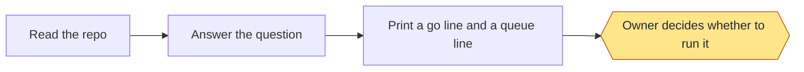

Status: built and proven: none. Built only: Read the repo; Answer the question; Print a go line and a queue line; Owner decides whether to run it. Planned: none.
Stops for the owner: Owner decides whether to run it.
Proof: no test covers `poc`, and no real run is on record. It writes nothing, so nothing shows it ran.

#### `go`

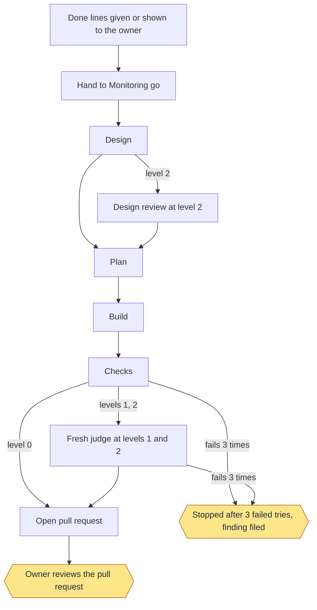

Status: built and proven: Done lines given or shown to the owner; Hand to Monitoring go; Design; Design review at level 2; Plan; Build; Checks; Fresh judge at levels 1 and 2; Open pull request; Owner reviews the pull request; Stopped after 3 failed tries, finding filed. Built only: none. Planned: none.
Stops for the owner: Owner reviews the pull request; Stopped after 3 failed tries, finding filed.
Proof: toy tests, plus a real agent on a toy repo at level 0. On this repo, eight real goals reached a pull request at the level now called 1, and real goals stopped after 3 tries. A second repo ran ten real goals, some at the old levels with no judge. The design review is tested alone: a full level 2 run has never happened, on a toy repo or a real one. Today's level 0, with its design step, has only had a real agent on a toy repo.

#### `new`

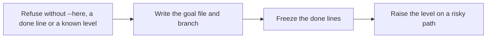

Status: built and proven: Refuse without --here, a done line or a known level; Write the goal file and branch; Freeze the done lines; Raise the level on a risky path. Built only: none. Planned: none.
Stops for the owner: none.
Proof: toy tests. A background agent skips this command, so real goals freeze through Monitoring.

#### `queue`

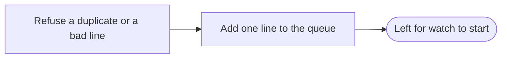

Status: built and proven: Refuse a duplicate or a bad line; Add one line to the queue. Built only: none. Planned: none.
Stops for the owner: none.
Proof: toy tests. No real use on record.

#### `step`

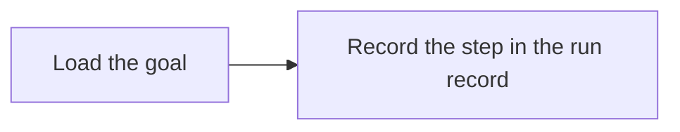

Status: built and proven: Load the goal; Record the step in the run record. Built only: none. Planned: none.
Stops for the owner: none.
Proof: the run records of real goals show their steps. No toy test calls it directly.

#### `check`

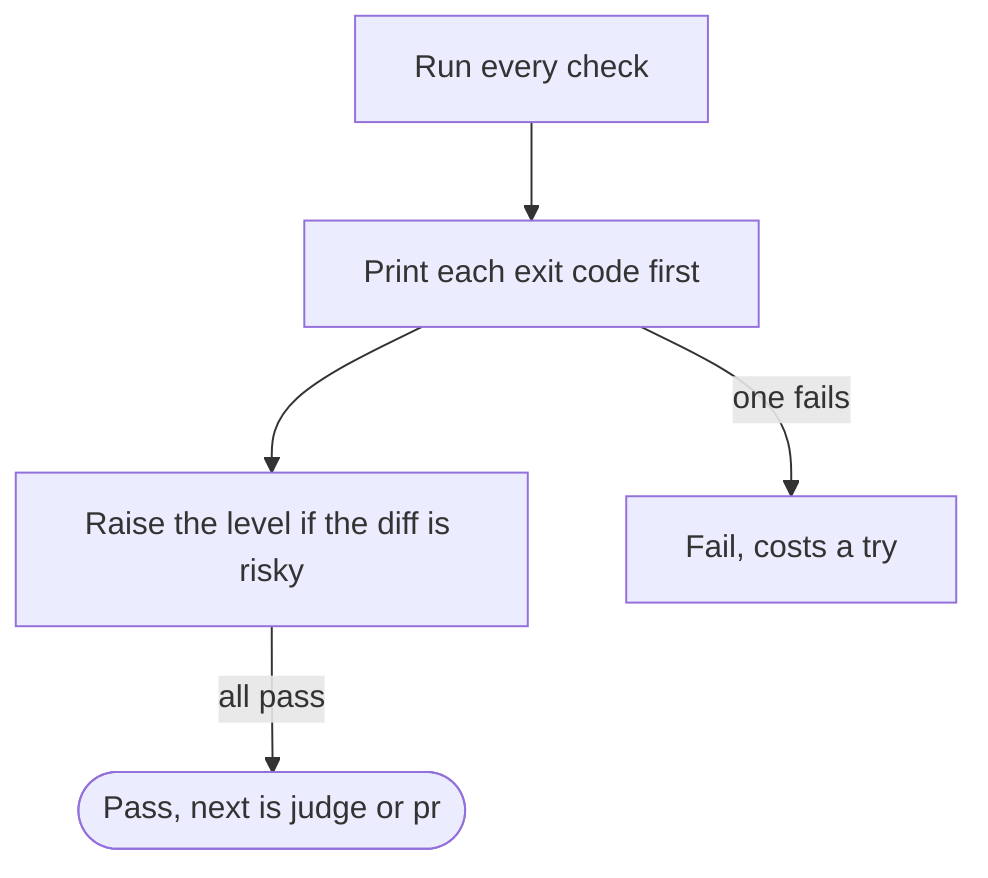

Status: built and proven: Run every check; Print each exit code first; Raise the level if the diff is risky; Fail, costs a try. Built only: none. Planned: none.
Stops for the owner: none.
Proof: toy tests and real goals.

#### `judge`

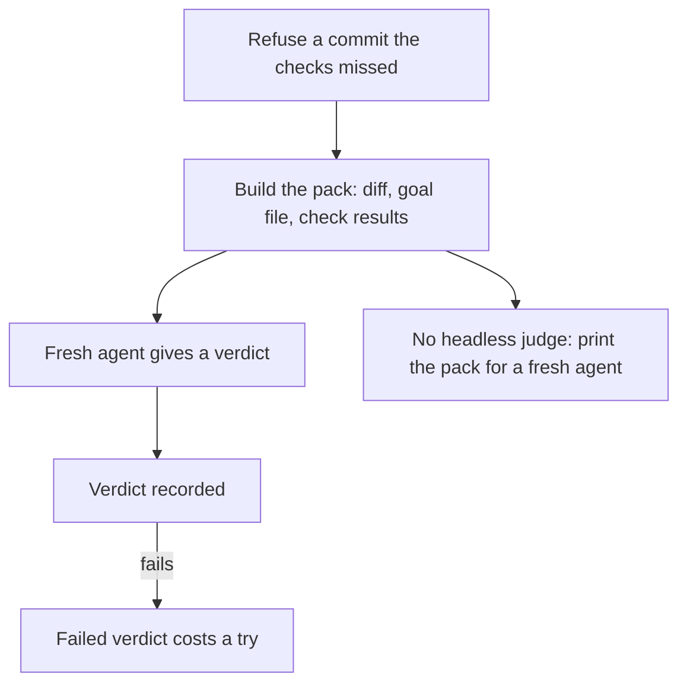

Status: built and proven: Refuse a commit the checks missed; Build the pack: diff, goal file, check results; Fresh agent gives a verdict; Verdict recorded; Failed verdict costs a try. Built only: No headless judge: print the pack for a fresh agent. Planned: none.
Stops for the owner: none.
Proof: toy tests and real goals, where the judge passed eight and failed others. With `--design` it has only been tested on a toy repo. The path with no headless judge has no test and no real run.

#### `verdict`

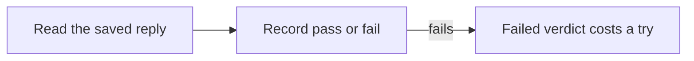

Status: built and proven: Read the saved reply; Record pass or fail; Failed verdict costs a try. Built only: none. Planned: none.
Stops for the owner: none.
Proof: toy tests. No real use on record: real judges ran headless.

#### `pr`

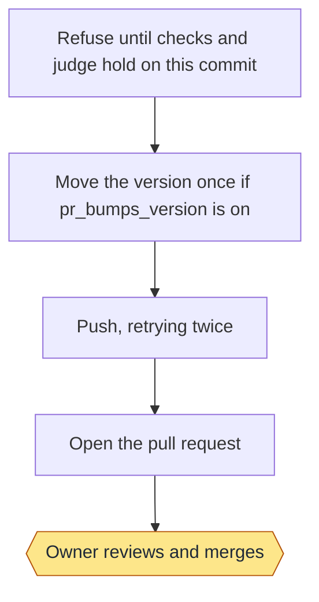

Status: built and proven: Refuse until checks and judge hold on this commit; Move the version once if pr_bumps_version is on; Push, retrying twice; Open the pull request; Owner reviews and merges. Built only: none. Planned: none.
Stops for the owner: Owner reviews and merges.
Proof: toy tests with a stand-in for GitHub, and real pull requests on this repo. The version bump has only run on a toy repo.

#### `wait`

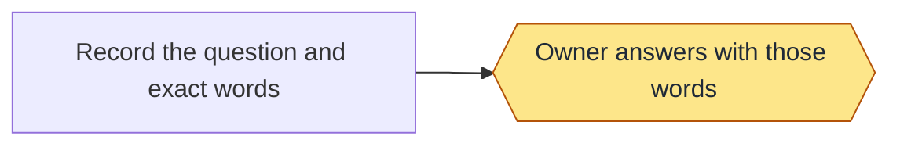

Status: built and proven: none. Built only: Record the question and exact words; Owner answers with those words. Planned: none.
Stops for the owner: Owner answers with those words.
Proof: no test calls it, and no real use is on record. Tests set a waiting goal by hand to prove that report shows it.

#### `answer`

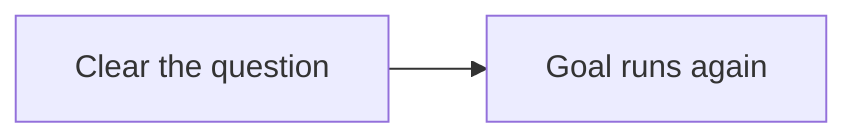

Status: built and proven: none. Built only: Clear the question; Goal runs again. Planned: none.
Stops for the owner: none.
Proof: no test calls it, and no real use is on record.

#### `finding`

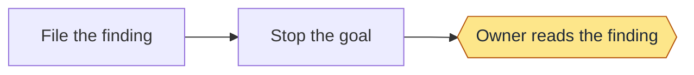

Status: built and proven: none. Built only: File the finding; Stop the goal; Owner reads the finding. Planned: none.
Stops for the owner: Owner reads the finding.
Proof: no test calls this command, and no real use is on record. The same stop after 3 failed tries is proven under `go`.

#### `show`

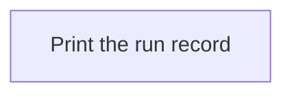

Status: built and proven: Print the run record. Built only: none. Planned: none.
Stops for the owner: none.
Proof: toy tests.

## Criteria

Tests: 9.
> **Unreviewed:** 5 of 5 criteria on this page have not been reviewed by the owner.

- DEL-5: **Unreviewed** Every goal starts from done lines that can't change once it starts.
- DEL-6: **Unreviewed** A goal gets the process its risk needs, and every level starts with a design.
- DEL-7: **Unreviewed** No agent judges its own work, and a judge always has a change to read.
- DEL-8: **Unreviewed** A goal that keeps failing stops and says why.
- DEL-9: **Unreviewed** The loop stops at a pull request, and only the owner merges.

## Enforced by

- DEL-5: DEL-1, frozen-done-lines
- DEL-6: DEL-2, DEL-3, design-every-level
- DEL-7: DEL-4, no-self-judging
- DEL-8: stop-after-3-tries
- DEL-9: never-merges
