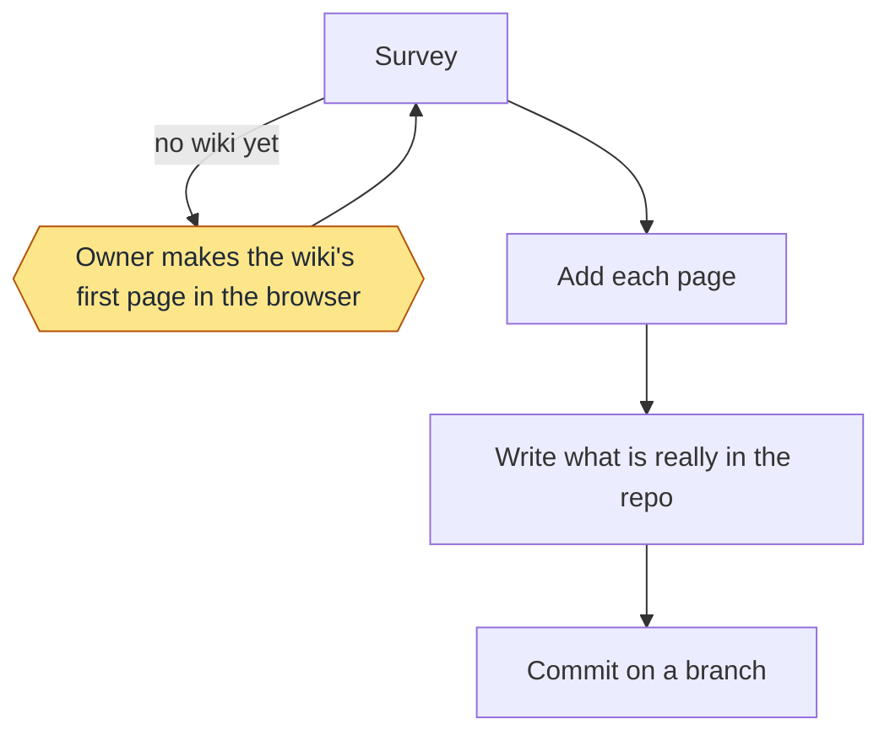
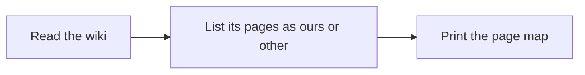
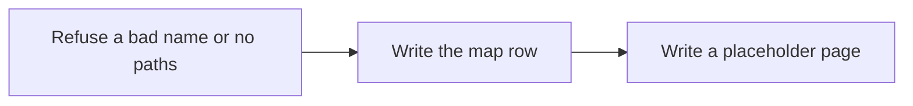
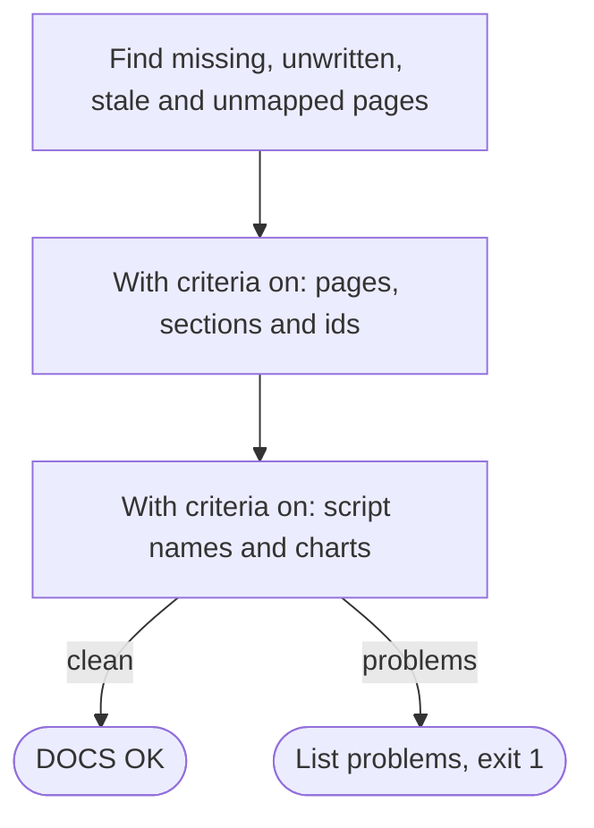
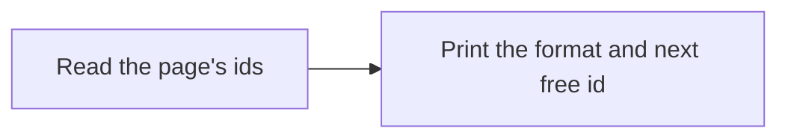
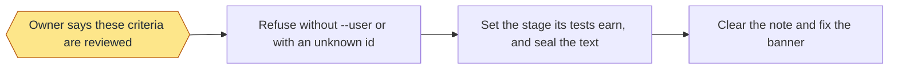
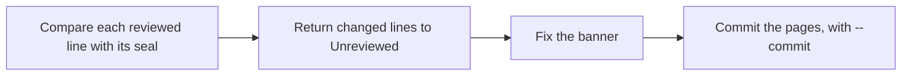
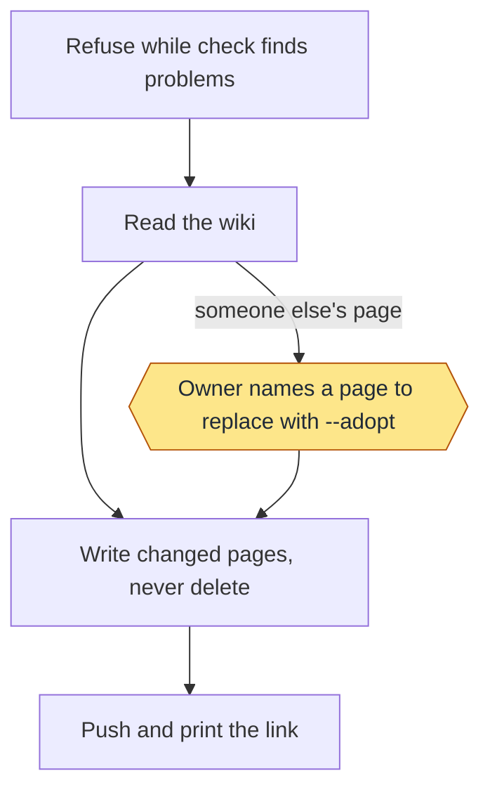
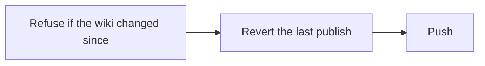

<!-- workflow-docs -->
# Documentation

## Summary

Skill: `workflow-docs`. Keeps wiki pages in `docs/wiki/` (reviewed in pull requests; `wiki_dir` in `.loop/config.json`
changes the folder) and finds stale ones.

### Init

`init` is a step list in `skills/workflow-docs/SKILL.md`, built from `survey` and `add`.

1. Survey: `survey` shows what exists.
2. Add: choose pages (three is a good start: how to use the repo, how it's run, how it's released), name the paths each
   describes, and use a name the survey doesn't list, so the wiki's other pages stay as they are:
   `add Using-the-workflow --paths ".loop/config.json,README.md"`.
3. Write each page: replace its placeholder text with what is really in the repo (real commands, real paths, real
   outputs). Keep the first line. If you didn't see it in the repo, don't write it.
4. Commit the pages and `.loop/docs.tsv` on a branch.

First-page rule: if the wiki has no pages yet, the user must create its first page in the browser, because GitHub only
makes the wiki's repo then. Tell them, then stop.

On Agensi, the file contract `loop-files.md` is under `shared/` in the pack.

## Commands

Pages are added and checked with these:

```text
init                            the step list above; an agent follows it
survey                          show the wiki's pages and this repo's page map
add PAGE --paths A,B            add a page and the paths it describes
check [--base REF]              list page problems, and contract problems when criteria is on; exit 1 if any
criteria PAGE                   print the criterion format and the next free id for a page
review ID [ID ...] --user       mark criteria reviewed, on the owner's own words
sync [--commit] [--dry-run]     return changed reviewed criteria to Unreviewed; --commit commits the pages
publish [--dry-run] [--adopt PAGE]   copy the pages to the GitHub wiki, commit and push
restore                         revert the last publish, if nothing came after it
```

`.loop/docs.tsv` maps each page to the paths it describes. `check` prints `STALE`, `MISSING`, `UNWRITTEN` or
`UNMAPPED`, `NO PAGES` if the map is empty, and `DOCS OK` when clean. `STALE` means a commit touched a mapped path and
no later commit to the page has it in its history. Merge commits don't count, so a page gives the same answer before and
after a merge. Only a commit that changes the page clears `STALE`.

With `"criteria": true` in the config, `check` also enforces the criteria contract: only the pages Delivery,
Documentation, Health, Milestones, Monitoring, Regression and Home; each feature page has exactly the sections Summary, Commands,
Criteria and Enforced by, in that order; a criterion is one line `- DEL-1: **Stage** text` with a unique id, and each id needs an
`- DEL-1: <regression row ids>` line in Enforced by.

Criteria are for the owner, and tests are for the machine. A test is a regression row, linked to one criterion by its
goal or id, and a criterion can have many. A page has 5 or 6 criteria, capped at 6. Each feature page counts its tests in a `Tests:` line above the criteria.
Criteria land with no approval, marked Unreviewed, and the page shows a banner while any is.

| Stage | Means |
|---|---|
| Unreviewed | Landed, and the owner hasn't reviewed it. New or changed criteria start here, whatever their tests |
| Reviewed | The owner reviewed it, and it has no test yet |
| Enforced | The owner reviewed it, and it has a test not yet seen failing |
| Proven | The owner reviewed it, and every test has been seen failing once |

`check` prints `CAP`, `STAGE`, `TESTS` or `LINK` when a page breaks these rules.

No check blocks a change to a criterion. A reviewed line carries a hidden hash of its text, set by `review`. If the text
changes, `sync` returns the line to Unreviewed, marked `(changed after review)`, and puts the banner back. `report` in
Monitoring names it, even before `sync` runs. The repo's checks run `sync --commit`, so a goal's own checks do this.

The same setting holds every page, Home too, to two more rules. `SCRIPT` fails a page that names a script file: pages
describe commands and behaviour only. `CHART` fails a command listed under Commands, in a text block or a bullet that
starts with it, that has no heading with the command in backticks holding a Mermaid block and a `Status:` line with all
three labels. Only the charts' presence is checked, not whether they are true.

`--base REF` counts only changes since `REF`. `publish` has no `--base`, so it counts every commit, and it refuses while
`check` finds problems. It never deletes a page. It refuses a page in the repo that lost the marker
`<!-- workflow-docs -->`, and won't replace a wiki page without that marker unless you name it with `--adopt`. `restore`
refuses if the wiki changed since.

### Example

```text
/workflow-docs add Delivery --paths "skills/workflow-delivery"
/workflow-docs check
/workflow-docs publish --dry-run
```

### Stage charts

Amber marks where the command stops for the owner. [Home](Home) says what each status means. "Toy test" means a throwaway repo with stand-ins for GitHub.

#### `init`



Status: built and proven: Survey; Owner makes the wiki's first page in the browser; Add each page; Write what is really in the repo; Commit on a branch. Built only: none. Planned: none.
Stops for the owner: Owner makes the wiki's first page in the browser.
Proof: this repo's own wiki was built this way, and the toy tests cover survey and add. `init` itself is steps for an agent, so no test runs it whole.

#### `survey`



Status: built and proven: Read the wiki; List its pages as ours or other; Print the page map. Built only: none. Planned: none.
Stops for the owner: none.
Proof: toy tests.

#### `add`



Status: built and proven: Write the map row; Write a placeholder page. Built only: Refuse a bad name or no paths. Planned: none.
Stops for the owner: none.
Proof: toy tests and this repo. The refusals have no test.

#### `check`



Status: built and proven: Find missing, unwritten, stale and unmapped pages; With criteria on: pages, sections and ids; With criteria on: script names and charts. Built only: none. Planned: none.
Stops for the owner: none.
Proof: toy tests, and it runs on this repo. It checks that each chart and status line exists, not that a chart is true: that stays a matter of review.

#### `criteria`



Status: built and proven: Read the page's ids; Print the format and next free id. Built only: none. Planned: none.
Stops for the owner: none.
Proof: toy tests.

#### `review`



Status: built and proven: Refuse without --user or with an unknown id; Set the stage its tests earn, and seal the text; Clear the note and fix the banner. Built only: Owner says these criteria are reviewed. Planned: none.
Stops for the owner: Owner says these criteria are reviewed.
Proof: toy tests. No real review is on record. Nothing enforces that `--user` is true: that is an instruction to the agent.

#### `sync`



Status: built and proven: Compare each reviewed line with its seal; Return changed lines to Unreviewed; Fix the banner; Commit the pages, with --commit. Built only: none. Planned: none.
Stops for the owner: none.
Proof: toy tests. It has not returned a real criterion, since none is reviewed yet.

#### `publish`



Status: built and proven: Refuse while check finds problems; Read the wiki; Owner names a page to replace with --adopt; Write changed pages, never delete; Push and print the link. Built only: none. Planned: none.
Stops for the owner: Owner names a page to replace with --adopt.
Proof: toy tests, three real publishes to this repo's wiki, and a real publish on a second repo. No record shows a real --adopt.

#### `restore`



Status: built and proven: Revert the last publish; Push. Built only: Refuse if the wiki changed since. Planned: none.
Stops for the owner: none.
Proof: toy tests only: it has never run on a real wiki, and the refusal has no test.

## Criteria

Tests: 11.
> **Unreviewed:** 6 of 6 criteria on this page have not been reviewed by the owner.

- DOC-4: **Unreviewed** A page that has fallen behind the code is caught before it reaches the wiki.
- DOC-5: **Unreviewed** Wiki pages written elsewhere stay as they are unless the owner names them.
- DOC-6: **Unreviewed** Every feature page has the same four sections and a chart for every command.
- DOC-7: **Unreviewed** Every criterion names the tests that enforce it.
- DOC-8: **Unreviewed** Anyone reading a page can see which criteria the owner hasn't reviewed.
- DOC-9: **Unreviewed** A reviewed criterion that changes goes back to Unreviewed and is named in the report, and no check blocks the change.

## Enforced by

- DOC-4: DOC-1, DOC-2, stale-merge-order
- DOC-5: DOC-3
- DOC-6: four-sections, flow-charts
- DOC-7: names-enforcer
- DOC-8: unreviewed-banner
- DOC-9: returned-on-change, returned-in-report, change-not-blocked
