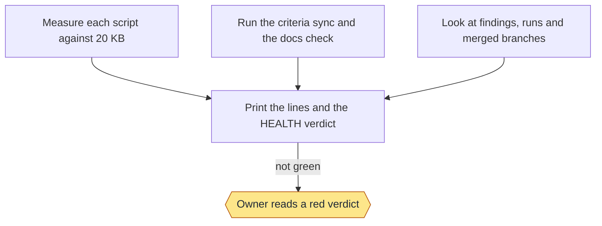

<!-- workflow-docs -->
# Health

## Summary

Skill: `workflow-health`. A read-only check of the repo's health with fixed rules, so the same repo always gets the
same answer. It runs `workflow-docs` and `workflow-regression` and reports on what they say, and adds the checks they
don't make: script size, old findings, stuck runs and merged branches.

## Commands

```text
check [--json] [--family size|criteria|docs|hygiene]
```

- `check` prints one line per finding, then one `HEALTH:` verdict line. A `FAIL` or an `UNREAD` line makes the verdict
  not green and the exit code 1; a `WARN` never does. `UNREAD` means a rule couldn't read its data, and is never a pass.
  Every non-pass line ends with the command that fixes it. `--json` prints the same rows as records.

### Stage charts

Amber marks where the command stops for the owner. [Home](Home) says what each status means. "Toy test" means a throwaway repo with stand-ins for GitHub.

#### `check`



Status: built and proven: Measure each script against 20 KB; Run the criteria sync and the docs check; Look at findings, runs and merged branches; Print the lines and the HEALTH verdict; Owner reads a red verdict. Built only: none. Planned: none.
Stops for the owner: Owner reads a red verdict.
Proof: toy tests on a throwaway repo. On this repo it has run by hand once and printed warnings for the five scripts near the limit.

## Criteria

Tests: 6.

> **Unreviewed:** 6 of 6 criteria on this page have not been reviewed by the owner.

- HLT-1: **Unreviewed** Running the check twice on a repo that hasn't changed prints exactly the same lines.
- HLT-2: **Unreviewed** A script over 20 KB is a failure, and one at 90 percent of that or more is a warning, each with a line saying how to fix it.
- HLT-3: **Unreviewed** A stale or missing wiki page shows up as a line naming the page.
- HLT-4: **Unreviewed** A criterion with no regression test shows up as a failure naming the criterion.
- HLT-5: **Unreviewed** When a rule can't read what it needs, it says so and the verdict is never green.
- HLT-6: **Unreviewed** The check changes nothing: no file, commit, branch or stash.

## Enforced by

- HLT-1: HLT-1
- HLT-2: HLT-2
- HLT-3: HLT-3
- HLT-4: HLT-4
- HLT-5: HLT-5
- HLT-6: HLT-6
