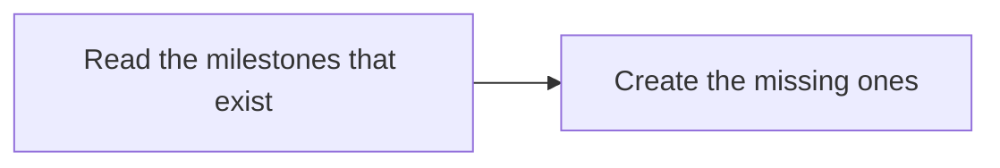
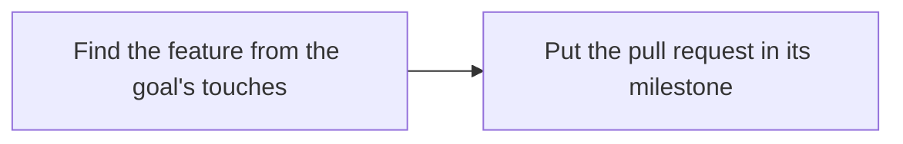
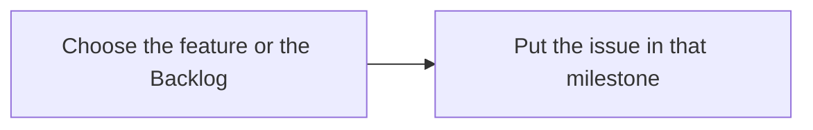
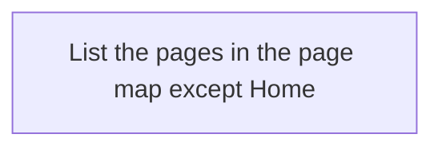

<!-- workflow-docs -->
# Milestones

## Summary

Skill: `workflow-health`. One GitHub milestone for each feature, named for its wiki page, and a `Backlog` for findings
nobody has placed yet. Goals and their pull requests go in their feature's milestone, health findings go on the
Backlog, and you move one to a feature when you decide. The board shows the counts.

## Commands

```text
features
new FEATURE|backlog|--all [--live]
attach SLUG [--live]
move ISSUE FEATURE|backlog [--live]
```

- `features` lists the features: the pages in the page map except Home.
- `new` creates the milestone for one feature, the `Backlog`, or all of them, and nothing that already exists.
- `attach` puts a goal's pull request in the milestone of the feature its touched files belong to. The pull request step
  of the delivery skill runs it, and a failure never stops the goal.
- `move` puts an issue in a feature's milestone, or back on the `Backlog`.

Each one prints what it would do and writes nothing unless you pass `--live` or set `GH_TOKEN` or `GITHUB_TOKEN`. None
of them closes, deletes or merges anything. The `run` command of [Health](Health) files findings on the `Backlog`.

### Stage charts

Amber marks where the command stops for the owner. [Home](Home) says what each status means. "Toy test" means a throwaway repo with stand-ins for GitHub.

#### `new`



Status: built and proven: Read the milestones that exist; Create the missing ones. Built only: none. Planned: none.
Stops for the owner: none.
Proof: toy tests with a stand-in for GitHub. No real milestone exists on this repo yet.

#### `attach`



Status: built and proven: Find the feature from the goal's touches; Put the pull request in its milestone. Built only: none. Planned: none.
Stops for the owner: none.
Proof: toy tests with a stand-in for GitHub. It has never run on a real pull request.

#### `move`



Status: built and proven: Choose the feature or the Backlog; Put the issue in that milestone. Built only: none. Planned: none.
Stops for the owner: none.
Proof: toy tests with a stand-in for GitHub.

#### `features`



Status: built and proven: List the pages in the page map except Home. Built only: none. Planned: none.
Stops for the owner: none.
Proof: toy tests use it through `new --all`.

## Criteria

Tests: 5.

> **Unreviewed:** 5 of 5 criteria on this page have not been reviewed by the owner.

- MIL-1: **Unreviewed** Creating milestones makes one per feature page and one Backlog, and running it again creates nothing.
- MIL-2: **Unreviewed** A goal's pull request is put in the milestone of the feature its touched files belong to.
- MIL-3: **Unreviewed** Health findings go on the Backlog by default, and nothing is written to GitHub without a token or the live flag.
- MIL-4: **Unreviewed** An issue moved to a feature's milestone stays there when health updates it.
- MIL-5: **Unreviewed** The board shows each milestone's open and closed counts and how old the Backlog's oldest open issue is.

## Enforced by

- MIL-1: MIL-1
- MIL-2: MIL-2
- MIL-3: MIL-3
- MIL-4: MIL-4
- MIL-5: MIL-5
