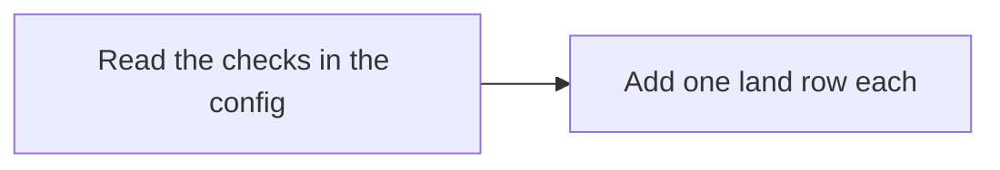
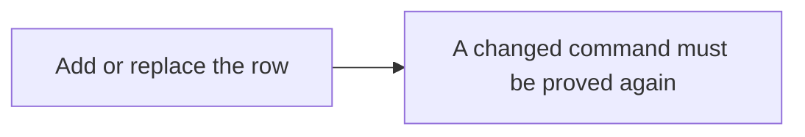
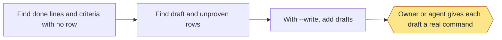
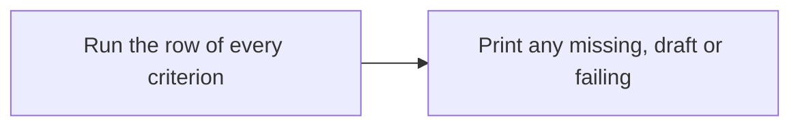
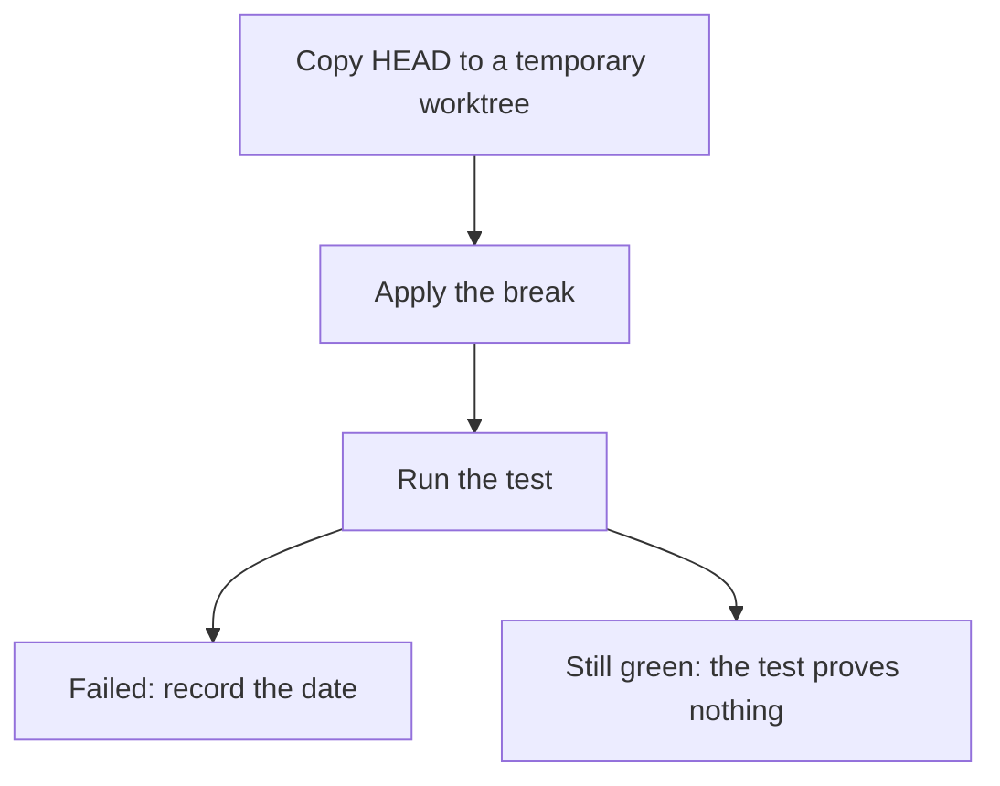
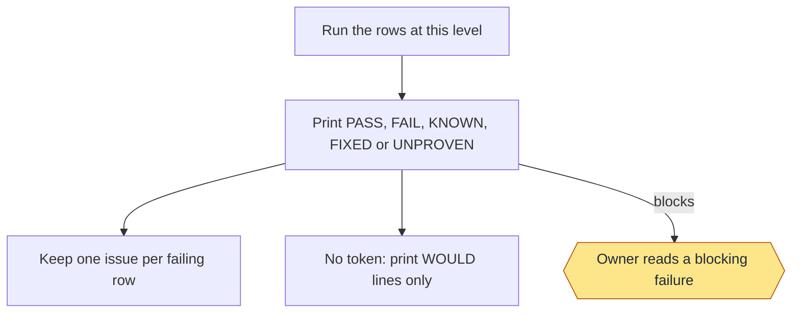
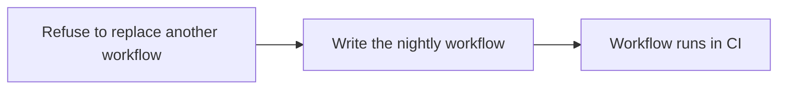

<!-- workflow-docs -->
# Regression

## Summary

Skill: `workflow-regression`. Keeps tests visible and enforced. Rows live in `.loop/regression.tsv`. A row tests code, not a delivery level: delivery has one flow. Like every script, it refuses rather than waits when no terminal is attached.

## Commands

```text
seed
add <id> --level <level> --command "<command>" [--goal <criterion>|<slug>:<n>]
sync [--write]
criteria
red <id> --break "<command>"
run [land|nightly|<id>] [--timeout S] [--live]
workflow
```

| Level | Runs in |
|---|---|
| `land` | `run land` and `run nightly` |
| `nightly` | `run nightly` |
| `draft` | Nothing, until given a real command |
| `covered` | Nothing; proved elsewhere |

- `seed` adds a `land` row for each check in the config.
- `add` adds or replaces a row. `--goal` ties it to a criterion or a goal's done line, and a changed command must be
  proved again.
- `sync` lists done lines, and wiki criteria (a row whose id or `--goal` is the criterion id), with no row (`GAP`), `DRAFT` rows and `UNPROVEN` rows; `--write` adds drafts.
- `criteria` runs the row of every wiki criterion and prints any that is missing, a draft or failing.
- `red` copies `HEAD` to a temporary worktree, applies the break and records the date if the test fails. `STILL GREEN`
  means the test proves nothing.
- `run` prints `PASS`, `FAIL`, `KNOWN`, `FIXED` or `UNPROVEN` (blocks). Known failures sit in
  `.loop/regression-known.tsv`. It keeps one issue per failing row; without a token it only prints `WOULD` lines.
- `workflow` writes `.github/workflows/regression.yml` (nightly, on `v*` tags, by hand).

### Example

```text
/workflow-regression red check-1 --break "<a command that breaks the code>"
/workflow-regression run land
```

### Stage charts

Amber marks where the command stops for the owner. [Home](Home) says what each status means. "Toy test" means a throwaway repo with stand-ins for GitHub.

#### `seed`



Status: built and proven: Read the checks in the config; Add one land row each. Built only: none. Planned: none.
Stops for the owner: none.
Proof: toy tests.

#### `add`



Status: built and proven: Add or replace the row. Built only: A changed command must be proved again. Planned: none.
Stops for the owner: none.
Proof: toy tests and this repo's rows. Nothing tests that a changed command loses its proof.

#### `sync`



Status: built and proven: Find done lines and criteria with no row; Find draft and unproven rows; With --write, add drafts. Built only: Owner or agent gives each draft a real command. Planned: none.
Stops for the owner: Owner or agent gives each draft a real command.
Proof: toy tests, and it runs on this repo, where it still lists old goals' done lines with no row.

#### `criteria`



Status: built and proven: Run the row of every criterion; Print any missing, draft or failing. Built only: none. Planned: none.
Stops for the owner: none.
Proof: a real run on this repo is on record. No toy test calls it.

#### `red`



Status: built and proven: Copy HEAD to a temporary worktree; Apply the break; Run the test; Failed: record the date; Still green: the test proves nothing. Built only: none. Planned: none.
Stops for the owner: none.
Proof: toy tests. This repo's 15 criterion rows each carry a date.

#### `run`



Status: built and proven: Run the rows at this level; Print PASS, FAIL, KNOWN, FIXED or UNPROVEN; Keep one issue per failing row; No token: print WOULD lines only; Owner reads a blocking failure. Built only: none. Planned: none.
Stops for the owner: Owner reads a blocking failure.
Proof: toy tests with a stand-in for GitHub. Two real issues with this label sit on a second repo, but no record ties them to a run.

#### `workflow`



Status: built and proven: Refuse to replace another workflow; Write the nightly workflow; Workflow runs in CI. Built only: none. Planned: none.
Stops for the owner: none.
Proof: toy tests run its inline block. On this repo a manual run on GitHub passed all 64 rows; the first run failed 2 and opened 2 issues, and the passing run closed them. The nightly and tag triggers haven't fired yet.

## Criteria

Tests: 6.
> **Unreviewed:** 5 of 5 criteria on this page have not been reviewed by the owner.

- REG-4: **Unreviewed** A test counts only after it has been seen failing.
- REG-5: **Unreviewed** A failure already known doesn't block work or open an issue.
- REG-6: **Unreviewed** Without a GitHub token, nothing reaches GitHub.
- REG-7: **Unreviewed** A failing test keeps one issue until it passes.
- REG-8: **Unreviewed** Every test belongs to exactly one criterion.

## Enforced by

- REG-4: REG-1, tests-seen-failing
- REG-5: REG-2
- REG-6: REG-3
- REG-7: one-issue
- REG-8: one-link
