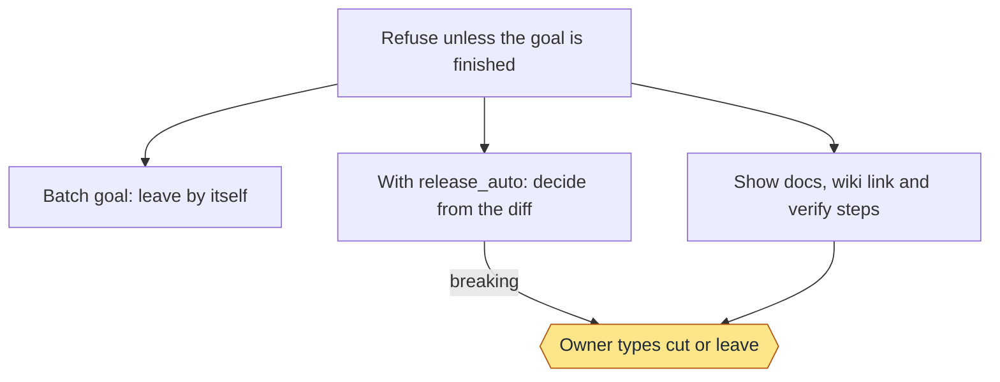
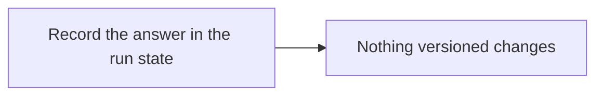
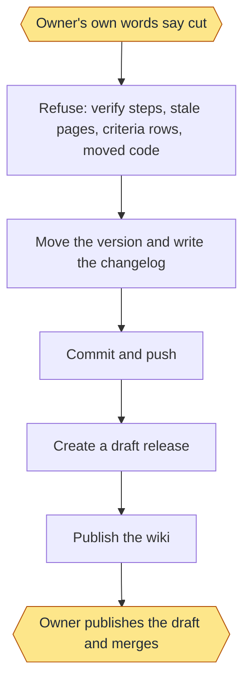
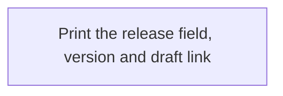

<!-- workflow-docs -->
# Release

## Summary

Skill: `workflow-release`. After a goal has a pull request and its checks hold.

## Commands

```text
ask SLUG
leave SLUG
cut SLUG [--bump patch|minor|major] [--user]
show SLUG
```

- `ask` shows the changed docs, the wiki link and the verify steps, then prints `cut <slug>` and `leave <slug>`. A
  monitored batch goal without `release: ask` answers `leave` by itself.
- `leave` keeps the work unreleased and changes nothing versioned.
- `cut` refuses without numbered steps under `## Verify by hand`, if any step has no `Expect:` line, or with a mapped
  page that is stale since the goal's base or missing. After fixing a page, commit it and run the goal's `check` again.
  `cut` then moves the version (`patch` by default), writes the changelog, commits, pushes and creates a **draft**
  GitHub release. You publish it. A batch goal refuses `cut` without `--user`, which means your own words said to cut.
- `cut` also refuses when a criterion on a wiki page (see Documentation) has a regression row that is missing, a draft
  or failing. A repo with no criteria is unaffected.
- `show` prints the `release` field, and the version and draft URL after a cut.

After a cut, the agent publishes the wiki with `workflow-docs` if `.loop/docs.tsv` exists. If that fails, the draft
stands.

### Automatic draft releases

Set `"release_auto": true` in `.loop/config.json` to let a monitored batch goal decide from its diff. `ask` prints
`NEED <leave|patch|minor|ask>: <reason>` and records it. Docs, tests and `.loop` changes leave. A fix cuts a `patch`
draft, and a new non-doc file or a `feat` commit cuts a `minor` draft, with no `--user`. A breaking change (a `BREAKING`
or `!:` commit, or a removed file) always waits for you, and so does a goal marked `release: ask`. Every refusal of
`cut` still applies, and then you decide. Without `release_auto`, a batch goal leaves as before. The release is always a
draft.

No release is published and nothing merges without you.

### Example

```text
/workflow-release ask add-median
/workflow-release cut add-median --bump minor --user
```

### Stage charts

Amber marks where the command stops for the owner. [Home](Home) says what each status means. "Toy test" means a throwaway repo with stand-ins for GitHub.

#### `ask`



Status: built and proven: Refuse unless the goal is finished; Batch goal: leave by itself; With release_auto: decide from the diff; Show docs, wiki link and verify steps; Owner types cut or leave. Built only: none. Planned: none.
Stops for the owner: Owner types cut or leave.
Proof: toy tests. Seventeen real goals took the batch path and left, and on a second repo one stopped for the owner, who answered `cut`. release_auto has only run on a toy repo.

#### `leave`



Status: built and proven: Record the answer in the run state; Nothing versioned changes. Built only: none. Planned: none.
Stops for the owner: none.
Proof: toy tests, and seventeen real goals through the batch path. No real owner's `leave` is on record.

#### `cut`



Status: built and proven: Owner's own words say cut; Refuse: verify steps, stale pages, criteria rows, moved code; Move the version and write the changelog; Commit and push; Create a draft release; Publish the wiki; Owner publishes the draft and merges. Built only: none. Planned: none.
Stops for the owner: Owner's own words say cut; Owner publishes the draft and merges.
Proof: toy tests with a stand-in for GitHub, and one real `cut` on a second repo, which made a real draft. It has never run on this repo: its one draft release wasn't made by `cut`. With release_auto, a non-breaking batch goal skips the first stop, proven only on a toy repo.

#### `show`



Status: built and proven: Print the release field, version and draft link. Built only: none. Planned: none.
Stops for the owner: none.
Proof: toy tests.

## Criteria

Tests: 3.

- REL-1: **Proven** A release is refused unless the goal lists numbered steps to verify by hand, each with what to expect.
- REL-2: **Proven** A release is only ever created as a draft on GitHub, and nothing is merged.
- REL-3: **Proven** With automatic releases off, a goal run in a monitored batch cannot be cut unless the owner's own words said to cut.

## Enforced by

- REL-1: REL-1
- REL-2: REL-2
- REL-3: REL-3
