# Delivery: commands and flows

Moved from the wiki page, which is now only a summary, criteria and tests.

## Commands

- `go "<goal>" --done "<line>" ... [--touches "<file,file>"]`: freezes the done lines and runs the goal through the
  flow. In an interactive session it hands off to [Monitoring](Monitoring), so the governing session never builds.

### The flow

Freeze, then idea, plan, build, review, qa, ship, pull request and release. Review is the only gate. Each step can be mapped to a skill in the private flow file, under `suite` (the default) or `steps` (an override for one step). The chart
under `go` shows it.

A step mapped to `built-in` runs delivery's own routine, from the section in this file, `## The built-in flow`, instead of a skill, so the
package runs with no suite of your own; setup fills a never-configured suite with `built-in` (the private flow file is
machine-wide, so one setup run makes goals runnable in every repo on that machine). A named skill needs the flow's
probe; a headless step needs its `command`; an in-session step needs neither. The first `flow.py` call checks every
mapped step for the mode it will run in and refuses with the whole list before any step starts.

| Code | Means | Fix |
|---|---|---|
| `FLOW_UNRUNNABLE` | a mapped step can't run in this mode: a named skill with no probe, or a headless step with no command | add `probe` and `command` to the flow file, or map those steps to `built-in` |
| `FLOW_SECTION_MISSING` | `references/commands.md` has no section for a built-in step | reinstall workflow-delivery |

A goal whose change makes `.loop/START.md` or a marked agent block stale (a PRD page's Problem, a setting) runs
`docs.py audit` (or `entry.py write`) in build and commits the result. A merge conflict in `.loop/START.md` or in a
marked block is resolved by taking either side, running `entry.py write`, and committing.

### Done lines

Done lines are frozen when the goal starts. A wrong one needs a new goal. Write each one so a test, or what a
person can see, proves it before the pull request.

### Goal steps

```text
new SLUG --here --goal TEXT --done LINE [--touches A,B] [--release R]
queue SLUG --goal TEXT --done LINE [--touches A,B] [--depends-on A,B]
flow SLUG STEP [--note TEXT] [--again]
record SLUG STEP --file REPLY
step SLUG NAME [--note TEXT] [--tokens N]
pr SLUG
wait SLUG --ask TEXT --words W [--words W]
answer SLUG
finding SLUG TEXT
resume SLUG --why TEXT [--by WHO]
touches SLUG --add PATH --why TEXT
set SLUG [--depth full|condensed] [--bump minor|major] [--budget-minutes N] [--budget-tokens N] --why TEXT
show SLUG
```

A background agent runs `flow` for the idea and plan steps, builds, fills in `## Verify by hand`, then runs the review, qa and
ship steps, and ends with `pr` and the release step. `flow` starts a step detached and
prints `RUNNING` until it ends, then a `NEXT` line naming `record`. `record` refuses a reply that `flow` didn't produce.
A failed step costs a try, and so does a background run's reply with no `STEP:` line (the run may have crashed); a lane that
ended with no exit status (LANE_DIED, killed from outside) does not, up to 3 per goal, and `resume` gives them back. After 3 it
files a finding in `.loop/findings.md` and stops with exit code 3. A refusal that changes nothing costs no try: it prints
`REFUSED (no try used): ... Fix: ... (CODE)` and `NEXT:`, exits 2, keeps the step's reply and run marker, and the goal keeps
running. That covers a session reply with no `STEP:` line, a step refused for its depth (no `DEPTH:` line, condensed under
`review_depth` full, a missing `full_markers` string), a reply `flow` didn't produce, and the qa lane not passed on HEAD.
Five refusals in a row leave a note on the board; ten put the goal in waiting for the owner. A format rule binds only steps started after it landed: each step records
the rule ids known when it started (`guards.py known` prints them), and a refusal names the rule and the release that
added it. A malformed `full_markers` in the flow file isn't the worker's slip: the goal waits for the owner. While a goal
waits, `record` and `pr` refuse (`WAITING_OWNER`). `pr` refuses until every step is done
or skipped with a reason, and until the issue or finding the goal fixes has a defect test seen failing and passing; its body lists each step's result. With `pr_bumps_version` on, it first moves the last number
of the version file once, unless the branch already changed it.

### Stage charts

Amber marks where the command stops for the owner. [Home](Home) says what each status means. "Toy test" means a throwaway repo with stand-ins for GitHub and for the skills.

#### `go`

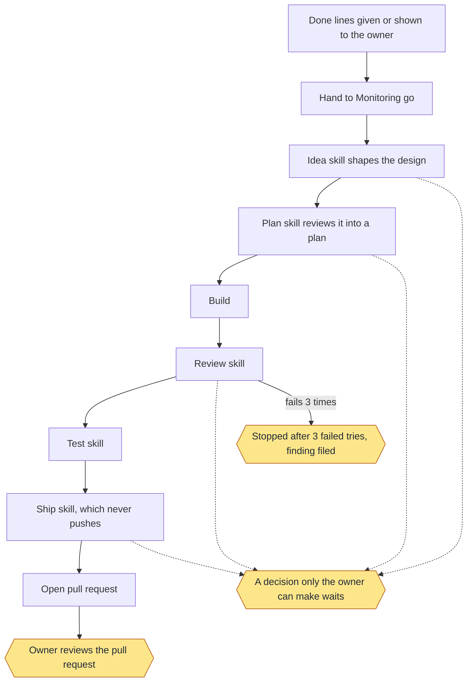

Status: built and proven: Done lines given or shown to the owner; Hand to Monitoring go; Build; Open pull request; Owner reviews the pull request; Stopped after 3 failed tries, finding filed. Built only: Idea skill shapes the design; Plan skill reviews it into a plan; Review skill; Test skill; Ship skill, which never pushes; A decision only the owner can make waits. Planned: none.
Stops for the owner: A decision only the owner can make waits; Owner reviews the pull request; Stopped after 3 failed tries, finding filed.
Proof: toy tests with stand-in skills prove the order, the waits and the stops. One real goal on a toy repo ran the idea step with the real skill, unattended, in about 75 seconds, then waited for the owner's approval of the design, as it should. The steps after it haven't run for real.

#### `new`

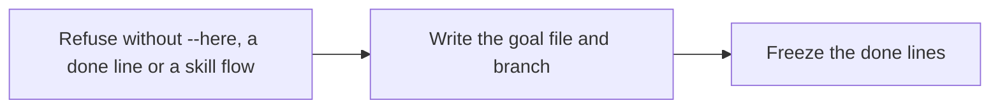

Status: built and proven: Refuse without --here, a done line or a skill flow; Write the goal file and branch; Freeze the done lines. Built only: none. Planned: none.
Stops for the owner: none.
Proof: toy tests. A background agent skips this command, so real goals freeze through Monitoring.

#### `queue`

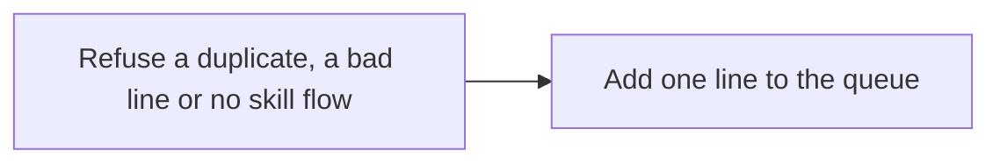

Status: built and proven: Refuse a duplicate, a bad line or no skill flow; Add one line to the queue. Built only: none. Planned: none.
Stops for the owner: none.
Proof: toy tests. No real use on record.

#### `flow`

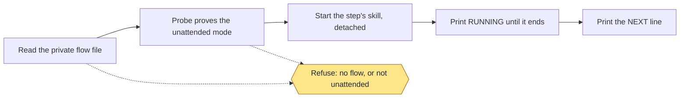

Status: built and proven: Read the private flow file; Probe proves the unattended mode; Start the step's skill, detached; Print RUNNING until it ends; Print the NEXT line; Refuse: no flow, or not unattended. Built only: none. Planned: none.
Stops for the owner: Refuse: no flow, or not unattended.
Proof: toy tests with a stand-in flow. The real skills have not run through it yet.

#### `record`

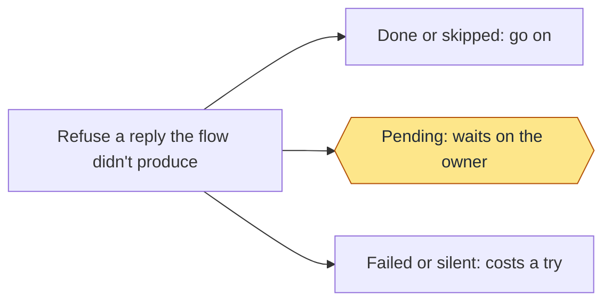

Status: built and proven: Refuse a reply the flow didn't produce; Done or skipped: go on; Pending: waits on the owner; Failed or silent: costs a try. Built only: none. Planned: none.
Stops for the owner: Pending: waits on the owner.
Proof: toy tests with stand-in skills.

#### `step`

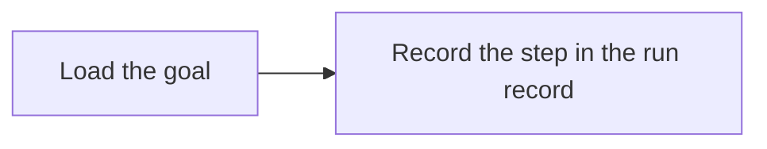

Status: built and proven: Load the goal; Record the step in the run record. Built only: none. Planned: none.
Stops for the owner: none.
Proof: the run records of real goals show their steps. No toy test calls it directly.

#### `pr`

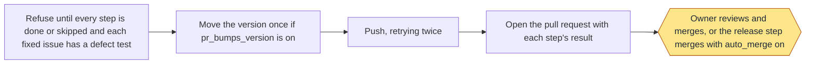

Status: built and proven: Refuse until every step is done or skipped and each fixed issue has a defect test; Move the version once if pr_bumps_version is on; Push, retrying twice; Open the pull request with each step's result; Owner reviews and merges, or the release step merges with auto_merge on. Built only: none. Planned: none.
Stops for the owner: Owner reviews and merges, or the release step merges with auto_merge on.
Proof: toy tests with a stand-in for GitHub, and real pull requests on this repo from before the flow.

#### `wait`

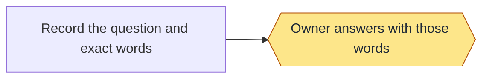

Status: built and proven: none. Built only: Record the question and exact words; Owner answers with those words. Planned: none.
Stops for the owner: Owner answers with those words.
Proof: no test calls it, and no real use is on record. Tests set a waiting goal by hand to prove that report shows it.

#### `answer`

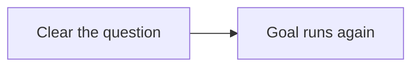

`answer` moves only a waiting goal on (`ANSWER_STATUS` otherwise); a stopped goal comes back with `resume`.

Status: built and proven: none. Built only: Clear the question; Goal runs again. Planned: none.
Stops for the owner: none.
Proof: no test calls it, and no real use is on record.

#### `finding`

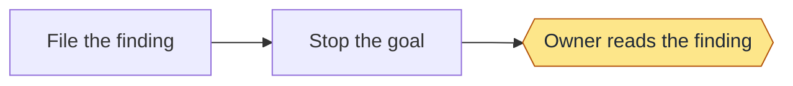

On a goal that is done or merged, `finding` only notes it (in the goal's `.extra.json`) and the goal keeps its status;
the board shows it on that goal.

Status: built and proven: none. Built only: File the finding; Stop the goal; Owner reads the finding. Planned: none.
Stops for the owner: Owner reads the finding.
Proof: no test calls this command, and no real use is on record. The same stop after 3 failed tries is proven under `go`.

#### `resume`

The operation session's repair for a failed or stopped goal worked in a session. It never starts a process; a worker
can't resume its own goal (`WORKER_SELF_REPAIR`). It refuses a goal that isn't failed or stopped (`RESUME_STATUS`), has no
session (`RESUME_NO_SESSION`: bind one, which revives it, or `watch.py resume` for a background worker), has lost its
worktree (`RESUME_NO_WORKTREE`), or whose done lines changed (`DONE_LINES_CHANGED`), and a session now serving another
goal (`SESSION_TAKEN`). Every check runs first, so a refusal writes nothing. Then it reserves the session under the pool
lock, resets status, tries, refusals, finding, waiting, note and report (as `sessions.py bind` does), logs who asked and
why, and sends the session "continue at <step> in <worktree>". If the send fails it says `(message not delivered)` and
prints the resend command.

```text
python3 scripts/goal.py resume board-held --why "usage limit passed"
RESUMED board-held at review
```

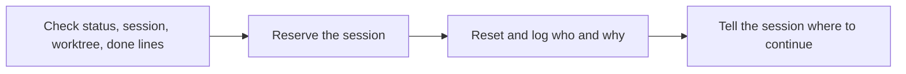

Status: built and proven: Check status, session, worktree, done lines; Reserve the session; Reset and log who and why; Tell the session where to continue. Built only: none. Planned: none.
Stops for the owner: none.
Proof: toy tests (test-guards.sh).

#### `touches`

The operation session widens a goal's touches with a logged reason; a worker can't widen its own (`WORKER_SELF_REPAIR`).
PATH must be repo-relative and new (`TOUCHES_PATH`). Only `<runs>/<slug>.extra.json` changes, under a lock, so no writer
of the run record can erase it; the board shows the widened list, and the worker's next `record` (and `pr`, before its
lane) rewrites the goal file's `- Touches:` line.

```text
python3 scripts/goal.py touches board-held --add skills/workflow-health --why "the board reads health.py"
TOUCHES board-held +skills/workflow-health
```

Status: built and proven: Widen touches with a reason. Built only: none. Planned: none.
Stops for the owner: none.
Proof: toy tests (test-guards.sh).

#### Refusal codes

| Code | Means | Fix |
|---|---|---|
| `FORMAT_RULE <id>` | The reply breaks a format rule the step started under | Fix the reply as the message says, record again |
| `NO_STEP_LINE` | A session reply has no `STEP:` line | End it with the DEPTH line and a STEP line |
| `NOT_RUN_BY_FLOW` | The reply or run marker isn't where `flow` leaves them | Run `flow` for the step until it prints NEXT |
| `LANE_MISSING` | The qa lane hasn't passed on HEAD | `role.py lane SLUG qa` |
| `WAITING_OWNER` | The goal waits for the owner | The operation answers |
| `NOT_WORKER` | A goal step outside a worker | Run it in the bound session as `LOOP_ROLE=worker ...` (the refusal prints it) |
| `WORKER_SELF_REPAIR` | A worker ran resume or touches | Ask the operation session |
| `RESUME_STATUS`, `RESUME_NO_SESSION`, `RESUME_NO_WORKTREE`, `SESSION_TAKEN`, `DONE_LINES_CHANGED` | resume can't run | As the message says |
| `ANSWER_STATUS` | answer on a goal that isn't waiting | resume a stopped goal instead |
| `TOUCHES_PATH` | touches PATH isn't repo-relative or is already there | Give a new repo-relative path |

#### `show`

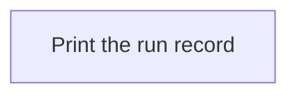

Status: built and proven: Print the run record. Built only: none. Planned: none.
Stops for the owner: none.
Proof: toy tests.

## Delivery PRD rules (DEL-5..DEL-9)

### Depth by size (DEL-6)

`goal.py new` sizes the goal once, from its frozen done lines and touches: small is at most 3 done lines, no `github:`
touch and at most one code area (a path's first two parts, like `skills/workflow-release` or `src/api`; `docs/`,
`.loop/`, `dev/toy/`, `test/`, `tests/` and files at the repo root are no area). No touches counts as large. The step's
depth is then: the owner's override (`goal.py set SLUG --depth`), else `review_depth` full holds every goal to full, else
(`condensed`) a small goal runs condensed (one spec-review round, a lighter plan review, one review pass) and a larger one
full, with a condensed reply refused. Widening touches to a second area re-sizes a small goal large, never the reverse.
The pull request and the live board name the decided depth and why. The qa lane never changes with depth. A repo on
`condensed` sees its large goals held to full from this release on.

### Owner settings: `set`

`goal.py set` is operation-only (it refuses `LOOP_ROLE=worker`): nothing a worker runs lowers a goal's depth or raises its
budget. Values go to the operation sidecar `<runs>/<slug>.extra.json` under its lock, never to the run record. A depth set
after the plan or review is recorded refuses (`SET_AFTER_RECORD`): set it, then rerun with `flow.py SLUG STEP --again`.

```bash
python3 scripts/goal.py set my-goal --depth full --why "owner: touches the release path"
python3 scripts/goal.py set my-goal --bump minor --why "owner: adds a command"
python3 scripts/goal.py set my-goal --budget-minutes 180 --budget-tokens 5000000 --why "owner: big goal"
```

| Flag | Repo setting it overrides for one goal |
|---|---|
| `--budget-minutes` | `time_budget_minutes` (active step time only: time held in the pr queue, on a hold, on an owner answer or after a stop counts nothing) |
| `--budget-tokens` | `token_budget` |

### Release bump (DEL-5)

The release bump is patch: a removed file or a BREAKING commit is named in the reason, never a silent major (issue 170).
Minor or major only when the operation recorded it with `goal.py set SLUG --bump` (it does so right after freezing a goal
whose text or queue line says minor or major; `new` prints a WARN when the text names one). The release side is in
`skills/workflow-release/references/commands.md`.

### Budgets (DEL-8)

A goal carries `budget: {minutes, tokens}` from the repo settings at freeze, 0 meaning none set. The token budget is a
spending limit: no new step starts at or over it (`BUDGET_TOKENS`). The time budget is advisory: the board flags it, and
nothing stops. Tokens add up across attempts of a step (failed tries and `--again` count). The live board prints one line
per running or held goal: `budget: 35m of 120m, 0.4M of 3.0M tokens`, `budget: 12m of 90m` (one half set), `budget: none
set`, with `, OVER time` or `, OVER tokens` appended when spent.

### Resume (DEL-7)

A stopped or crashed goal goes on from its last recorded step, never from the start. A killed background step leaves its
`.job`; the next `flow.py` finds the dead pid and `record` counts one failed try. `goal.py show` adds `resume_at`: the first
of idea, plan, review, qa, ship not recorded, except `build` when idea and plan are recorded and no commit landed since
the plan (`review` once one did), and `pr` when all are. `goal.py resume` and mend's prompt name it, the exact next
command, HEAD and the uncommitted file count. `resume` resets the tries, so read them first. `flow.py SLUG STEP` on a
recorded step refuses with no try (`ALREADY_RECORDED`); `--again` reruns it on purpose, clearing that step and every
later one (result, depth, verdicts), never tries or tokens, and refuses while the step's job still runs.

### Nothing private ships (DEL-9)

Every push and GitHub write in delivery, release and monitoring runs `private.py` first: `goal.py pr` (the branch, the
title, the body), a finding's push (kept local on a hit: `FINDING_LOCAL`, shown under Issues), `wiki.py`, the release
steps and `merge.py`. The list is outside the repo, `$LOOP_PRIVATE_NAMES` or `~/.workflow-loop/private-names`, one regular
expression per line, case-insensitive, `#` lines are comments:

```text
# names that never ship
my-private-suite
owner@example\.com
```

A file of only comments says the scan is off on purpose. No file: the scan passes, the pull request says "nothing was
checked" and the board lists it under Issues. A broken file (unreadable, a bad pattern) refuses every push. A scan reads
the branch name, changed file names, every commit's added lines and message (a name added then removed still counts; a
commit that only removes one passes) and the named texts. A hit names its place and the list line, never the text:

```text
$ python3 scripts/private.py check
PRIVATE LIST: 2 patterns from ~/.workflow-loop/private-names
$ python3 scripts/goal.py pr my-goal
REFUSED (no try used): a private name would be pushed: notes.txt:1 (commit:1a2b3c4) matches list line 2; nothing was pushed. Fix: remove the text, then squash ... (PRIVATE_NAME)
```

<a id="private-name-hooks"></a>
### Private-name hooks (DEL-9, SET-8)

`python3 skills/workflow-setup/scripts/setup.py --git-hooks` (a default `setup` run does it too; `--no-git-hooks` or
`LOOP_NO_GIT_HOOKS=1` skips) writes `pre-commit`, `commit-msg` and `pre-push` into the git common dir's `hooks` folder.
Each runs `private.py hook staged | message "$1" | push` by absolute path with the same list. They are early feedback:
the push scan and the scans before every GitHub write stay the authority. Needs python3 3.8 or later. A repo with
`core.hooksPath`, or a hook of your own, gets the exact call line to add instead; a hook that already holds the call
counts as installed. `--check` prints the list and each hook (`installed`, `stale`, `foreign`, `missing`); health's `hooks`
rule warns on the last three and on a broken list.

<a id="private-name-hook-exit-codes"></a>

| Exit | Hook says | Means and what to do |
|---|---|---|
| 0 | nothing | clean, no list (`private.py check` says so), or a list of only comments (off on purpose) |
| 1 | `REFUSED: a private name would be committed\|pushed: <place> matches list line <n>; nothing was committed\|pushed ... (PRIVATE_NAME)` | remove the text from that place and commit or push again; for a false positive edit that list line. A pre-push hit means a commit already holds it: amend or squash, then push |
| 2 | `REFUSED: the private-name list or scan is broken: ... (PRIVATE_LIST)` | the list file is missing or unreadable, a pattern is invalid or matches ordinary text such as an empty line, or git couldn't be read (a push over 500 commits: set `LOOP_HOOK_RANGE=<rev>` to scan from that rev). Nothing was committed or pushed; repair the line named |
| 64 | `the hook is wired wrong` | the stub calls a mode `private.py` doesn't have; rerun `setup.py --git-hooks` |
| 142 | `the scan took too long and was killed` | a pattern is too slow (`LOOP_HOOK_DEADLINE` seconds, default 30); shorten the pattern |
| other | `private.py is gone`, `python3 is not on PATH` or `the scan failed unexpectedly` | the skills moved or python3 is gone: rerun `python3 .../setup.py --git-hooks`. To skip one commit or push git's own `--no-verify` is yours to decide; the push scan and the merge step still scan it |

"My commit was refused": the message names the place (`file:line (staged)`, `commit message`, `file name <private>...`,
`ref name ...`) and the list line, never the text; nothing was committed, so fix it and commit again. A file name that
matches is masked as `<private>`. `commit -a`, `--amend` and partial staging scan what git is about to commit; the lines
under `commit -v`'s scissors line and the comment lines are not scanned. A rebase, cherry-pick or `commit-tree` skips the
commit hooks; the push scan reads the commits a push would publish (up to 500, 4 MB of diff is the practical bound).
Annotated tag messages are not scanned. Windows has no alarm, so the time limit is not enforced there.

### Worker push guard

A mistake guard, not enforcement. The pre-push hook (the same one the private-name scan uses; there is no second hook) also
checks where it runs: inside a goal worktree (`<git common dir>/loop/worktrees/<slug>`), a push may update only
`refs/heads/loop/<slug>`. Main, other branches, tags and deletions are refused, and a push of several refs with one bad ref is
refused whole. The role is never read, only the location, so the operation checkout and the release step are untouched.
`private.py where` says `WORKER <slug>`, `NOT A WORKER (<why>)` or `UNKNOWN (<what>)`. The guard fails closed
(`WORKER_PUSH_INTERNAL`) when git's ref lines or `git rev-parse` can't be read.

Limits: `--no-verify`, `core.hooksPath`, a hook that was never installed and a push from the main checkout skip it. The real
backstop is GitHub branch protection on main (GRD-6) and a credential for workers scoped to `loop/*`.

### Issue 38 and 117 extras

A step reply's `VERDICT: <who>: <verdict>` lines are kept on the run record and listed under their step in the pull
request, with each step's tokens. Touches may name GitHub surfaces (`github:wiki`, `github:milestones`, `github:projects`,
`github:releases`, `github:labels`, `github:issues`); they make a goal large and are listed in the pull request. When a
goal deletes a file a tracked script or workflow names, the pull request carries `WARN: <script> names <path>, which this
goal deletes; it may write it back`. A worker session binds itself with `sessions.py bind SLUG self`.

### Refusal codes

| Code | Where | Fix |
|---|---|---|
| `PRIVATE_NAME` | `goal.py pr`, the git hooks | remove the text and squash, or edit that list line for a false positive |
| `WORKER_PUSH` | the pre-push hook, in a goal worktree | push only `loop/<slug>` (`goal.py pr` does); main, tags and other branches are for the operation session |
| `WORKER_PUSH_INTERNAL` | the pre-push hook | git's ref lines or `git rev-parse` couldn't be read (also a push from a bare clone); run `private.py where` in this folder to see why, then tell the owner |
| `PRIVATE_LIST` | every scan | repair the list; `private.py check` names the line |
| `FINDING_LOCAL` | a finding's push | the finding stays local; fix the hit, then push |
| `ALREADY_RECORDED` | `flow.py` | go on with the step it names, or `--again` |
| `SET_AFTER_RECORD` | `goal.py set` | set first, then `flow.py SLUG STEP --again` |
| `BUDGET_TOKENS` | `flow.py` | `goal.py set SLUG --budget-tokens N` from the operation |
| `BIND_SELF_UNSET` | `sessions.py bind SLUG self` | `sessions.py bind SLUG <ID>` |

## Moved from SKILL.md

Detail the skill's SKILL.md points to, kept word for word so no instruction is lost.

### Step tokens

`flow.py` records each step's tokens itself, from the agent's JSON output (input + output + cache-creation
tokens, no cache reads); report a step it didn't run with `goal.py step <slug> <name> --tokens N`.

### The regression lane

**The regression lane.** The loop runs only the affected rows, once per goal, in qa, within `test_budget_minutes`; the full suite runs on the schedule. Before your qa skill starts, `flow.py qa` runs the
lane, `python3 <workflow-regression>/scripts/regression.py run land --reuse`, in the background (`RUNNING` until it
ends). It runs through your flow file's `test_record` prefix when you set one (a receipt recorder, so your ship skill's
own check of recorded test runs can reuse it), and tests the committed HEAD only: an unclean tree fails it (`LANE_DIRTY`).
A failing or never-seen-failing row fails the qa step before your skill runs, and `goal.py record <slug> qa` refuses
until a qa lane passed on HEAD (`LANE_MISSING`; start one with `role.py lane <slug> qa`), except for a reply whose last
`STEP:` line is `failed` and that has no `PENDING:` line, which records as a failed try. `flow.py ship` and `goal.py pr`
run the same lane: on unchanged content it prints `REUSED` and runs nothing, and after a commit or a base merge it reruns
only the rows the change can affect. The release step itself (merge.py) doesn't rerun it; GitHub Actions still runs the
full suite.

### Pull request: version and push

With `pr_bumps_version` on, it moves the last number of the version file once on this branch first, unless the
branch already changed it. It retries a failed push twice, then prints git's full error.

### Switches that remove gates

Two keys in `.loop/config.json` remove gates, and each is off unless the owner turns it on:

- `"auto_approve": true`: `record` approves what a step leaves for the owner, logs it as auto-approved, and goes on.
- `"auto_merge": true`: after `pr`, the release step runs the `routines` from `.loop/config.json`, merges the pull request, bumps the version once and publishes a GitHub release with a CHANGELOG entry.

## The built-in flow

A step mapped to `built-in` in the flow file runs the routine below instead of a skill from your own suite, so the
package works with no suite at all. `flow.py` puts the step's section into the step's prompt. Setup fills an empty
suite with `built-in` for idea, plan, review, qa and ship; build, pr and release are run by delivery itself, as always.
Name your own skill for any step in the flow file, and it replaces that step's routine.

Every routine runs unattended: take the recommended answer at every question, approve nothing, merge nothing and push
nothing. A built-in step needs no probe: delivery's own build and pr steps already run under the same command and
prompt rules, and the command's allowed tools set the real limit.

## idea
Read `.loop/goals/<slug>.md`: its done lines are frozen. Read the code and pages the goal touches. Write
`.loop/goals/<slug>.design.md`: the problem in two or three sentences, two approaches with their cost and risk, the one
you chose and why, what each done line needs, and the open questions. Commit it.

## plan
Read the design. Check each claim against the code: name the files and functions to change and confirm they exist.
Write `.loop/goals/<slug>.plan.md`: the ordered build steps, the test for each done line (a regression row seen
failing before the change and passing after), what could break, and what is out of scope. Commit it. List anything only
the owner can decide as a PENDING line.

## review
Read `git diff <base>...HEAD`. For each change, check it does what the plan says, handles errors and empty input,
keeps every script under 20 KB, adds no private value, name or machine path, and has a test. Fix what is clearly wrong
and commit; list the rest as findings, one line each, in your reply.

## qa
The regression lane has already run on this commit. Run the repo's check commands from `.loop/config.json` and try
each done line the way a person would, from the goal's Verify by hand steps. If a step needs a browser or a tool this
machine doesn't have, end with STEP: skipped and say what was missing.

## ship
Check the branch is ready for a pull request: the version and changelog follow the repo's habit, the docs that
describe the changed paths are updated, and the tree is clean. Commit what is missing. Don't push and don't open the
pull request: delivery does that. File what you found and did not fix, one line each, in your reply:
`FILE defect <Feature>: text` for a break of a Reviewed requirement outside this goal's touches, `FILE backlog <Feature>: text` for an
improvement, idea or saving (`Other` when no feature fits). A break inside the touches is fixed, not filed. Record files them once.

## Exact command entries (as of main, 2026-11-13, when the Usage section was retired)

- Every skill holds the same `proctree.py` copy, which also holds the lane and goal helpers.

- `flow.py SLUG STEP` — Runs one step (idea, plan, review, qa, ship); a review or ship step stops at `step_budget_minutes` (default 30, never under 15), is recorded done with what it left and the goal goes on. In a worker session prints `IN SESSION` and the skill to run. Prints `RUNNING` until it ends. A step mapped to `built-in` takes its routine from `references/commands.md`, under The built-in flow.

- `goal.py record SLUG STEP --in-session` — Records a finished step. Refuses a reply with no `DEPTH:` line, and a qa step with no passing lane on HEAD (`LANE_MISSING`). A `PENDING:` line that says none, nothing, n/a or nothing at all asks nothing and never makes the goal wait; a real item still waits for the owner, including one written on the line under a bare `PENDING:` heading. Goal steps (`step`, `record`, `pr`) refuse outside a worker session. A recorded ship reply's `FILE defect|backlog <Feature>: text` lines are filed once each as issues, a defect on no milestone and a backlog item on `Backlog: <Feature>` (`Backlog: Other` when no page matches), and printed as `FILED`, `SAME` or `NOTE`; an email address or the home folder in a line skips it.
