# Delivery: commands and flows

Moved from the wiki page, which is now only a summary, criteria and tests.

## Commands

- `go "<goal>" --done "<line>" ... [--touches "<file,file>"]`: freezes the done lines and runs the goal through the
  flow. In an interactive session it hands off to [Monitoring](Monitoring), so the governing session never builds.

### The flow

Freeze, then idea, plan, build, review, qa, ship, pull request and release. Review is the only gate. Each step can be mapped to a skill in the private flow file, under `suite` (the default) or `steps` (an override for one step). The chart
under `go` shows it.

### Done lines

Done lines are frozen when the goal starts. A wrong one needs a new goal. Write each one so a test, or what a
person can see, proves it before the pull request.

### Goal steps

```text
new SLUG --here --goal TEXT --done LINE [--touches A,B] [--release R]
queue SLUG --goal TEXT --done LINE [--touches A,B]
flow SLUG STEP [--note TEXT]
record SLUG STEP --file REPLY
step SLUG NAME [--note TEXT]
pr SLUG
wait SLUG --ask TEXT --words W [--words W]
answer SLUG
finding SLUG TEXT
show SLUG
```

A background agent runs `flow` for the idea and plan steps, builds, fills in `## Verify by hand`, then runs the review, qa and
ship steps, and ends with `pr` and the release step. `flow` starts a step detached and
prints `RUNNING` until it ends, then a `NEXT` line naming `record`. `record` refuses a reply that `flow` didn't produce.
A failed step and a step with no `STEP:` line each cost a try. After 3 it files a finding in
`.loop/findings.md` and stops with exit code 3. `pr` refuses until every step is done
or skipped with a reason, and until the issue or finding the goal fixes has a defect test seen failing and passing; its body lists each step's result. With `pr_bumps_version` on, it first moves the last number
of the version file once, unless the branch already changed it.

### Stage charts

Amber marks where the command stops for the owner. [Home](Home) says what each status means. "Toy test" means a throwaway repo with stand-ins for GitHub and for the skills.

#### `go`

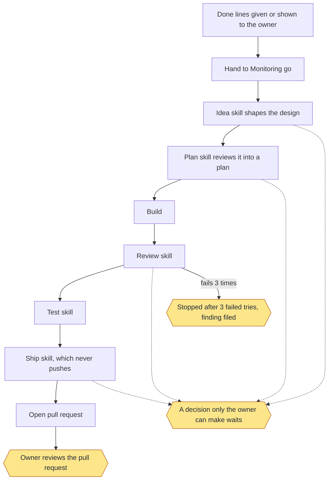

Status: built and proven: Done lines given or shown to the owner; Hand to Monitoring go; Build; Open pull request; Owner reviews the pull request; Stopped after 3 failed tries, finding filed. Built only: Idea skill shapes the design; Plan skill reviews it into a plan; Review skill; Test skill; Ship skill, which never pushes; A decision only the owner can make waits. Planned: none.
Stops for the owner: A decision only the owner can make waits; Owner reviews the pull request; Stopped after 3 failed tries, finding filed.
Proof: toy tests with stand-in skills prove the order, the waits and the stops. One real goal on a toy repo ran the idea step with the real skill, unattended, in about 75 seconds, then waited for the owner's approval of the design, as it should. The steps after it haven't run for real.

#### `new`

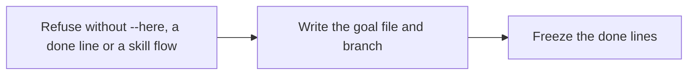

Status: built and proven: Refuse without --here, a done line or a skill flow; Write the goal file and branch; Freeze the done lines. Built only: none. Planned: none.
Stops for the owner: none.
Proof: toy tests. A background agent skips this command, so real goals freeze through Monitoring.

#### `queue`

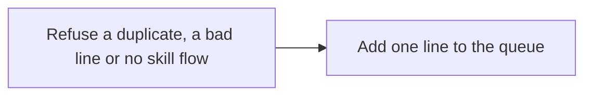

Status: built and proven: Refuse a duplicate, a bad line or no skill flow; Add one line to the queue. Built only: none. Planned: none.
Stops for the owner: none.
Proof: toy tests. No real use on record.

#### `flow`

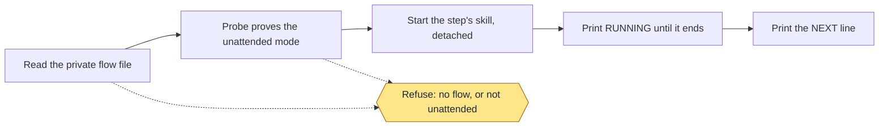

Status: built and proven: Read the private flow file; Probe proves the unattended mode; Start the step's skill, detached; Print RUNNING until it ends; Print the NEXT line; Refuse: no flow, or not unattended. Built only: none. Planned: none.
Stops for the owner: Refuse: no flow, or not unattended.
Proof: toy tests with a stand-in flow. The real skills have not run through it yet.

#### `record`

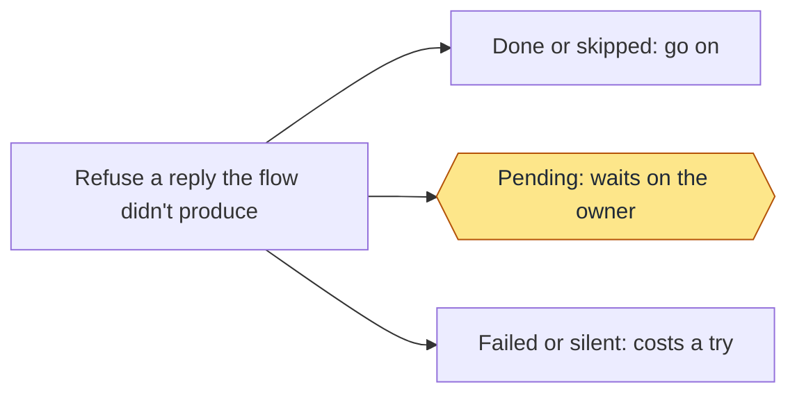

Status: built and proven: Refuse a reply the flow didn't produce; Done or skipped: go on; Pending: waits on the owner; Failed or silent: costs a try. Built only: none. Planned: none.
Stops for the owner: Pending: waits on the owner.
Proof: toy tests with stand-in skills.

#### `step`

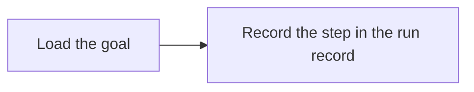

Status: built and proven: Load the goal; Record the step in the run record. Built only: none. Planned: none.
Stops for the owner: none.
Proof: the run records of real goals show their steps. No toy test calls it directly.

#### `pr`

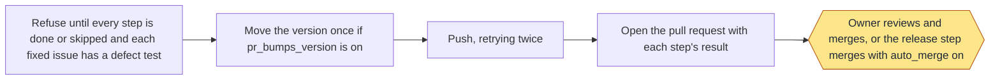

Status: built and proven: Refuse until every step is done or skipped and each fixed issue has a defect test; Move the version once if pr_bumps_version is on; Push, retrying twice; Open the pull request with each step's result; Owner reviews and merges, or the release step merges with auto_merge on. Built only: none. Planned: none.
Stops for the owner: Owner reviews and merges, or the release step merges with auto_merge on.
Proof: toy tests with a stand-in for GitHub, and real pull requests on this repo from before the flow.

#### `wait`

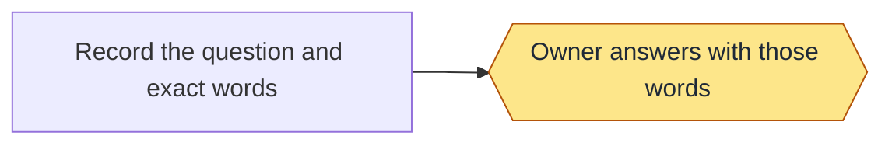

Status: built and proven: none. Built only: Record the question and exact words; Owner answers with those words. Planned: none.
Stops for the owner: Owner answers with those words.
Proof: no test calls it, and no real use is on record. Tests set a waiting goal by hand to prove that report shows it.

#### `answer`

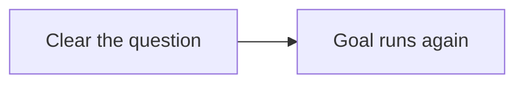

Status: built and proven: none. Built only: Clear the question; Goal runs again. Planned: none.
Stops for the owner: none.
Proof: no test calls it, and no real use is on record.

#### `finding`

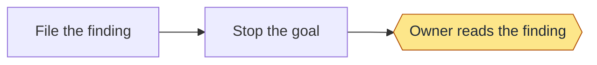

Status: built and proven: none. Built only: File the finding; Stop the goal; Owner reads the finding. Planned: none.
Stops for the owner: Owner reads the finding.
Proof: no test calls this command, and no real use is on record. The same stop after 3 failed tries is proven under `go`.

#### `show`

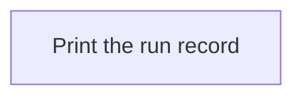

Status: built and proven: Print the run record. Built only: none. Planned: none.
Stops for the owner: none.
Proof: toy tests.

