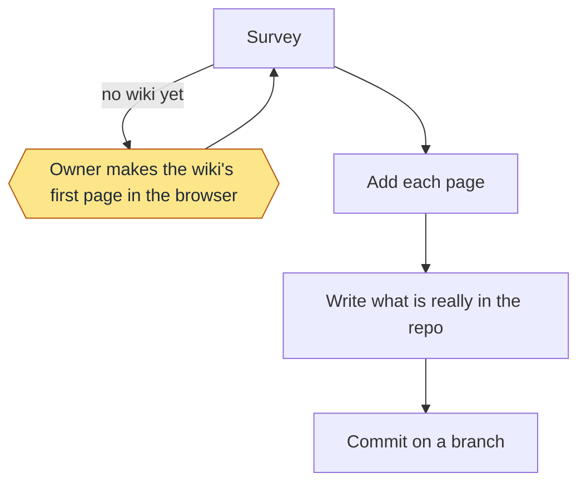
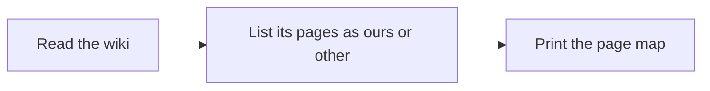
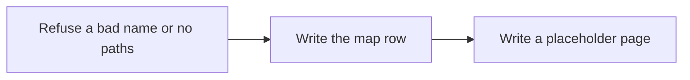
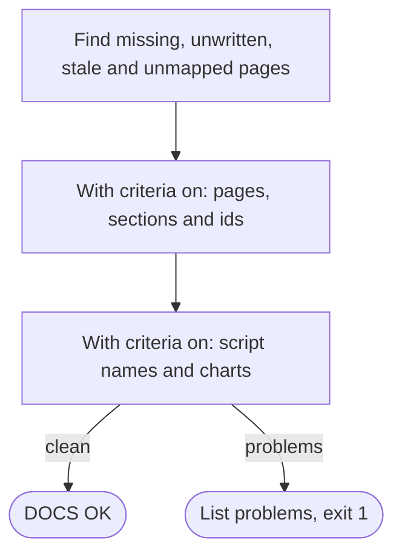
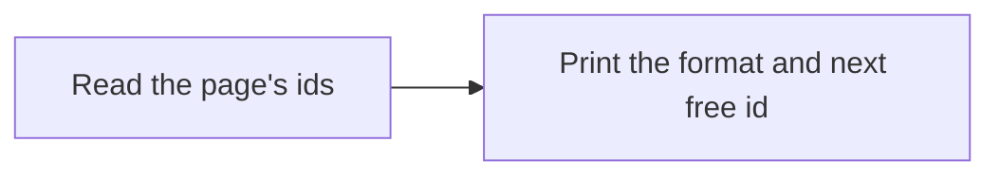
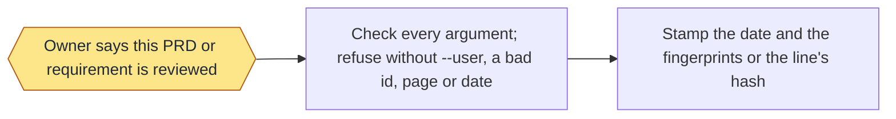
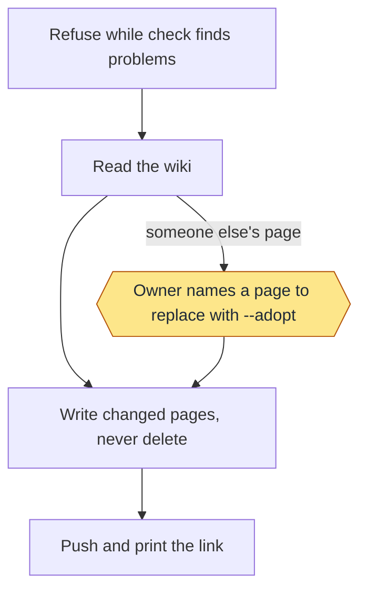
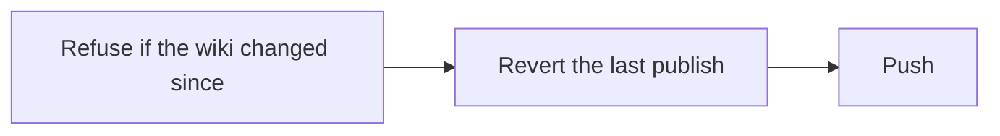

# Documentation: commands and flows

Moved from the wiki page, which is now only a short PRD and its tests.

### Init

`init` is a step list in `skills/workflow-docs/SKILL.md`, built from `survey` and `add`.

1. Survey: `survey` shows what exists.
2. Add: choose pages (three is a good start: how to use the repo, how it's run, how it's released), name the paths each
   describes, and use a name the survey doesn't list, so the wiki's other pages stay as they are:
   `add Using-the-workflow --paths ".loop/config.json,README.md"`.
3. Write each page: replace its placeholder text with what is really in the repo (real commands, real paths, real
   outputs). Keep the first line. If you didn't see it in the repo, don't write it.
4. Commit the pages and `.loop/docs.tsv` on a branch.

First-page rule: if the wiki has no pages yet, the user must create its first page in the browser, because GitHub only
makes the wiki's repo then. Tell them, then stop.

On Agensi, the file contract `loop-files.md` is under `shared/` in the pack.


## Commands

Pages are added and checked with these:

```text
init                            the step list above; an agent follows it
survey                          show the wiki's pages and this repo's page map
add PAGE --paths A,B            add a page and the paths it describes
check [--base REF]              list page problems, and PRD contract problems when criteria is on; exit 1 if any
audit [--base REF] [--dry-run]  check all required docs against the template, fix the mechanical, list wording to rewrite
criteria PAGE                   print the requirement format and the next free id for a page
review PAGE|ID [...] --user [--date D]   the owner marks a PRD, or a requirement, Reviewed
unreview PAGE|ID [...] --user   the owner lifts that review
render [--check]                rewrite each page's Tests from the regression rows
prd NAME "<idea>" --paths A,B   draft a new feature's PRD, Unreviewed, and map it
convert                         turn old Summary/Criteria pages into PRD pages (prd.py convert previews, --write writes)
publish [--dry-run] [--adopt PAGE]   copy the pages to the GitHub wiki, commit and push
restore                         revert the last publish, if nothing came after it
```

`entry.py write|check|render|block` builds `.loop/START.md`, the entry point every new session reads first, and the
workflow-loop block for the agent files, from the PRD pages, `.loop/config.json` and `references/start.md`. `check`
(also run by `docs.py check`) prints `STALE` when either differs from a fresh render and `MISSING` when a stamped repo
(it holds `template_version`, or is the template's own checkout) has none; both fail. While the installed skills are
newer than the repo's `template_version`, a difference only in the parts built from the skills prints `LAG` and does
not fail. `docs.py audit` rewrites a stale entry point and stale blocks itself.

| Code | Means | Fix |
|---|---|---|
| `ENTRY_STALE` | START.md or an agent block differs from its sources | `docs.py audit`, or `entry.py write` |
| `ENTRY_MISSING` | a stamped repo has no START.md, or an agent file has no block | `entry.py write`; ask for workflow-setup agents |
| `ENTRY_LAG` | the installed skills are newer than the repo's template_version | run the migrate goal (workflow-setup update) |

`.loop/docs.tsv` maps each page to the paths it describes. `check` prints `STALE`, `MISSING`, `UNWRITTEN` or
`UNMAPPED`, `NO PAGES` if the map is empty, and `DOCS OK` when clean. `STALE` means a commit touched a mapped path and
no later commit to the page has it in its history. Merge commits don't count, so a page gives the same answer before and
after a merge. Only a commit that changes the page clears `STALE`.

With `"criteria": true` in the config, every feature page is a short PRD (`references/template.md` holds the rules and
an example page): the Review line, then Problem, Requirements, Non-goals, Success metrics, an
optional Deployments (DOC-14: a Page table and/or a Delivery table for what the feature ships) and Tests, in that order
and nothing else. Requirements are the owner's lines (`- DEL-1: **Unreviewed** text`, up to
`criteria_max`, default 10); tests are for the machine: a regression row linked to one requirement by its goal column,
described as one `Given ..., when ..., then ...` scenario, rendered under its requirement with its last result.

### Page states

| State | Cause | `check` exit | `audit` | Release | `publish` | Who acts |
|---|---|---|---|---|---|---|
| Unreviewed | `Review: **Unreviewed**` | 0 | clean | goes ahead | publishes | the owner reviews the PRD when ready |
| Reviewed | the owner ran `review PAGE --user` | 0 | lists requirements with no passing test as `UNTESTED` (not a failure) | goes ahead | publishes | the loop writes the tests |
| `LOCKED` | Problem, Requirements, Non-goals or Success metrics changed after the review | 1 | fails | blocked | refused | an agent restores the text (`git log -p`), or the owner un-reviews |
| `USAGE` | a page still has a `## Usage` section (dropped 2026-11-13) | 1 | fails | fails | fails | remove the section; the commands are in the skill's Command map and `references/commands.md` |
| `UNWRITTEN` | a placeholder line is still on the page | 1 | fails | blocked | refused | an agent writes the drafts |
| `SCENARIO` | a row on the page is not Given/When/Then | 0 | fails | blocked | publishes | an agent rewrites the row's description |

### Examples

```text
/workflow-docs prd Billing "charge cards once a month" --paths src/billing
/workflow-docs review Billing                 # only on the owner's own words
/workflow-docs review BIL-1 --date 2026-11-08 # one requirement, on the owner's words
/workflow-docs unreview Billing               # the owner lifts the PRD lock
/workflow-docs convert                        # after an upgrade: old pages to PRD pages
/workflow-docs render
```

`--base REF` counts only changes since `REF`. `publish` has no `--base`, so it counts every commit, and it refuses while
`check` finds problems other than `CHANGED`. It never deletes a page. It refuses a page in the repo that lost the marker
`<!-- workflow-docs -->`, and won't replace a wiki page without that marker unless you name it with `--adopt`. `restore`
refuses if the wiki changed since.

### Stage charts

Amber marks where the command stops for the owner. [Home](Home) says what each status means. "Toy test" means a throwaway repo with stand-ins for GitHub.

#### `init`



Status: built and proven: Survey; Owner makes the wiki's first page in the browser; Add each page; Write what is really in the repo; Commit on a branch. Built only: none. Planned: none.
Stops for the owner: Owner makes the wiki's first page in the browser.
Proof: this repo's own wiki was built this way, and the toy tests cover survey and add. `init` itself is steps for an agent, so no test runs it whole.

#### `survey`



Status: built and proven: Read the wiki; List its pages as ours or other; Print the page map. Built only: none. Planned: none.
Stops for the owner: none.
Proof: toy tests.

#### `add`



Status: built and proven: Write the map row; Write a placeholder page. Built only: Refuse a bad name or no paths. Planned: none.
Stops for the owner: none.
Proof: toy tests and this repo. The refusals have no test.

#### `check`



Status: built and proven: Find missing, unwritten, stale and unmapped pages; With criteria on: pages, sections and ids; With criteria on: script names and charts. Built only: none. Planned: none.
Stops for the owner: none.
Proof: toy tests, and it runs on this repo. It checks that each chart and status line exists, not that a chart is true: that stays a matter of review.

#### `criteria`



Status: built and proven: Read the page's ids; Print the format and next free id. Built only: none. Planned: none.
Stops for the owner: none.
Proof: toy tests.

#### `review`



Status: built and proven: Check every argument; refuse without --user, a bad id, page or date; Stamp the date and the fingerprints or the line's hash. Built only: Owner says this PRD or requirement is reviewed. Planned: none.
Stops for the owner: Owner says this PRD or requirement is reviewed.
Proof: toy tests. With no terminal, `--user` also needs `LOOP_OWNER_WORDS`, the owner's quoted words, logged in
`.git/loop/reviews.tsv`; that the words are really the owner's is an instruction to the agent.

#### `publish`



Status: built and proven: Refuse while check finds problems; Read the wiki; Owner names a page to replace with --adopt; Write changed pages, never delete; Push and print the link. Built only: none. Planned: none.
Stops for the owner: Owner names a page to replace with --adopt.
Proof: toy tests, three real publishes to this repo's wiki, and a real publish on a second repo. No record shows a real --adopt.

#### `restore`



Status: built and proven: Revert the last publish; Push. Built only: Refuse if the wiki changed since. Planned: none.
Stops for the owner: none.
Proof: toy tests only: it has never run on a real wiki, and the refusal has no test.

## Moved from SKILL.md

Detail the skill's SKILL.md points to, kept word for word so no instruction is lost.

### The PRD page

1. the title, an optional free-form `Milestone:` line, then `Review: **Unreviewed**` (or the owner's Reviewed line);
2. `## Problem`: who it's for and what it solves, at most `problem_lines` lines;
3. (no Usage section: the commands are in the skill's Command map and `references/commands.md`);
4. `## Requirements`: up to `criteria_max` (default 10) lines `- DEL-3: **Unreviewed** what must hold`, short and plain,
   no script names; ids are stable: take the next free id (`criteria PAGE` prints it), never reuse or renumber one;
5. `## Non-goals`: at least one line; `## Success metrics`: one to `metrics_lines` measurable lines;
6. `## Tests`: written by `criteria.py render`, never by hand: under each requirement, one Given/When/Then scenario per
   regression row with its test, its kind, what it guards, when it runs, its last result and date and when it was seen failing; **not enforced**
   when no row passes; then the workflow tests, then the defect tests, in the same table.

Lines: `SECTIONS` (wrong, extra or out-of-order sections, or text before the first one), `REVIEW`, `PROBLEM`,
`NONGOALS`, `METRICS`, `CRITERION`, `CAP`, `SCRIPT`, `USAGE`, `TESTS` (run `render`), `LOCKED`, `CHANGED`.

Since the docs format (DOC-4..DOC-10), the shapes in `references/template.md` win over items 2, 3, 4 and 6 above: Problem
is 1 to `problem_lines` first-person bullets,
Requirements sit under `### Functional` and `### Non-functional` with `  - ` sub-bullets, and Tests is one table
linking the generated Tests page. Their refusals are `FORMAT <Page>:<line>: <Section>: DOC-n ...` lines, and a
generated Tests page behind a fresh render is `STALE Tests`.

### Review locks

`review PAGE` stamps the Review line with a fingerprint each of Problem, Requirements, Non-goals, Success metrics (and
the retired Usage print, still written and never reported). After it, a change to any of them is `LOCKED` (check, audit and release fail). A reviewed requirement line is locked on its own as well. To edit a reviewed requirement the
owner un-reviews that requirement and the PRD, then reviews both again.

### Tests follow on their own

**Tests follow on their own.** Write each new regression row's description as one scenario,
`Given <context>, when <action>, then <outcome>.`; `audit` lists any other as `SCENARIO` and the release step blocks on
it. Once a PRD is Reviewed, `audit` lists every requirement with no passing test as `UNTESTED` for the loop to queue.
`regression.py sync` reports an id with no row, and `release.py cut` refuses while any of its rows is missing, a draft
or failing.

### New and old pages

**New and old pages.** `python3 scripts/prd.py new NAME "<idea>" --paths A,B` drafts a new feature's PRD, Unreviewed,
maps it in `.loop/docs.tsv` and prints what is left: replace the Non-goals and Success metrics placeholders (the page
is `UNWRITTEN` until then) and add its requirement's regression row in the same pull request (it needs one before the
next release). `python3 scripts/prd.py convert` previews turning old Summary/Criteria pages into PRD pages, and
`convert --write` does it (Summary becomes Problem, Criteria Requirements, every stamp kept, placeholder Non-goals and
Success metrics added); then write the drafts, rewrite row descriptions as scenarios and run `render`.

### The automation registry

The Automation block lists health and regression (built in, cadence from `health_cron` and `regression_cron`) and each entry
of `automation` in `.loop/config.json`: `{"name", "does", "cadence", "runs", "enabled", "last_run"}`, where `runs` is
`github:FILE` (a workflow file), `mac:LABEL` (a launch agent) or `claude:TASK` (a Claude scheduled task) and `cadence` is a
cron string, words, or `off`. Adding a routine is adding one entry. `python3 scripts/docs.py automation` prints each one's
live state here; the committed block holds only what files and config show.

### `restore`

This reverts the last publish. It refuses if the wiki has changed since.

### audit

The one command. It checks every page against `references/template.md` (the page rules live in its `rules` block, so
nothing else holds a number), the code (stale pages), the tests (Tests tables) and the required docs (a release note per tag; a milestone is
optional and free form, never required). It fixes the mechanical (`FIXED`: Tests tables), lists wording for a person to write as `REWRITE`, and lists each Reviewed criterion with no
test, or whose tests no longer match, as `UNTESTED` (also saved to `untested.tsv` under `.git/loop`, for the loop to
queue goals from). Exit 0 only when nothing is left; `UNTESTED` and a `SKIP` for no `gh` answer don't fail it. The
release step runs it on every goal. It never deletes a page or edits a criterion.
