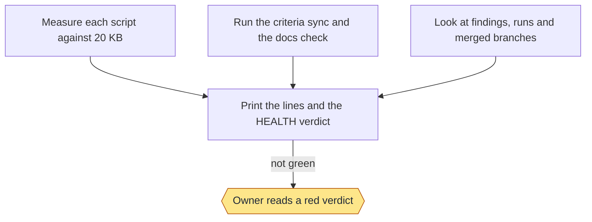
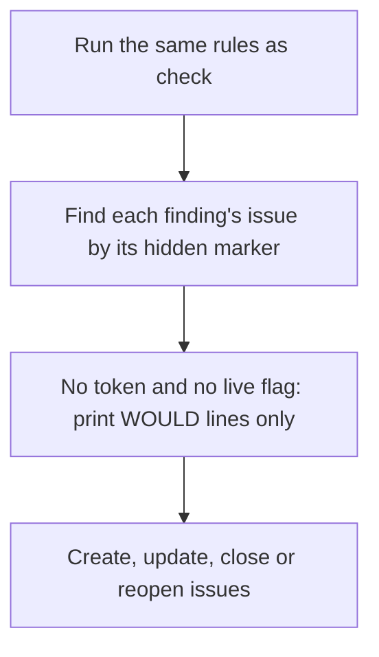
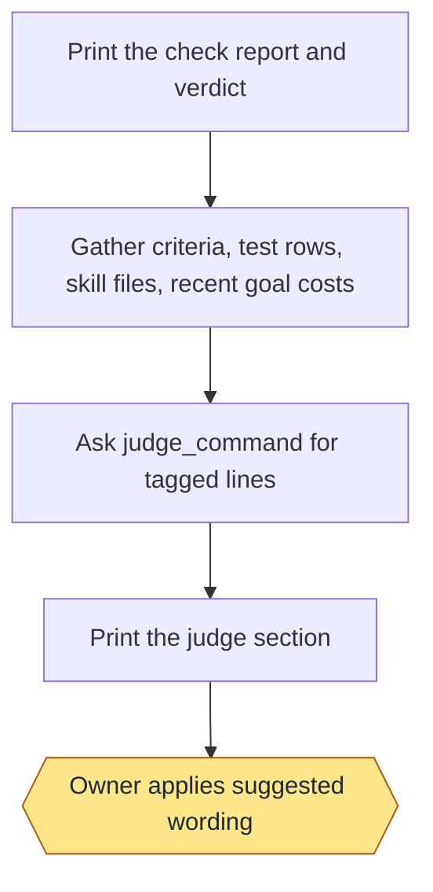

# Health: commands and flows

Moved from the wiki page, which is now only a summary, criteria and tests.

## Commands

```text
check [--json] [--group size|criteria|docs|hygiene|performance|mine|controls] [--skip controls]
preview [--group NAME[,NAME]]   (run is a deprecated alias)
file --group NAME[,NAME]
judge   (alias: suggest)
```

- `check` prints one line per finding, then one `HEALTH:` verdict line. A `FAIL` or an `UNREAD` line makes the verdict
  not green and the exit code 1; a `WARN` never does. `UNREAD` means a rule couldn't read its data, and is never a pass:
  that includes a sync with no result, an unreadable run record and a failing branch list. Every non-pass line ends with the command that fixes it. `--json` prints the same rows as records.

- `check` prints a fixed template: `HEALTH REPORT`, a header naming the groups run and skipped, then each group (`size`,
  `criteria`, `docs`, `hygiene`, `performance` (the Cost rule), `Mine`, `controls`) with every rule it checked, then the `HEALTH:` verdict. `Mine` runs the owner's own rules from `~/.workflow-loop/health.json` (or the file
  `LOOP_HEALTH` names), outside the repo: exit 0 is `PASS`, 1 `FAIL`, 2 `WARN`, and a rule that can't run is `UNREAD`.
  Mine runs the owner's commands, so it is outside the read-only and same-answer promises, and it is filed only when named.

- `cost` reads the last 10 finished goals' run records: seconds per step from the log gaps and tokens from the record. A
  goal over `time_budget_minutes` or `token_budget` in `.loop/config.json` is a `WARN` naming its three slowest or
  costliest steps; no budget set is an `INFO` row; no tokens recorded in any of them is one `UNREAD` row. Only finished
  goals count, so two runs give the same lines.

- `hygiene` also reads the land lane record (`regression.py`'s record of the current branch, else the newest one) and
  warns when its land rows took longer than `test_budget_seconds`, naming the five slowest rows and the slowest toy
  scripts. It lists loop worktrees that no live goal names (queued, running, waiting, failed, stopped, or done with its pull
  request still open) and local branches on no remote older than `stale_branch_days`, one row per kind with the first
  five and their removal commands (all of them under `--json`). A branch whose commits exist only on this machine says
  so before `git branch -D`. These rows are never filed and the commands are never run for you.

- `controls` runs each rule's negative control (`controls.py`): a throwaway repo, with no inherited git setting, made
  to break that rule, then the real rule on it. `PASS` means it fired; `FAIL ... cannot fire` means the rule no longer
  sees what it is for; `UNREAD` means the fixture could not be built, with the failing command, or the rule could not read its data on it. A rule with no control
  stops health.py from loading (exit 2). `check --skip controls` leaves the group out; `controls.py run <rule> --keep`
  runs one and keeps its fixture.

- `judge` prints the `check` report, then a separate judge section, marked as suggestions: criteria quality, test
  quality, and performance (test time and tokens) ranked by savings, with suggested criterion wording under `Needs you` and weak
  tests and savings as candidate goals, then ranked next steps. It asks `judge_command` from `.loop/config.json` and
  reads only tagged lines (`CRITERION`, `TEST`, `SAVES`); any failure prints `JUDGE UNAVAILABLE`. It never changes the
  verdict or the exit code, and `check` itself calls no model.
- The full `check` and `judge` reports print a `TESTS` block just before the `HEALTH:` line: every test, grouped by
  feature, in workflow-regression's one test format (`tests.py list`). It never changes the verdict, and it is left out
  for a single group and for `--json`.

- `preview` lists exactly what `file` would do: each issue it would open, update, close or reopen, with its
  `health:<group>` tag. It has no write path, even with a token. With no `--group` it covers every group except `mine`;
  the judge runs (and its savings are included) only when `performance` is named.

- `file --group NAME[,NAME]` is the only writer, and refuses without a group. For the named groups only it files each
  warning, failure or unread finding as one issue on the `Backlog` milestone, labelled `health:<group>` (`size`,
  `criteria`, `docs`, `hygiene`, `performance` for Cost and the judge's savings, `mine`) and the older `health`. A hidden
  marker in the body finds it again: a repeat updates the issue, a fixed finding closes it, a returning one reopens it,
  and an issue you moved to a feature stays there. A rule that could not be read closes none of its issues. Create the
  milestones first (see Milestones).

The milestones the issues land in are on the [Documentation](Documentation) page.

### Stage charts

Amber marks where the command stops for the owner. [Home](Home) says what each status means. "Toy test" means a throwaway repo with stand-ins for GitHub.

#### `check`



Status: built and proven: Measure each script against 20 KB; Run the criteria sync and the docs check; Look at findings, runs and merged branches; Print the lines and the HEALTH verdict; Owner reads a red verdict. Built only: none. Planned: none.
Stops for the owner: Owner reads a red verdict.
Proof: toy tests on a throwaway repo. On this repo it has run by hand once and printed warnings for the five scripts near the limit.

#### `run`



Status: built and proven: Run the same rules as check; Find each finding's issue by its hidden marker; Create, update, close or reopen issues; No token and no live flag: print WOULD lines only. Built only: none. Planned: none.
Stops for the owner: none.
Proof: toy tests with a stand-in for GitHub. It has only been dry-run on this repo, which has no health issues yet.


#### `judge`



Status: built and proven: Print the check report and verdict; Gather criteria, test rows, skill files, recent goal costs; Ask judge_command for tagged lines; Print the judge section; Owner applies suggested wording. Built only: none. Planned: none.
Stops for the owner: Owner applies suggested wording.
Proof: toy tests with a stand-in judge on a throwaway repo; no model is called in any test.

#### `automation.py`: `workflow`, `digest`

`workflow` writes `.github/workflows/health.yml` from `.loop/config.json`: `health_cron` (five cron fields, or `off`,
which keeps only the by-hand trigger) and `judge_secret` (a secret name, `^[A-Z_][A-Z0-9_]*$`; anything else is
refused). The run checks the routine first: `off` prints `OFF:` and writes nothing; a schedule unlike the config prints
`SCHEDULE:` with the command that rewrites it; a checkout without the workflow-health skill prints `MISSING:` and fails,
writing nothing. Then `health.py check --group size,criteria,docs,hygiene` goes into the run summary (Cost and Mine need
this machine's run records and private files), `health.py file` for those groups, the judge only when the secret is set
and the runner has `judge_command`'s program (`judge_setup` can install it; otherwise `JUDGE: skipped` says why), and the
digest. The workflow reads the repo and writes only issues, labels, comments and the run summary.

`digest` finds or creates the `Automation digest` issue (label `automation`) and pins it (a failed pin warns). It reads
the open issues labelled `regression` (failing tests, also labelled `defect`) or `health`, compares them with the state
kept in the digest issue's body, and posts one comment: `@digest_owner` (default the repo owner; an organisation is named,
not mentioned), what ran (regression's latest run, health's verdict), **New**, **Still open** and **Fixed**, and for each
open issue ``/workflow-delivery go "Fix #N"`` with its link, never its title. A rerun of the same run posts nothing. In
Actions with no token it says so and fails; elsewhere without one it only prints the comment.
