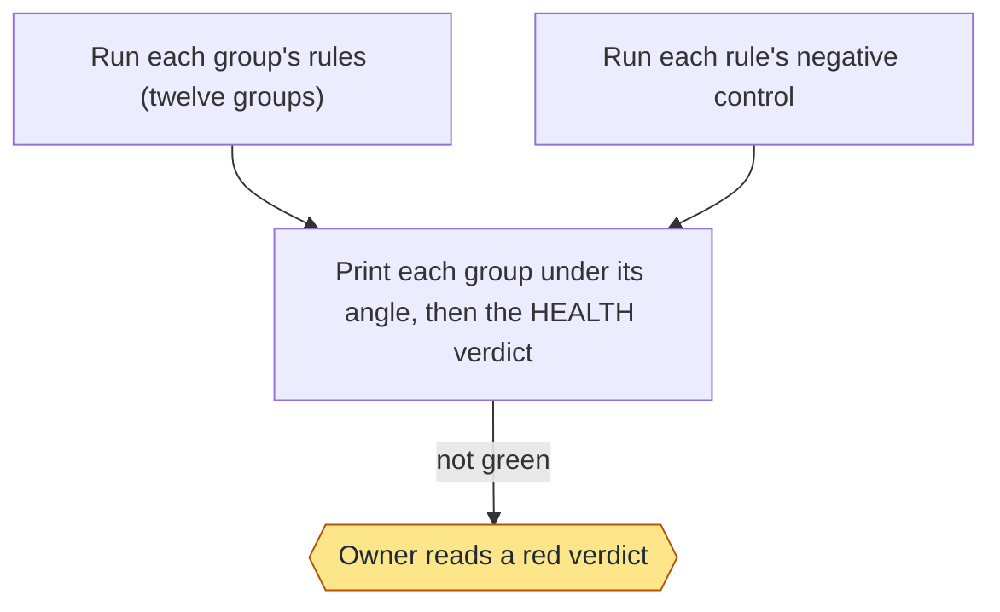
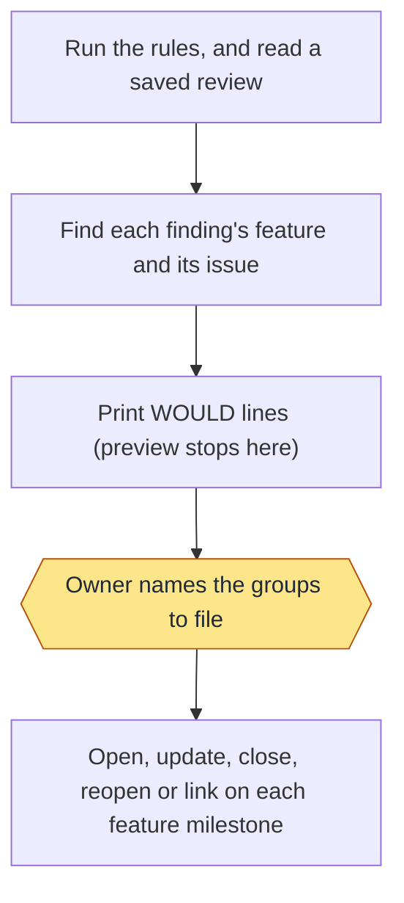
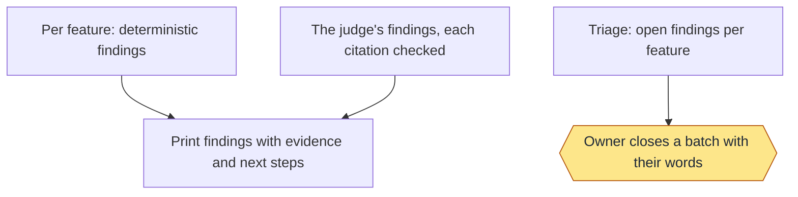
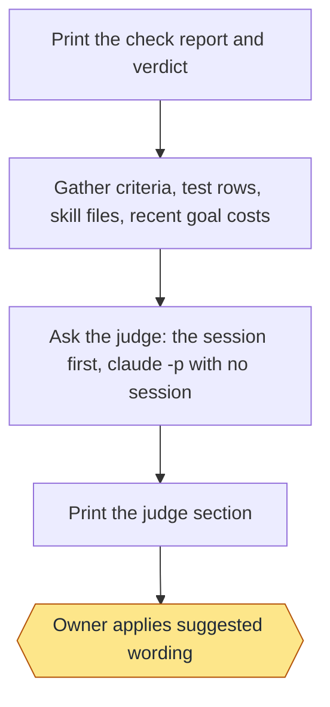

# Health: commands and flows

Moved from the wiki page, which is now only a summary, criteria and tests.

## Commands

```text
check [--json] [--group NAME[,NAME]] [--skip NAME[,NAME]]
review [--feature NAME] [--json]
judge   (alias: suggest)
preview [--group NAME[,NAME]] [--feature NAME] [--review FILE]   (run is a deprecated alias)
file --group NAME[,NAME] | --review FILE [--feature NAME]
triage [--feature NAME] [--close --kind K --why WORDS [--older DAYS] [--max N] [--yes]]
```

Group names for `--group`: requirements, traceability, consistency, docs, freshness, tests, performance, security, size,
hygiene, adoption, mine, controls (criteria and cost still work for one release, meaning requirements and performance).

## Rules

Each rule belongs to one group (`scripts/groups.py`) and has a negative control (`controls.py`, plus each rule module's
`CONTROLS`). A rule that needs gh says `INFO: gh not available here` without it; a rule about this machine says
`not applicable here` where its state is absent. Ages and counts appear only in a warning's detail, so two checks of an
unchanged repo print the same lines.

| Group (angle) | Rule | Warns or fails when |
|---|---|---|
| Requirements (is every promise I approved proven?) | `rows` | a criterion has no regression row (FAIL) |
| | `proof` | a row is a draft with no command or level (FAIL) |
| | `done` | done lines have no regression row, as one WARN; goals frozen before `done_lines_since` owe none |
| Traceability (can I follow any work end to end?) | `defect-tests` | closed work has no defect test (FAIL) |
| | `row-requirement` | a row guards an id no page defines and isn't a done line `slug:N` (FAIL) |
| Consistency (do the pages agree?) | `ids-unique` | a requirement id is defined on two pages (FAIL) |
| | `refs` | a page names an id of a known prefix that no page defines (FAIL) |
| | `usage-readme` | the README names a `/workflow-x verb` no page's Usage names (WARN) |
| Docs (does each page match the template and the code?) | `docs-check` | `docs.py check`: a stale page WARNs, any other gap FAILs (its requirement count belongs to Size); `issues.py` (DOC-10): an open issue with no milestone FAILs, and an unreadable issue list is shown as UNREAD but never turns the verdict red |
| Freshness (is anything out of date?) | `nightly` | the newest nightly run is older than a day (WARN) |
| | `unreleased` | commits after the newest `v*` tag, the oldest over 3 days old (WARN) |
| | `finding-age` | an open health issue is older than 30 days (WARN) |
| Tests (do the tests prove anything?) | `seen-red` | a row was never seen failing (FAIL) |
| | `skipped` | a row recorded SKIPPED for over 7 days (WARN) |
| | `network` | a land row's command reaches the network: curl, wget, http(s):// (WARN) |
| Performance (is it fast and cheap enough?) | `cost` | a finished goal over `time_budget_minutes` or `token_budget` (WARN); goals that recorded no tokens are left out |
| | `test-time` | the land lane over `test_budget_seconds`, naming its slowest rows (WARN; shown, never filed) |
| | `check-time` | the check, up to this group, past 60 seconds (WARN; shown, never filed) |
| Security and privacy (can anything private escape?) | `private` | a tracked file matches a `leak_patterns` entry of the private flow file: file:line and the pattern's number only, never the text (FAIL) |
| | `scan-hook` | no commit scan hook (WARN; shown, never filed) |
| | `workflow-permissions` | a workflow has no top-level `permissions:` (WARN) |
| Size (can someone still read this?) | `scripts` | a script at 90% of 20 KB (WARN) or over it (FAIL) |
| | `skill-lines` | a SKILL.md of 150 lines or more (FAIL) |
| | `requirements-per-page` | a page with more requirements than `criteria_max` (FAIL) |
| Hygiene (is anything left lying around?) | `findings` | over 5 open findings in `.loop/findings.md` (WARN) |
| | `waiting` | a run waiting over 24 hours (WARN) |
| | `branches` | a `loop/` branch already merged (WARN) |
| | `worktrees`, `local-branches` | loop worktrees no live goal names, local branches on no remote older than `stale_branch_days`, with the commands that remove them (WARN; shown, never filed, never run) |
| | `idle-sessions` | a busy worker session whose goal has ended (WARN; shown, never filed) |
| Adoption (would this work installed fresh?) | `config` | `.loop/config.json` doesn't parse or has no base (FAIL) |
| | `checks-run-tests` | the regression workflow exists but no land row does (WARN) |
| | `template-version` | VERSION isn't the newest CHANGELOG heading (WARN) |
| | `scheduled` | the regression or health workflow is missing or has no schedule (WARN) |
| Controls (can each rule fire?) | `control` per rule | a rule's control stays green: it cannot fire (FAIL); a fixture that can't be built is UNREAD |

- Performance's `test-time` reads the land lane record (`regression.py`'s record of the current branch, else the newest
  one) and warns when its land rows took longer than `test_budget_minutes` (default 15, floor 15), naming the five
  slowest rows and the slowest toy scripts; a full run over 30 minutes also warns, and each step or test run that hit its
  budget is an INFO row with what it left. Its `cost` rule also carries lane-control's REG-7 timing rows: a goal lane over
  `goal_lane_minutes`, or the newest full suite over 30 minutes, warns. Hygiene's `worktrees` and `local-branches` list loop
  worktrees that no live goal names and local branches on no remote older than `stale_branch_days`, one row per kind with
  the first five and their removal commands (all of them under `--json`). A branch whose commits exist only on this
  machine says so before `git branch -D`. These rows are never filed and the commands are never run for you.


Mine runs the owner's own rules from `~/.workflow-loop/health.json` (or `LOOP_HEALTH`): exit 0 is PASS, 1 FAIL, 2 WARN,
anything else UNREAD. It runs the owner's commands, so it is outside the read-only and same-answer promises, and it is
filed only when named.

Adding a rule: write `fn(root) -> rows` in a rule module, add its name to its group in `groups.py`, list it in the
module's `FUNCTIONS`, and add a fixture to its `CONTROLS` that makes it fire. Health refuses to load until the control exists.

## Review, filing and triage

- `review` runs per feature: a deterministic layer (a page with no non-functional requirement, an open issue naming no
  requirement, a Usage command the skill doesn't name) and the judge. The judge's `FINDING|feature|kind|angle|evidence|fix`
  lines are kept only with verified citations: a page's requirement id, a file or file:line, a row id, or an issue. The
  rest are dropped and counted. `--json` prints `{"version": 1, "findings": [...]}`; `preview`/`file --review FILE` read it.
- The judge is the session first, `claude -p` later (the owner's rule). Run by a session (`CLAUDECODE` set), `review`,
  `judge` and `preview`/`file` never call a model: they write the prompt to a temporary file and say so; an in-session
  subagent answers it, and the rerun takes its saved reply with `--judge-answer FILE`. With no session (the scheduled
  GitHub Actions run) they run `judge_command` (`claude -p`). Each report logs `judge: session` or
  `judge: claude -p (no session)`.
- `file` puts each finding on its feature's milestone: the page whose `.loop/docs.tsv` path is the longest prefix of the
  finding's path, the page defining its requirement id, the page of its row's requirement, an issue's own milestone, or a
  review finding's feature. Backlog when none fits.
  - Its marker is `<!-- loop-health KEY evidence=H placed=P -->`, where H hashes the finding's identity and stable citations,
    never its ages, counts or sizes, and P is the milestone `file` put it on: it moves to its feature only while it is still
    there, so an issue you moved anywhere else, `Backlog` included, stays. Markers from before the twelve groups are found
    and moved to the new key. A feature milestone that isn't there falls back to `Backlog` (made when needed); create the
    milestones first (see Milestones). When the milestones can't be read, issues are placed by title and none is moved.
  - An open non-health issue on that milestone naming the subject (exact path, id or row id) gets one comment marked
    `<!-- loop-health-link KEY evidence=H -->`, instead of a new issue.
  - An issue closes only when its own rule ran and read its data. One closed in triage (`health:closed`) stays closed while
    its evidence hash is unchanged.
- `triage` lists open health issues per feature by kind, count and age. `--close` always lists the matches first and
  writes only with `--yes`, with the owner's words as the closing comment.

Refusals print `REFUSED[code]` and exit 2: `[file]`, `[gh]`, `[review]`, `[feature]`, `[kind]`, `[why]`, `[cap]`.

The milestones the issues land in are on the [Documentation](Documentation) page.

### Stage charts

Amber marks where the command stops for the owner. [Home](Home) says what each status means. "Toy test" means a throwaway repo with stand-ins for GitHub.

#### `check`



Status: built and proven: Run each group's rules (twelve groups); Run each rule's negative control; Print each group under its angle, then the HEALTH verdict; Owner reads a red verdict. Built only: none. Planned: none.
Stops for the owner: Owner reads a red verdict.
Proof: toy tests on throwaway repos (test-health*.sh, test-health-prd.sh); run on this repo by hand.

#### `preview` and `file`



Status: built and proven: Run the rules, and read a saved review; Find each finding's feature and its issue; Print WOULD lines (preview stops here); Owner names the groups to file; Open, update, close, reopen or link on each feature milestone. Built only: none. Planned: none.
Stops for the owner: Owner names the groups to file.
Proof: toy tests with a stand-in for GitHub.

#### `review` and `triage`



Status: built and proven: Per feature: deterministic findings; The judge's findings, each citation checked; Print findings with evidence and next steps; Triage: open findings per feature; Owner closes a batch with their words. Built only: none. Planned: none.
Stops for the owner: Owner closes a batch with their words.
Proof: toy tests with stand-in judges and a stand-in for GitHub.

#### `judge`



Status: built and proven: Print the check report and verdict; Gather criteria, test rows, skill files, recent goal costs; Ask the judge: the session first, claude -p with no session; Print the judge section; Owner applies suggested wording. Built only: none. Planned: none.
Stops for the owner: Owner applies suggested wording.
Proof: toy tests with a stand-in judge on a throwaway repo; no model is called in any test.

#### `automation.py`: `workflow`, `digest`

`workflow` writes `.github/workflows/health.yml` from `.loop/config.json`: `health_cron` (five cron fields, or `off`,
which keeps only the by-hand trigger) and `judge_env` (a secret name, `^[A-Z_][A-Z0-9_]*$`; anything else is
refused). The run checks the routine first: `off` makes a scheduled run print `OFF:` and write nothing (a run started by hand
still runs); a schedule unlike the config prints
`SCHEDULE:` with the command that rewrites it; a checkout without the workflow-health skill prints `MISSING:` and fails,
writing nothing. Then `health.py check --group size,criteria,docs` goes into the run summary (Cost, Mine and hygiene need
this machine's run records, branches and private files), `health.py file` for those groups, the judge only when the secret is set
and the runner has `judge_command`'s program (`judge_setup` can install it; otherwise `JUDGE: skipped` says why), and the
digest. The workflow reads the repo and writes only issues, labels, comments and the run summary.

`digest` finds or creates the `Automation digest` issue (label `automation`) and pins it (a failed pin warns). It reads
the open issues labelled `regression` (failing tests, also labelled `defect`) or `health`, compares them with the state
kept in the digest issue's body, and posts one comment: `@digest_owner` (default the repo owner; an organisation is named,
not mentioned), what ran (regression's latest run, health's verdict), **New**, **Still open** and **Fixed**, and for each
open issue ``/workflow-delivery go "Fix #N"`` with its link, never its title. A rerun of the same run posts nothing. In
Actions with no token it says so and fails; elsewhere without one it only prints the comment. `workflow --check` reports a
written workflow older than the skills (`STALE_WORKFLOW`) or one not written by it (`NOT_OURS`).

`mail.py send` (the `mail` job, after the digest) mails the round's comment at most once, by Cloudflare Email or SMTP
(`digest_mail`), to the address in the `DIGEST_TO` secret; `mail.py test` (`mail-test.yml`, by hand) sends one fixed mail.
Codes and fixes are in the Automation wiki page.
