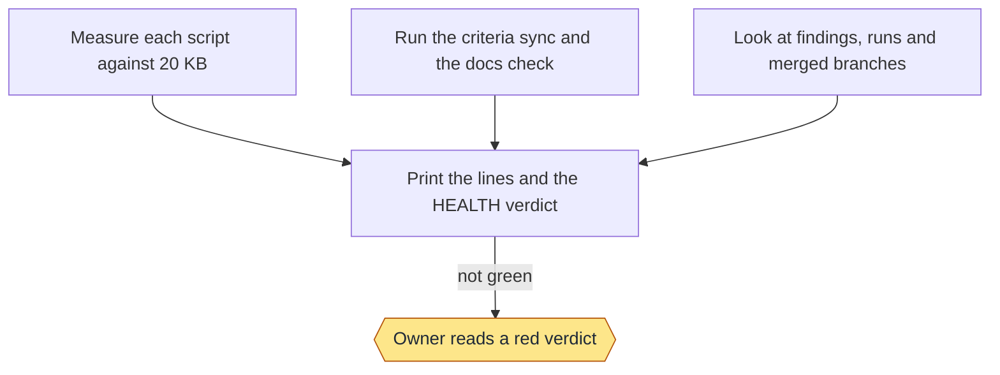
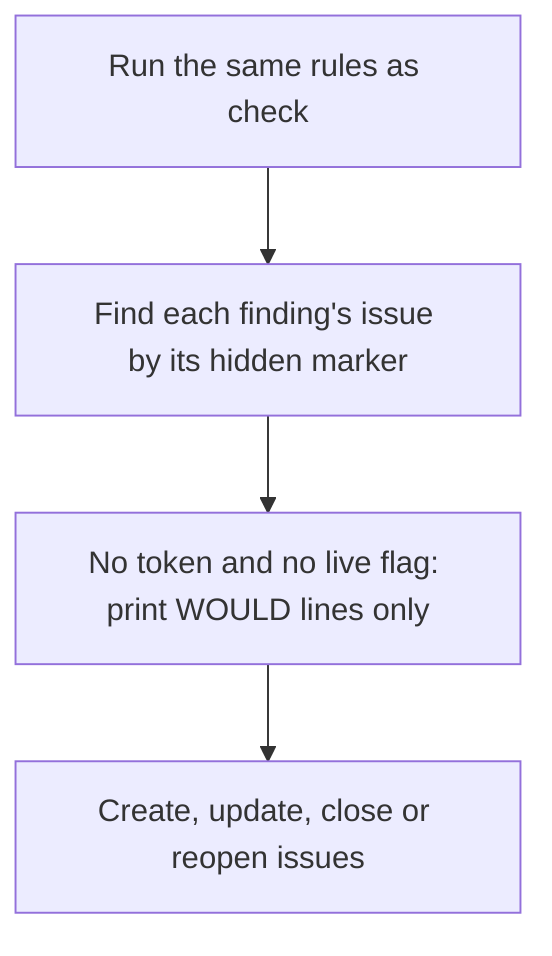

# Health: commands and flows

Moved from the wiki page, which is now only a summary, criteria and tests.

## Commands

```text
check [--json] [--family size|criteria|docs|hygiene]
run [--live] [--family size|criteria|docs|hygiene]
```

- `check` prints one line per finding, then one `HEALTH:` verdict line. A `FAIL` or an `UNREAD` line makes the verdict
  not green and the exit code 1; a `WARN` never does. `UNREAD` means a rule couldn't read its data, and is never a pass:
  that includes a sync with no result, an unreadable run record and a failing branch list. Every non-pass line ends with the command that fixes it. `--json` prints the same rows as records.

- `run` files each warning, failure or unread finding as one issue on the `Backlog` milestone, labelled `health`. A hidden
  marker in the body finds it again: a repeat updates the issue, a fixed finding closes it, a returning one reopens it,
  and an issue you moved to a feature stays there. With no `--live`, `GH_TOKEN` or `GITHUB_TOKEN` it only prints what it
  would do. Create the milestones first (see Milestones).

The milestones the issues land in are on the [Documentation](Documentation) page.

### Stage charts

Amber marks where the command stops for the owner. [Home](Home) says what each status means. "Toy test" means a throwaway repo with stand-ins for GitHub.

#### `check`



Status: built and proven: Measure each script against 20 KB; Run the criteria sync and the docs check; Look at findings, runs and merged branches; Print the lines and the HEALTH verdict; Owner reads a red verdict. Built only: none. Planned: none.
Stops for the owner: Owner reads a red verdict.
Proof: toy tests on a throwaway repo. On this repo it has run by hand once and printed warnings for the five scripts near the limit.

#### `run`



Status: built and proven: Run the same rules as check; Find each finding's issue by its hidden marker; Create, update, close or reopen issues; No token and no live flag: print WOULD lines only. Built only: none. Planned: none.
Stops for the owner: none.
Proof: toy tests with a stand-in for GitHub. It has only been dry-run on this repo, which has no health issues yet.

