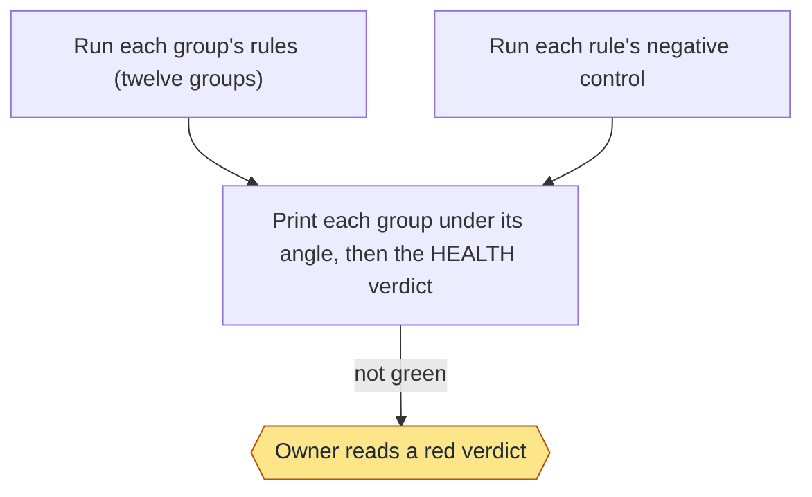
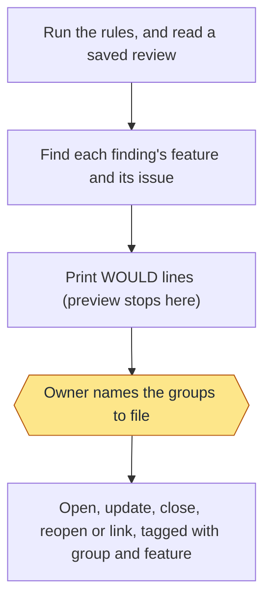
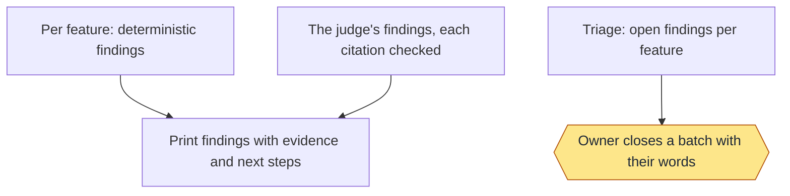
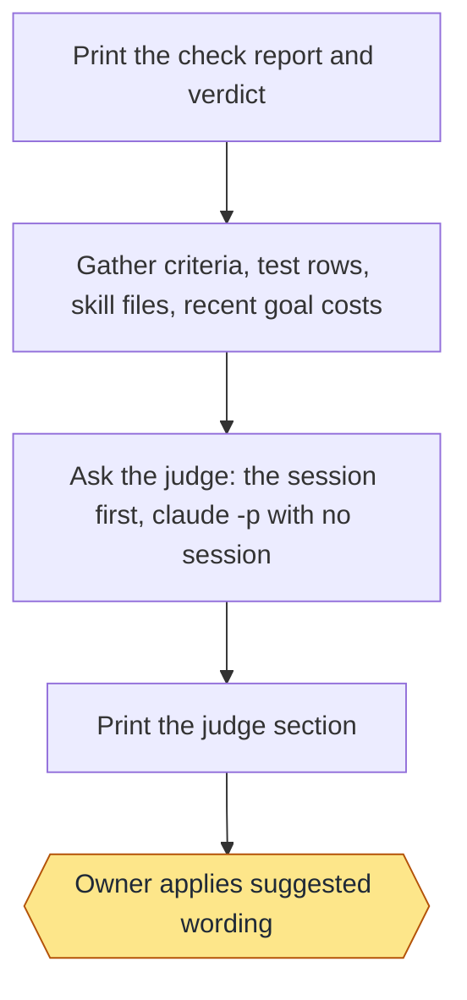
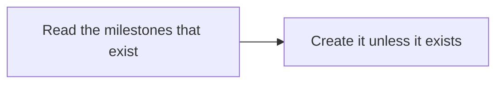
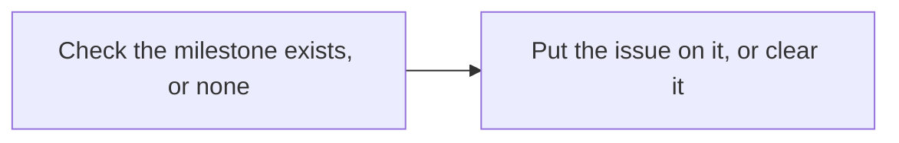

# Health: commands and flows

Moved from the wiki page, which is now only a summary, criteria and tests.

## Commands

```text
check [--json] [--group NAME[,NAME]] [--skip NAME[,NAME]]
review [--feature NAME] [--json]
judge   (alias: suggest)
preview [--group NAME[,NAME]] [--feature NAME] [--review FILE]   (run is a deprecated alias)
file --group NAME[,NAME] | --review FILE [--feature NAME]
triage [--feature NAME] [--close --kind K --why WORDS [--older DAYS] [--max N] [--yes]]
```

Group names for `--group`: requirements, traceability, consistency, docs, freshness, tests, performance, security, size,
hygiene, adoption, mine, controls (criteria and cost still work for one release, meaning requirements and performance).

## Rules

Each rule belongs to one group (`scripts/report.py`) and has a negative control (`controls.py`, plus each rule module's
`CONTROLS`). A rule that needs gh says `INFO: gh not available here` without it; a rule about this machine says
`not applicable here` where its state is absent. Ages and counts appear only in a warning's detail, so two checks of an
unchanged repo print the same lines.

| Group (angle) | Rule | Warns or fails when |
|---|---|---|
| Requirements (is every promise I approved proven?) | `rows` | a criterion has no regression row (FAIL) |
| | `proof` | a row is a draft with no command or level (FAIL) |
| | `done` | done lines of a goal still being built have no regression row, as one WARN |
| Traceability (can I follow any work end to end?) | `defect-tests` | closed work has no defect test (FAIL) |
| | `row-requirement` | a row guards an id no page defines and isn't a done line `slug:N` (FAIL) |
| Consistency (do the pages agree?) | `ids-unique` | a requirement id is defined on two pages (FAIL) |
| | `refs` | a page names an id of a known prefix that no page defines (FAIL) |
| | `usage-readme` | the README names a `/workflow-x verb` no skill's Command map names (WARN) |
| Docs (does each page match the template and the code?) | `docs-check` | `docs.py check`: a stale page WARNs, any other gap FAILs (its requirement count belongs to Size); no check reads a milestone |
| Freshness (is anything out of date?) | `nightly` | the newest nightly run is older than a day (WARN) |
| | `unreleased` | commits after the newest `v*` tag, the oldest over 3 days old (WARN) |
| | `finding-age` | an open health issue is older than 30 days (WARN) |
| Tests (do the tests prove anything?) | `seen-red` | a row was never seen failing (FAIL) |
| | `skipped` | a row recorded SKIPPED for over 7 days (WARN) |
| | `network` | a land row's command reaches the network: curl, wget, http(s):// (WARN) |
| Performance (is it fast and cheap enough?) | `cost` | a finished goal over `time_budget_minutes` or `token_budget` (WARN); goals that recorded no tokens are left out |
| | `test-time` | the land lane over `test_budget_minutes`, naming its slowest rows (WARN; shown, never filed) |
| | `check-time` | the check, up to this group, past 60 seconds (WARN; shown, never filed) |
| Security and privacy (can anything private escape?) | `private` | a tracked file matches a `leak_patterns` entry of the private flow file: file:line and the pattern's number only, never the text (FAIL) |
| | `scan-hook` | no commit scan hook (WARN; shown, never filed) |
| | `workflow-permissions` | a workflow has no top-level `permissions:` (WARN) |
| Size (can someone still read this?) | `scripts` | a script at 90% of 20 KB (WARN) or over it (FAIL) |
| | `skill-lines` | a SKILL.md of 150 lines or more (FAIL) |
| | `requirements-per-page` | a page with more requirements than `criteria_max` (FAIL) |
| Hygiene (is anything left lying around?) | `findings` | over 5 open findings in `.loop/findings.md` (WARN) |
| | `waiting` | a run waiting over 24 hours (WARN) |
| | `branches` | a `loop/` branch already merged (WARN) |
| | `worktrees`, `local-branches` | loop worktrees no live goal names, local branches on no remote older than `stale_branch_days`, with the commands that remove them (WARN; shown, never filed, never run) |
| | `idle-sessions` | a busy worker session whose goal has ended (WARN; shown, never filed) |
| Adoption (would this work installed fresh?) | `config` | `.loop/config.json` doesn't parse or has no base (FAIL) |
| | `checks-run-tests` | the regression workflow exists but no land row does (WARN) |
| | `template-version` | VERSION isn't the newest CHANGELOG heading (WARN) |
| | `scheduled` | the regression or health workflow is missing or has no schedule (WARN) |
| | `no-fit` | an open `[adoption]` line in `.loop/findings.md` (setup writes one per kind): one WARN row naming its subjects and fix |
| | `agent-tools` | `agent_command` or the flow file's command grants its agent no tools (WARN), naming each setting to fix |
| | `prompt-pointer` | an installed scheduled-task prompt (`~/.claude/scheduled-tasks/<task>/SKILL.md`, for a routine whose `runs` is `claude:` or `mac:`) holds a line other than the Runbook pointer `docs.py prompts` prints (WARN) |
| Controls (can each rule fire?) | `control` per rule | a rule's control stays green: it cannot fire (FAIL); a fixture that can't be built is UNREAD |

- Performance's `test-time` reads the land lane record (`regression.py`'s record of the current branch, else the newest
  one) and warns when its land rows took longer than `test_budget_minutes` (default 15, floor 15), naming the five
  slowest rows and the slowest toy scripts; a full run over 30 minutes also warns, and each step or test run that hit its
  budget is an INFO row with what it left. Its `cost` rule also carries lane-control's REG-7 timing rows: a goal lane over
  `goal_lane_minutes`, or the newest full suite over 30 minutes, warns. Hygiene's `worktrees` and `local-branches` list loop
  worktrees that no live goal names and local branches on no remote older than `stale_branch_days`, one row per kind with
  the first five and their removal commands (all of them under `--json`). A branch whose commits exist only on this
  machine says so before `git branch -D`. These rows are never filed and the commands are never run for you.


Mine runs the owner's own rules from `~/.workflow-loop/health.json` (or `LOOP_HEALTH`): exit 0 is PASS, 1 FAIL, 2 WARN,
anything else UNREAD. It runs the owner's commands, so it is outside the read-only and same-answer promises, and it is
filed only when named.

Adding a rule: write `fn(root) -> rows` in a rule module, add its name to its group in `report.py`, list it in the
module's `FUNCTIONS`, and add a fixture to its `CONTROLS` that makes it fire. Health refuses to load until the control exists.

## Review, filing and triage

- `review` runs per feature: a deterministic layer (a page with no non-functional requirement, an open issue naming no
  requirement, a Usage command the skill doesn't name) and the judge. The judge's `FINDING|feature|kind|angle|evidence|fix`
  lines are kept only with verified citations: a page's requirement id, a file or file:line, a row id, or an issue. The
  rest are dropped and counted. `--json` prints `{"version": 1, "findings": [...]}`; `preview`/`file --review FILE` read it.
- The judge is the session first, `claude -p` later (the owner's rule). Run by a session (`CLAUDECODE` set), `review`,
  `judge` and `preview`/`file` never call a model: they write the prompt to a temporary file and say so; an in-session
  subagent answers it, and the rerun takes its saved reply with `--judge-answer FILE`. With no session (the scheduled
  GitHub Actions run) they run `judge_command` (`claude -p`). Each report logs `judge: session` or
  `judge: claude -p (no session)`.
- `file` tags each finding's issue with its group and, by kind (HLT-4), labels it `defect` (a FAIL except a performance one, a review
  conflict; no milestone) or `backlog` (the rest; milestone `Backlog: <Feature>`, or `Backlog: Other`), making the milestone first. Its feature is the page whose `.loop/docs.tsv` path is
  the longest prefix of the finding's path, the page defining its requirement id, the page of its row's requirement, an
  issue's own feature, or a review finding's feature; none when none fits. With the `feature_labels` setting on it also
  tags `feature:<Page>`, made first with `label create --force`; if that label can't be made or set, the issue is filed
  without it and `FAILED label feature:X: ...` says so.
  - Its marker is `<!-- loop-health KEY evidence=H placed= -->`, where H hashes the finding's identity and stable citations,
    never its ages, counts or sizes; `placed=` is always empty, and an older marker that names a milestone still parses.
    A Backlog milestone is made when missing, only at `open`, and an issue you moved to another stays. Markers from before the twelve groups are found
    and moved to the new key.
  - An open non-health issue naming the subject (exact path, id or row id) gets one comment marked
    `<!-- loop-health-link KEY evidence=H -->`, instead of a new issue.
  - An issue closes only when its own rule ran and read its data. One closed in triage (`health:closed`) stays closed while
    its evidence hash is unchanged.
- `triage` lists open health issues per feature by kind, count and age. `--close` always lists the matches first and
  writes only with `--yes`, with the owner's words as the closing comment.

Refusals print `REFUSED[code]` and exit 2: `[file]`, `[gh]`, `[review]`, `[feature]`, `[kind]`, `[why]`, `[cap]`.


### Stage charts

Amber marks where the command stops for the owner. [Home](Home) says what each status means. "Toy test" means a throwaway repo with stand-ins for GitHub.

#### `check`



Status: built and proven: Run each group's rules (twelve groups); Run each rule's negative control; Print each group under its angle, then the HEALTH verdict; Owner reads a red verdict. Built only: none. Planned: none.
Stops for the owner: Owner reads a red verdict.
Proof: toy tests on throwaway repos (test-health*.sh, test-health-prd.sh); run on this repo by hand.

#### `preview` and `file`



Status: built and proven: Run the rules, and read a saved review; Find each finding's feature and its issue; Print WOULD lines (preview stops here); Owner names the groups to file; Open, update, close, reopen or link, tagged with group and feature. Built only: none. Planned: none.
Stops for the owner: Owner names the groups to file.
Proof: toy tests with a stand-in for GitHub.

#### `review` and `triage`



Status: built and proven: Per feature: deterministic findings; The judge's findings, each citation checked; Print findings with evidence and next steps; Triage: open findings per feature; Owner closes a batch with their words. Built only: none. Planned: none.
Stops for the owner: Owner closes a batch with their words.
Proof: toy tests with stand-in judges and a stand-in for GitHub.

#### `judge`



Status: built and proven: Print the check report and verdict; Gather criteria, test rows, skill files, recent goal costs; Ask the judge: the session first, claude -p with no session; Print the judge section; Owner applies suggested wording. Built only: none. Planned: none.
Stops for the owner: Owner applies suggested wording.
Proof: toy tests with a stand-in judge on a throwaway repo; no model is called in any test.

#### `automation.py`: `local`, `digest`

`local install|uninstall|status|plist|tick` is the local schedule (workflows.py): one user launch agent,
`com.workflow-loop.schedule`, and a registry of repos in `~/.workflow-loop/schedule/repos.json`, both outside every repo.
`health_cron` (`off`, `M */N * * *` with N dividing 24, or `M h[,h] * * *`) sets its calendar. A tick, per repo that is due,
probes gh, fetches `origin/<base>` into its own checkout, runs `health.py check`, files its findings, runs the judge with the owner's
own claude login (`ANTHROPIC_API_KEY` and `CLAUDECODE` are dropped; `judge_env` and `judge_setup` are no longer read), runs the
full regression live when `regression_runs` is `mac` (a private repo), then the digest and, with a 0600 `mail.env`, the mail.
launchd runs one coalesced fire at wake, so a missed run happens at the next wake and the digest says when it last ran
(`MISSED:` after a gap). `automation.py workflow` is removed (exit 2, `SCHEDULE_REMOVED_WORKFLOW`). The Health wiki page lists
every message with its code and fix.

`digest` finds or creates the `Automation digest` issue (label `automation`) and pins it (a failed pin warns). It reads
the open issues labelled `regression` (failing tests, also labelled `defect`) or `health`, compares them with the state
kept in the digest issue's body, and posts one comment: `@digest_owner` (default the repo owner; an organisation is named,
not mentioned), what ran (regression's latest run, health's verdict), **New**, **Still open** and **Fixed**, and for each
open issue ``/workflow-delivery go "Fix #N"`` with its link, never its title. A rerun of the same run posts nothing. In
Actions with no token it says so and fails; elsewhere without one it only prints the comment. `workflow --check` reports a
written workflow older than the skills (`STALE_WORKFLOW`) or one not written by it (`NOT_OURS`).

`mail.py send` (the tick's last step) mails the round's comment at most once, by Cloudflare Email or SMTP
(`digest_mail`), to the address in `DIGEST_TO` (from the schedule's `mail.env`); `mail.py test`, by hand, sends one fixed mail.
Codes and fixes are in the Automation wiki page.

## Milestones: free form, optional, an owner's commands

A version milestone is only for planning (for example v1.0). Nothing requires an issue or pull request to have one. The standing
ones are `Backlog: <Feature>` for each feature page and `Backlog: Other` (DOC-10): setup makes them, `file` and ship put backlog
items on them, and the Adoption group's `milestones` rule warns for a missing one. `new` and `move` are the owner's.

### Milestone commands

```text
new TITLE [--live]
move ISSUE TITLE|none [--live]
```

```text
$ milestone.py new v1.0 --live
CREATED v1.0
$ milestone.py new v1.0 --live
EXISTS v1.0
$ milestone.py move 42 v1.0 --live
MOVED issue 42 to milestone v1.0
$ milestone.py move 42 none --live
MOVED issue 42 to no milestone
```

- `new` creates the milestone TITLE (any text, `backlog` included) and nothing that already exists. Without `--live` it prints
  `WOULD create milestone TITLE (dry run; add --live)` and writes nothing; `--live` with no token refuses
  (`REFUSED: no GitHub token, nothing created. ...`, exit 1).
- `backlog` makes every missing standing milestone (`EXISTS`, `CREATED` or `WOULD create`; exit 1 if one failed). An old milestone named
  `Backlog` is renamed `Backlog: Other` first when that title does not exist (`RENAMED`, `WOULD rename`), keeping its issues.
- `leftovers FILE [--goal SLUG]` files each `FILE defect|backlog <Feature>: text` line of FILE once (marker `loop-leftover`), at most ten:
  `FILED`, `SAME` (already filed), `WOULD file` (no `--live`) or `NOTE` (a private value, or past ten). A feature that matches no page files on `Backlog: Other`.
- `move` puts an issue on an existing milestone, or clears it with `none`. A title that doesn't exist refuses
  (`REFUSED: no milestone TITLE (issue N unchanged). Fix: milestone.py new TITLE --live`, exit 1), and so does a gh failure
  (`REFUSED: could not move issue N: ... Fix: gh issue view N ...`).
- `features`, `attach` and `new --all` were removed: each prints one line `REFUSED: <name> was removed, milestones are free form.
  Fix: drop the call.` and exits 1. A health workflow written by an older template still has that step; it only echoes a
  warning, so its job goes on. Remove the workflow (`git rm .github/workflows/health.yml`): health runs on the Mac now.

A milestone that exists is still shown: on Home when the owner links it, in the digest beside an issue's request, and in
triage and the judge as the issue's own milestone. Nothing is ever closed, deleted or merged by these commands.

### Feature tag and grouping

- An issue is about a feature by its `feature:<Page>` label (`issues.feature_label`: the page name without commas or control
  characters, cut at 42 characters so the label stays within GitHub's 50; two page names sharing their first 42 characters
  share a label, accepted). Only when the `feature_labels` setting is on (default off) do `file` and the regression workflow
  create that label and apply it; with it off, issues carry their group (or `regression`) label only.
- Triage, `--feature`, the digest and the judge group by `issues.feature_group`: the feature label, else a milestone named
  like a page (an old feature milestone), else `No feature`. A free-form milestone such as v1.0 or `Backlog` never becomes a
  feature, so until the owner labels an issue (`gh issue edit N --add-label "feature:<Page>"`, an owner command) grouping
  is mixed: labelled and page-milestoned issues under their feature, the rest under `No feature`.

### Stage charts

Amber marks where the command stops for the owner. [Home](Home) says what each status means. "Toy test" means a throwaway repo with stand-ins for GitHub.

#### `new`



Status: built and proven: Read the milestones that exist; Create it unless it exists. Built only: none. Planned: none.
Stops for the owner: none.
Proof: toy tests with a stand-in for GitHub.

#### `move`



Status: built and proven: Check the milestone exists, or none; Put the issue on it, or clear it. Built only: none. Planned: none.
Stops for the owner: none.
Proof: toy tests with a stand-in for GitHub.

## Exact command entries (moved from the retired Usage section on the Health page)

Syntax, what each prints, and each refusal with its message and exit code.

- `/workflow-health check [--group NAME] [--skip controls] [--json]` — Runs the fixed rules and prints one line per finding, then the verdict. Prints `HEALTH REPORT`, then `<STATE> <group> <subject> <rule>: <detail>` per row, and last `HEALTH: green|not green (<p> pass, <w> warn, <f> fail, <u> unread)` (with `--json`, one object with green, counts, rows and verdict); exits 1 when not green. Refuses (exit 1) `REFUSED: unknown group <names>. Groups: ...` and `REFUSED: not inside a git repo.`; (exit 2) `REFUSED: --skip leaves no group to check` and `REFUSED: rule <name> has no negative control. ...` Its Security and privacy group (`--group security`) includes a `hooks` rule: it warns when a private-name hook (pre-commit, commit-msg or pre-push, installed by workflow-setup) is missing, is not ours or calls a script that is gone, or when the private-name list is broken. The owner's private rules (`--group mine`) run from `enforce.py`, folded in beside the not-enforced check to keep the package under 100 files. The Adoption group's `migration` rule runs setup's migration check (the same gaps as `setup.py migration-check`) as one WARN row per gap, with the published-wiki rows grouped by code: it reads the wiki only when `LOOP_MIGRATION_ONLINE=1` (the 4-hourly local run sets it; file its issues only through that run or with the variable set, since an offline `file` would close the wiki issues and the next run reopen them), prints `[offline]` or `[online]` in each row, and shows an unreadable wiki or registry as an INFO row, never a crash; the wiki clone it makes is stopped after 30 s on Windows too, where there is no `os.killpg`. The `template-version` rule also warns, as `MIG_VERSION`, for a repo whose `template_version` is missing or older than the installed template (fix: run the migrate goal); the 4-hourly run files it as an issue. size rules count a file's committed (LF) bytes and lines, so a Windows CRLF checkout gets the same size and skill-lines findings as Linux. Its task check also accepts a scheduled task folder named `<repo>-health-regression` under `~/.claude/scheduled-tasks` on the Mac, and never asks a `regression_runs: mac` repo for `pull_request` in `regression.yml`.
- `/workflow-health preview [--group NAME[,NAME]]` — Lists what file would do, and writes nothing. Prints `WOULD <open|update|reopen|close> ...` or `SAME #<n> <key> [<tag>]` per issue, then `PREVIEW: <count> to write, nothing written. ...`. Refuses (exit 1) `REFUSED: unknown group <names>. ...`, `REFUSED: not inside a git repo.`, `REFUSED: file.py is not installed beside health.py` and `REFUSED: could not read the health issues: <why>`; (exit 2) `REFUSED: rule <name> has no negative control. ...`
- `/workflow-health file --group NAME[,NAME] [--open-only]` — Files the named groups' findings as GitHub issues, each tagged with its group and, when the `feature_labels` setting is on (off by default), with the feature whose path holds it; no milestone is made or set, and an issue you put on a milestone stays where you put it. `--open-only` only opens or links issues and never closes, reopens or updates one (setup files an adoption's findings this way, and an issue that would hold the home folder or an email is skipped with `NOTE: skipped <key> (holds a private value)`); the Adoption group's `no-fit` rule turns each open `[adoption]` line of `.loop/findings.md` into one finding and `agent-tools` names an agent command that grants no tools. Prints `DONE <open|update|reopen|close> ...`, `FAILED <action>: <error>` or `SAME #<n> <key>` per issue. Refuses (exit 1) `REFUSED: file needs --group NAME[,NAME], one of ... Run preview first.`, `REFUSED: unknown group <names>. ...`, `REFUSED: not inside a git repo.`, `REFUSED: file.py is not installed beside health.py` and `REFUSED: could not read the health issues: <why>`; (exit 2) `REFUSED: rule <name> has no negative control. ...`
- `/workflow-health judge` — Prints the check report, then a judge section of suggestions that never changes the verdict. Prints the report ending in `HEALTH: green|not green (...)`, then `JUDGE (suggestions, never part of the verdict)` with its sections through `== next steps ==`, or `JUDGE UNAVAILABLE: <why>`; exits 1 when not green. Refuses (exit 1) `REFUSED: not inside a git repo.`; (exit 2) `REFUSED: rule <name> has no negative control. ...`
- `/workflow-health local install [--load]` — Registers this repo and writes the one launch agent for this Mac (`com.workflow-loop.schedule`, a user agent in `~/Library/LaunchAgents`, no root; the registry is `~/.workflow-loop/schedule/repos.json`, both outside every repo). It fires every 4 hours by default (the `health_cron` setting, an every-N-hours or fixed-hours shape) and runs `local tick`; a run missed while the Mac sleeps happens once at the next wake. Prints `SCHEDULE installed for <key> (<n> repos)`, the exact `launchctl bootstrap gui/<uid> <plist>` line to load it (`--load` runs that line itself; setup never does), the `launchctl bootout gui/<uid>/com.workflow-loop.schedule` line to stop it, and the next commands. Refuses (exit 1) `REFUSED: health_cron <v> is not an every-N-hours or fixed-hours shape. Fix: edit .loop/config.json (SCHEDULE_CRON)`, `REFUSED: run install from the installed skills or the repo's main checkout (SCHEDULE_PROGRAM_PATH)`, `REFUSED: <path> is already registered for this origin; run local uninstall there first (SCHEDULE_DUPLICATE_ORIGIN)`, `REFUSED: this repo has no origin remote (SCHEDULE_NO_ORIGIN)` and, off macOS, `(SCHEDULE_PLATFORM)`. To start: run `automation.py local install`, then the `launchctl bootstrap gui/$(id -u) <plist>` line it printed; to stop: `launchctl bootout gui/$(id -u)/com.workflow-loop.schedule`; to remove a repo: `automation.py local uninstall`. The first run is at the next slot, or by hand with `automation.py local tick`. `claude` must be logged in once in a normal terminal, the Mac must be logged in (locked is fine) for the keychain, and a powered-off Mac runs nothing. The trust model, once: the Mac is the CI. A pr lane's status is your own attestation, a compromised Mac means a green pull request, a tick runs merged repo code (rows, your private `mine` rules) with your gh and claude logins and no one present, a success status can include rows left to the scheduled suite, and two hand ticks in the same minute share a run id, so the second posts no second digest. `local status` prints `<key>: last_run never, last_ok None` then `OK plist`, `FIX loaded: launchctl bootstrap gui/501 <plist>`, `OK gh`; setup in a private repo prints `BLOCKS: <required check> (...)` for each required check or rule no commit status can satisfy.
- `/workflow-health local uninstall` — Removes this repo's registry entry; with the last entry it boots the agent out and deletes its file. Prints `SCHEDULE removed here (<n> repos left)`, plus `NOTE: the agent stays loaded for them` while others remain. Refuses (exit 1) `REGISTRY_UNREADABLE <path>: fix or remove it (REGISTRY_UNREADABLE)`.
- `/workflow-health local status [--json]` — Lists each registered repo with its last run, whether that run was whole, and `OVERDUE`, `MISSING (path gone)`, `ORIGIN_CHANGED`, `SKIPPED_OFFLINE <n> ticks in a row` and `JUDGE_SKIPPED <n> ticks` when they apply, then `OK <check>` or `FIX <check>: <command>` for the plist, whether it is loaded, the program path, the gh login and the claude program (`--json` prints the same as one object). Refuses (exit 1) `REGISTRY_UNREADABLE ...`.
- `/workflow-health local plist` — Prints the launch agent text for the current registry (one `StartCalendarInterval` slot per scheduled hour, `RunAtLoad` false, no secret). Refuses nothing. It is built in code, so no template file is added to the skills package.
- `/workflow-health local tick [--scheduled] [--dry-run] [--repo PATH]` — What the agent runs, once per repo that is due (by hand every repo, or the one `--repo`): probes `gh auth status` and the API, fetches `origin/<base>` into a checkout under the schedule home (your working tree is never touched), runs `health.py check`, files its findings, runs the judge with your own `claude` login (the tick drops `ANTHROPIC_API_KEY` and `CLAUDECODE` from the environment, so no API key secret exists), runs the full regression live for a private repo (`regression_runs` is `mac`) or downloads the newest suite time for a public one, posts the digest and mails it when `~/.workflow-loop/schedule/mail.env` (mode 0600, `DIGEST_TO=...` lines) exists. The digest comment says `Last ran: <time>, previous run <time> (<n> hours earlier)` and `MISSED: no run for <n> hours (Mac asleep or offline)` after a gap. `--dry-run` prints each repo's plan and writes nothing. Prints `SKILLS: checkout|installed`, `JUDGE: ran|skipped`, `REGRESSION: runs on the Mac|in GitHub Actions`; offline it prints `SKIPPED <key> (gh auth status failed) Fix: gh auth login (SCHEDULE_AUTH)` or `(gh api rate_limit failed) ... (SCHEDULE_OFFLINE)`, changes no issue, keeps `last_run` and exits 0 with `--scheduled`, 3 by hand; a locked repo prints `SKIPPED <key> (locked by pid <n>)`; a crash prints `TICK_CRASH <key>: <Name>; trace <file>. Fix: ... (TICK_CRASH)` and exits 1. Every step is capped (`LOOP_TICK_MINUTES`, default 60 per repo; `LOOP_TICK_TOTAL_MINUTES`, default 180) and prints `SKIPPED <step> (cap reached)` past it. A `mail.env` of the wrong mode sends nothing (`MAIL_ENV_MODE`). The tick also prints `DRIFT: regression_runs says <x> but the repo is <y>; run setup (DRIFT)` when the recorded setting disagrees with the live visibility; a repo recorded `mac` is never flagged, public or private, and runs its regression on the Mac. Messages: Every code the schedule and the statuses print, ending its line as `(CODE)`, with its meaning, exit status and fix: `SCHEDULE_CRON` health_cron is not an every-N-hours or fixed-hours shape (exit 1; fix: edit .loop/config.json); `SCHEDULE_PROGRAM_PATH` the program path would vanish (a worktree or the system temp) (exit 1; fix: run install from the installed skills or the main checkout); `SCHEDULE_DUPLICATE_ORIGIN` another clone of this origin is registered (exit 1; fix: run local uninstall there first); `SCHEDULE_NO_ORIGIN` the repo has no origin remote (exit 1; fix: add an origin); `SCHEDULE_PLATFORM` the launch agent is for macOS (exit 1; fix: use a Mac; plist, status and tick still work); `SCHEDULE_REMOVED_WORKFLOW` automation.py workflow no longer exists (exit 2; fix: run local install); `SCHEDULE_AUTH` gh is not logged in, so the tick skipped (exit 0 scheduled, 3 by hand; fix: gh auth login); `SCHEDULE_OFFLINE` the API or origin cannot be reached, so the tick skipped (exit 0 scheduled, 3 by hand; fix: check the network); `REGISTRY_UNREADABLE` repos.json cannot be parsed and is never overwritten (exit 1; fix: fix or remove the file); `PATH_MISSING` a registered repo's folder is gone; skipped (exit 0; fix: run local uninstall or install again); `MAIL_ENV_MODE` mail.env is readable by others, so no mail was sent (exit 0; fix: chmod 600 the file); `TICK_CRASH` a repo's tick raised; its trace is in the log folder (exit 1; fix: run local tick --repo by hand); `DRIFT` regression_runs disagrees with the repo's live visibility (exit 0; fix: run setup); `JUDGE_SKIPPED` the judge was skipped on three ticks in a row (exit 0; fix: log claude in once in a terminal); `PROGRAM_MISSING` the launch agent's program path no longer exists (exit 0; fix: run local install again); `ORIGIN_CHANGED` the repo's origin differs from the registry (exit 0; fix: run local install again); `STATUS_FAILED` a commit status did not post; the pull request will not merge yet; goal.py pr exits 5 (exit 5; fix: private.py statuses --head SHA --ok); `STATUSES_UNREADABLE` the rules or protection could not be read, so nothing was posted (exit 0; fix: gh auth refresh -s repo); `BLOCKS` a required check or rule no commit status can satisfy (exit 0; fix: remove it from the ruleset or branch protection). `goal.py pr` exits 5 when a status failed to post. For a public repo whose `regression_runs` is `actions`, the tick first waits (up to 20 minutes) for a running regression workflow to finish, so health follows regression's end instead of a fixed offset, and it takes the slowest shard's suite time from the `suite-time-<shard>` artifacts. The tick's lock, child timeout and launchd user id work on native Windows (no `os.getuid`, `os.killpg` or signal probe).
- `/workflow-health workflow` — Removed: health runs on the Mac now, on `health_cron` (`off`, an every-N-hours shape such as `47 */4 * * *`, or fixed hours such as `47 8,20 * * *`; the Health page's `local install` registers it), so no repo has a health workflow. Prints `REMOVED: health runs on the Mac now; run automation.py local install (SCHEDULE_REMOVED_WORKFLOW)` and exits 2. A leftover `.github/workflows/health.yml` is a WARN of the `scheduled` rule: `git rm` it. Off macOS the launch agent cannot be loaded (`SCHEDULE_PLATFORM`), but the tick's code (`workflows.py`) imports and runs on native Windows; the launchd user id falls back to 0 where `os.getuid` does not exist.

## Exact command entries (moved from the retired Usage section on the Automation page)

- `/workflow-health digest` — Posts one comment per round on the pinned Automation digest issue: what ran, the round's cost (job time, Actions minutes since the last round, `OVER 45 min` past the budget), the email's state, then per feature the new, still-open and fixed issues (with the milestone title beside an issue that has one) and a request per open issue. Prints `DIGEST: posted on #<n> (<k> open)`, `DIGEST: already posted for run <id> (DIGEST_ALREADY)`, `DIGEST: run <id> is older than the round on the issue ... (DIGEST_STALE)` or `DIGEST: already posted for run <id>; state repaired (DIGEST_REPAIRED)`. Refuses nothing; with no token it prints `DIGEST: no GH_TOKEN in this step, so nothing was posted. ...` and writes nothing, and in Actions a failed read or write exits 1. The digest lists up to 1000 open issues per label and prints `TRUNCATED` in its run summary when a listing reaches that limit, so a count is never silently cut off.

- `/workflow-health mail send` — Runs as the last step of the Mac tick: mails this run's digest comment once, through `digest_mail` (`cloudflare`, the default; `smtp`, with `smtp_host` and `smtp_port` 465 or 587; or `off`), to the address `DIGEST_TO`, from `DIGEST_FROM`, with `CLOUDFLARE_ACCOUNT_ID` and `CLOUDFLARE_EMAIL_TOKEN` or `DIGEST_SMTP_USER` and `DIGEST_SMTP_PASSWORD`, all read from the schedule's `~/.workflow-loop/schedule/mail.env` (mode 0600). Prints one `MAIL: <what happened> (<code>)` line, also in the tick log: `MAIL_SENT`; exit 0 also for `MAIL_ALREADY` (sent before), `MAIL_STALE` (a later round posted), `MAIL_OFF` and `MAIL_NOT_SET_UP` (no mail secret, nothing written). Refuses (exit 1) `MAIL_SECRETS` (names each missing secret, or one with a space, line break or non-ASCII), `MAIL_SETTING` (a bad setting), `MAIL_TEST_URL` (a non-local test override), `MAIL_NO_COMMENT`, `MAIL_GH`, `MAIL_MARK` (nothing sent; rerun), `MAIL_REFUSED` (the provider refused; nothing sent), `MAIL_CLEAR_FAILED`, `MAIL_UNKNOWN` (it may have been sent: check the inbox, and if nothing came, delete the word mailing from the comment's last line and rerun), `MAIL_MARKED_LATE` and `MAIL_FAILED` (one line with its file and line, never a traceback). No line holds a secret, the address or its local part, in any form.

- `/workflow-health mail test` — Sends one fixed test mail through the same sender and variables, touching no issue; run it by hand with the `mail.env` variables set in the environment. Prints `MAIL: test sent (MAIL_SENT)`. Refuses (exit 1) `MAIL_OFF`, `MAIL_SECRETS`, `MAIL_SETTING`, `MAIL_TEST_URL`, `MAIL_REFUSED` and `MAIL_FAILED`, each with its fix.

## Exact command entries (as of main, 2026-11-13, when the Usage section was retired)

- `/workflow-health check [--group NAME] [--skip controls] [--json]` — Runs the fixed rules and prints one line per finding, then the verdict. Prints `HEALTH REPORT`, then `<STATE> <group> <subject> <rule>: <detail>` per row, and last `HEALTH: green|not green (<p> pass, <w> warn, <f> fail, <u> unread)` (with `--json`, one object with green, counts, rows and verdict); exits 1 when not green. Refuses (exit 1) `REFUSED: unknown group <names>. Groups: ...` and `REFUSED: not inside a git repo.`; (exit 2) `REFUSED: --skip leaves no group to check` and `REFUSED: rule <name> has no negative control. ...` Its Security and privacy group (`--group security`) includes a `hooks` rule: it warns when a private-name hook (pre-commit, commit-msg or pre-push, installed by workflow-setup) is missing, is not ours or calls a script that is gone, or when the private-name list is broken. The owner's private rules (`--group mine`) run from `enforce.py`, folded in beside the not-enforced check to keep the package under 100 files. The Adoption group's `migration` rule runs setup's migration check (the same gaps as `setup.py migration-check`) as one WARN row per gap, with the published-wiki rows grouped by code: it reads the wiki only when `LOOP_MIGRATION_ONLINE=1` (the 4-hourly local run sets it; file its issues only through that run or with the variable set, since an offline `file` would close the wiki issues and the next run reopen them), prints `[offline]` or `[online]` in each row, and shows an unreadable wiki or registry as an INFO row, never a crash; the wiki clone it makes is stopped after 30 s on Windows too, where there is no `os.killpg`. The `template-version` rule also warns, as `MIG_VERSION`, for a repo whose `template_version` is missing or older than the installed template (fix: run the migrate goal); the 4-hourly run files it as an issue. size rules count a file's committed (LF) bytes and lines, so a Windows CRLF checkout gets the same size and skill-lines findings as Linux. Its task check also accepts a scheduled task folder named `<repo>-health-regression` under `~/.claude/scheduled-tasks` on the Mac, and never asks a `regression_runs: mac` repo for `pull_request` in `regression.yml`. The cost rule's code (budgets, REG-7 timing rows) is in `milestone.py`.

- `/workflow-health file --group NAME[,NAME] [--open-only]` — Files the named groups' findings as GitHub issues, each tagged with its group and, when the `feature_labels` setting is on (off by default), with the feature whose path holds it; a FAIL (except a performance one) and a review conflict is a defect labelled `defect` on no milestone, and everything else is a backlog item labelled `backlog` on its feature's milestone `Backlog: <Feature>` (`Backlog: Other` when it fits none), made first when missing (an old `Backlog` milestone is renamed `Backlog: Other` once); an issue you put on another milestone stays where you put it. `--open-only` only opens or links issues and never closes, reopens or updates one (setup files an adoption's findings this way, and an issue that would hold the home folder or an email is skipped with `NOTE: skipped <key> (holds a private value)`); the Adoption group's `no-fit` rule turns each open `[adoption]` line of `.loop/findings.md` into one finding `agent-tools` names an agent command that grants no tools, and `milestones` warns for each standing Backlog milestone a GitHub repo lacks. Prints `DONE <open|update|reopen|close> ...`, `FAILED <action>: <error>` or `SAME #<n> <key>` per issue. Refuses (exit 1) `REFUSED: file needs --group NAME[,NAME], one of ... Run preview first.`, `REFUSED: unknown group <names>. ...`, `REFUSED: not inside a git repo.`, `REFUSED: file.py is not installed beside health.py` and `REFUSED: could not read the health issues: <why>`; (exit 2) `REFUSED: rule <name> has no negative control. ...`
