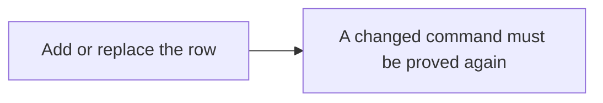
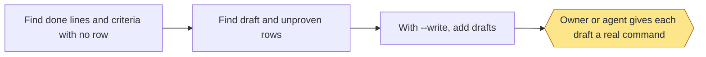
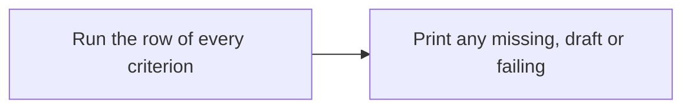
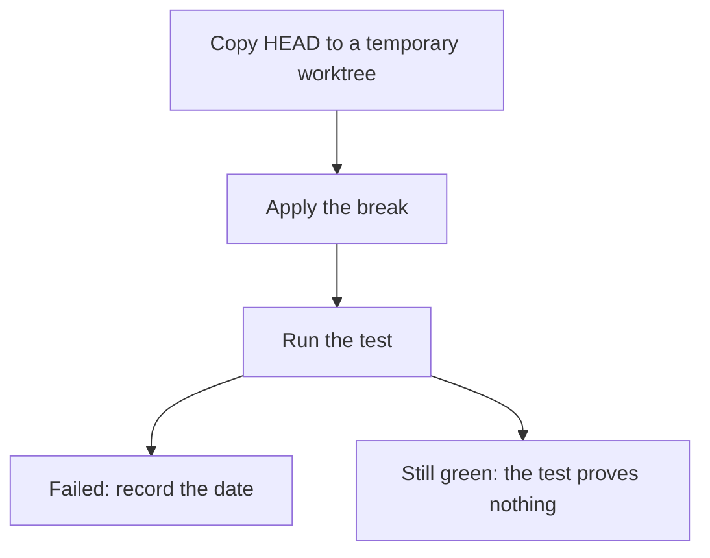
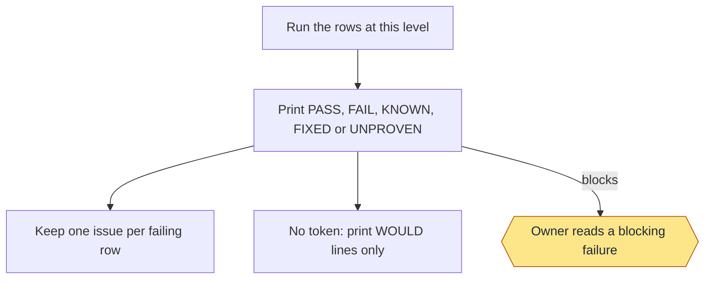
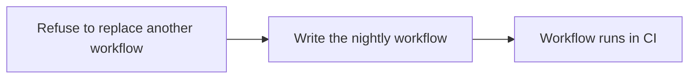

# Regression: commands and flows

Moved from the wiki page, which is now only a summary, criteria and tests.

## Commands

```text
add <id> --level <level> --command "<command>" [--goal <criterion>|<slug>:<n>] [--category criterion|defect --link <url>]
sync [--write]
criteria
red <id> --break "<command>"
run [land|nightly|<id>] [--timeout S] [--live]
workflow
```

| Level | Runs in |
|---|---|
| `land` | `run land` and `run nightly` |
| `nightly` | `run nightly` |
| `draft` | Nothing, until given a real command |
| `covered` | Nothing; proved elsewhere |

- `add` adds or replaces a row. `--goal` ties it to a criterion or a goal's done line, and a changed command must be
  proved again. `--category defect --link <issue or pull request URL, or finding:SLUG>` makes it a defect test: it keeps a
  fixed issue, finding or bug fixed, shows under "Defect tests" on the page of the criterion in `--goal`, and never counts as
  proof of that criterion. A row with no category reads as a criterion test; a defect row with no link is flagged by `sync`.
- `sync` lists done lines, and wiki criteria (a row whose id or `--goal` is the criterion id), with no row (`GAP`), `DRAFT` rows and `UNPROVEN` rows; `--write` adds drafts.
- `criteria` runs the row of every wiki criterion and prints any that is missing, a draft or failing.
- `red` copies `HEAD` to a temporary worktree, applies the break and records the date if the test fails. `STILL GREEN`
  means the test proves nothing. Only a `YYYY-MM-DD` date counts as seen failing; an empty cell, `-` or other text
  counts as never, in `sync`, `run`, the wiki Tests lines and delivery's defect-test check.
- `run` prints `PASS`, `FAIL`, `KNOWN`, `FIXED` or `UNPROVEN` (blocks). Known failures sit in
  `.loop/regression-known.tsv`. It keeps one issue per failing row; without a token it only prints `WOULD` lines.
- `workflow` writes `.github/workflows/regression.yml` (nightly, on `v*` tags, by hand). The job has 90 minutes; each
  row runs in its own process group with a 15-minute limit and starts only if that limit still fits an 88-minute
  budget (`REGRESSION_ROW_SECONDS` and `REGRESSION_JOB_SECONDS` in the step's environment override them). A row that
  doesn't fit is skipped (`SKIPPED`) and fails with an issue. Each result is saved as the row ends, and a last step
  that always runs writes the run summary: one header with totals and the run time, then one table per feature, or the
  plain results if that fails. Rows run with no GitHub token and none of the runner's own files in their environment
  (`regression.py run` too), and the checkout uses `persist-credentials: false`.
- `tests.py list` prints every test in one fixed format, grouped by feature (`--markdown` tables, `--tsv` lines);
  `summary` writes the GitHub run summary from a run's results; `issues --write` records each defect test's issue or
  pull request state. The wiki Tests lines and the health report use the same fields.

### Example

```text
/workflow-regression red check-1 --break "<a command that breaks the code>"
/workflow-regression run land
```

### Stage charts

Amber marks where the command stops for the owner. [Home](Home) says what each status means. "Toy test" means a throwaway repo with stand-ins for GitHub.

#### `add`



Status: built and proven: Add or replace the row. Built only: A changed command must be proved again. Planned: none.
Stops for the owner: none.
Proof: toy tests and this repo's rows. Nothing tests that a changed command loses its proof.

#### `sync`



Status: built and proven: Find done lines and criteria with no row; Find draft and unproven rows; With --write, add drafts. Built only: Owner or agent gives each draft a real command. Planned: none.
Stops for the owner: Owner or agent gives each draft a real command.
Proof: toy tests, and it runs on this repo, where it still lists old goals' done lines with no row.

#### `criteria`



Status: built and proven: Run the row of every criterion; Print any missing, draft or failing. Built only: none. Planned: none.
Stops for the owner: none.
Proof: a real run on this repo is on record. No toy test calls it.

#### `red`



Status: built and proven: Copy HEAD to a temporary worktree; Apply the break; Run the test; Failed: record the date; Still green: the test proves nothing. Built only: none. Planned: none.
Stops for the owner: none.
Proof: toy tests. This repo's 15 criterion rows each carry a date.

#### `run`



Status: built and proven: Run the rows at this level; Print PASS, FAIL, KNOWN, FIXED or UNPROVEN; Keep one issue per failing row; No token: print WOULD lines only; Owner reads a blocking failure. Built only: none. Planned: none.
Stops for the owner: Owner reads a blocking failure.
Proof: toy tests with a stand-in for GitHub. Two real issues with this label sit on a second repo, but no record ties them to a run.

#### `workflow`



Status: built and proven: Refuse to replace another workflow; Write the nightly workflow; Workflow runs in CI. Built only: none. Planned: none.
Stops for the owner: none.
Proof: toy tests run its inline block. On this repo a manual run on GitHub passed all 64 rows; the first run failed 2 and opened 2 issues, and the passing run closed them. The nightly and tag triggers haven't fired yet.

#### `tests.py`: `list [--markdown|--tsv]`, `summary`, `issues [--write]`

```bash
python3 scripts/tests.py list
```

Every test in one fixed format, grouped by feature: the wiki page that holds the requirement a row guards, in page
order, then `Other` for rows that guard none. Each test shows its name, kind (`requirement` or `defect`), what it guards
(the requirement's ID and words, or the issue or pull request link with its recorded state and date, or the finding),
what it checks, when it runs (`both`, `nightly`, `by a person`), its last result and date, and when it was seen failing.
Plain output has one `FEATURE <name>` line per group; `--markdown` gives one table per feature; `--tsv` gives one line
per test for scripts. The wiki Tests lines, the health report and the GitHub run summary all use this format.

`summary --results FILE --took S` writes the GitHub run summary from a run's results (`id<TAB>state` lines, states
`PASS`, `FAIL`, `SKIPPED`, `KNOWN`); a malformed file or run time is refused with the line to fix. `issues --write`
reads each defect test's issue or pull request state with `gh` into `.loop/regression-issues.tsv` (a live `run` does
this too); if `gh` can't read them it says so and writes nothing.
