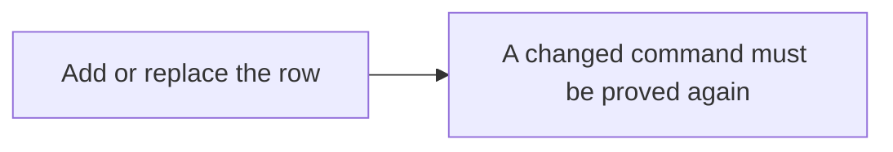
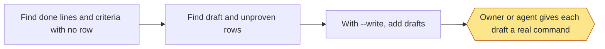
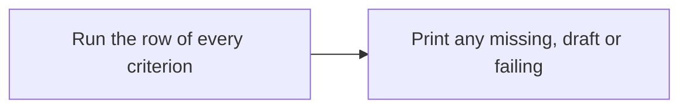
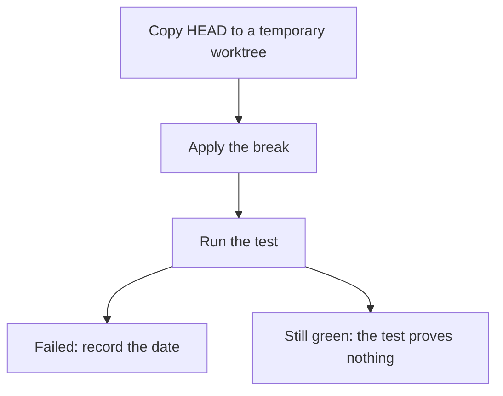
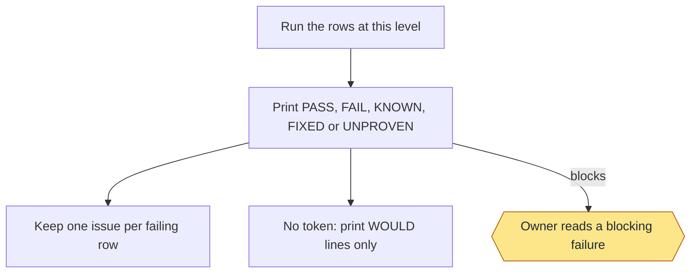
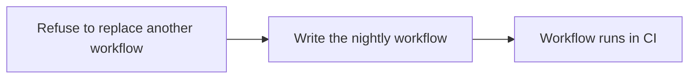

# Regression: commands and flows

Lane messages, which tests run when, clocks and lane settings: the Lanes section at the end of this page.

Moved from the wiki page, which is now only a summary, criteria and tests.

## Commands

```text
add <id> --level <level> --command "<command>" [--goal <criterion>|<slug>:<n>] [--category criterion|workflow|defect --link <url>]
sync [--write]
criteria
red <id> --break "<command>"
run [land|nightly|<id>] [--timeout S] [--live] [--reuse [--tier goal]] [--kind requirement|workflow|defect]
workflow
```

| Level | Runs in |
|---|---|
| `land` | `run land` and `run nightly` |
| `nightly` | `run nightly` |
| `draft` | Nothing, until given a real command |
| `covered` | Nothing; proved elsewhere |

- `add` adds or replaces a row. `--goal` ties it to a criterion or a goal's done line, and a changed command must be
  proved again. `--category defect --link <issue or pull request URL, or finding:SLUG>` makes it a defect test: it keeps a
  fixed issue, finding or bug fixed, shows under "Defect tests" on the page of the criterion in `--goal`, and never counts as
  proof of that criterion. `--category workflow` makes it a workflow test: an end-to-end run of a whole flow on a toy
  repo, shown as kind `workflow` after the requirement tests of its criterion. A row with no category reads as a
  criterion test; a defect row with no link is flagged by `sync`.
- `sync` lists done lines, and wiki criteria (a row whose id or `--goal` is the criterion id), with no row (`GAP`), `DRAFT` rows and `UNPROVEN` rows; `--write` adds drafts.
- `criteria` runs the row of every wiki criterion and prints any that is missing, a draft or failing.
- `red` copies `HEAD` to a temporary worktree, applies the break and records the date if the test fails. `STILL GREEN`
  means the test proves nothing. Only a `YYYY-MM-DD` date counts as seen failing; an empty cell, `-` or other text
  counts as never, in `sync`, `run`, the wiki Tests lines and delivery's defect-test check.
- `run` prints `PASS`, `FAIL`, `KNOWN`, `FIXED` or `UNPROVEN` (blocks). Known failures sit in
  `.loop/regression-known.tsv`. It keeps one issue per failing row; without a token it only prints `WOULD` lines.
- `workflow` writes `.github/workflows/regression.yml` (on `regression_cron`, every 4 hours by default, or only by hand
  when it is `off`, which a scheduled run reads first and then writes nothing; on `v*` tags and by hand, which still run). A failing row's issue is
  labelled `regression` and `defect`, names the feature and requirement the row guards, and goes on that feature's
  milestone (`Backlog` when it guards no `.loop/docs.tsv` page, made when missing); an issue you moved stays where you put
  it, and a failed issue write fails the step after the last row (`FILE_FAILED`). The job has 90 minutes; each
  row runs in its own process group with a 15-minute limit and starts only if that limit still fits an 88-minute
  budget (`REGRESSION_ROW_SECONDS` and `REGRESSION_JOB_SECONDS` in the step's environment override them). A row that
  doesn't fit is skipped (`SKIPPED`) and fails with an issue. A row that exits 77 says it cannot run on this machine (no Codex signed in, say): it is `SKIPPED` too, never `PASS`, never reused by a later lane (`SKIPPED <id>` is printed and `RESULT` ends `, <n> skipped`), does not fail the lane, opens no issue, and `red` refuses a break run that exits 77. Each result is saved as the row ends, and a last step
  that always runs writes the run summary: one header with totals and the run time, then one table per feature, or the
  plain results if that fails. Rows run with no GitHub token and none of the runner's own files in their environment
  (`regression.py run` too), and the checkout uses `persist-credentials: false`.
- `tests.py list` prints every test in one fixed format, grouped by feature (`--markdown` tables, `--tsv` lines,
  `--kind requirement|workflow|defect` only that kind);
  `summary` writes the GitHub run summary from a run's results; `issues --write` records each defect test's issue or
  pull request state. The wiki Tests lines and the health report use the same fields.

### Example

```text
/workflow-regression red check-1 --break "<a command that breaks the code>"
/workflow-regression run land
```

### Stage charts

Amber marks where the command stops for the owner. [Home](Home) says what each status means. "Toy test" means a throwaway repo with stand-ins for GitHub.

#### `add`



Status: built and proven: Add or replace the row. Built only: A changed command must be proved again. Planned: none.
Stops for the owner: none.
Proof: toy tests and this repo's rows. Nothing tests that a changed command loses its proof.

#### `sync`



Status: built and proven: Find done lines and criteria with no row; Find draft and unproven rows; With --write, add drafts. Built only: Owner or agent gives each draft a real command. Planned: none.
Stops for the owner: Owner or agent gives each draft a real command.
Proof: toy tests, and it runs on this repo, where it still lists old goals' done lines with no row.

#### `criteria`



Status: built and proven: Run the row of every criterion; Print any missing, draft or failing. Built only: none. Planned: none.
Stops for the owner: none.
Proof: a real run on this repo is on record. No toy test calls it.

#### `red`



Status: built and proven: Copy HEAD to a temporary worktree; Apply the break; Run the test; Failed: record the date; Still green: the test proves nothing. Built only: none. Planned: none.
Stops for the owner: none.
Proof: toy tests. This repo's 15 criterion rows each carry a date.

#### `run`



Status: built and proven: Run the rows at this level; Print PASS, FAIL, KNOWN, FIXED or UNPROVEN; Keep one issue per failing row; No token: print WOULD lines only; Owner reads a blocking failure. Built only: none. Planned: none.
Stops for the owner: Owner reads a blocking failure.
Proof: toy tests with a stand-in for GitHub. Two real issues with this label sit on a second repo, but no record ties them to a run.

#### `workflow`



Status: built and proven: Refuse to replace another workflow; Write the nightly workflow; Workflow runs in CI. Built only: none. Planned: none.
Stops for the owner: none.
Proof: toy tests run its inline block. On this repo a manual run on GitHub passed all 64 rows; the first run failed 2 and opened 2 issues, and the passing run closed them. The nightly and tag triggers haven't fired yet.

#### `tests.py`: `list [--markdown|--tsv]`, `summary`, `issues [--write]`

```bash
python3 scripts/tests.py list
```

Every test in one fixed format, grouped by feature: the wiki page that holds the requirement a row guards, in page
order, then `Other` for rows that guard none. Each test shows its name, kind (`requirement`, `workflow` or `defect`), what it guards
(the requirement's ID and words, or the issue or pull request link with its recorded state and date, or the finding),
what it checks, when it runs (`both`, `nightly`, `by a person`), its last result and date, and when it was seen failing.
Plain output has one `FEATURE <name>` line per group; `--markdown` gives one table per feature; `--tsv` gives one line
per test for scripts. The wiki Tests lines, the health report and the GitHub run summary all use this format.

`summary --results FILE --took S` writes the GitHub run summary from a run's results (`id<TAB>state` lines, states
`PASS`, `FAIL`, `SKIPPED`, `KNOWN`); a malformed file or run time is refused with the line to fix. `issues --write`
reads each defect test's issue or pull request state with `gh` into `.loop/regression-issues.tsv`; if `gh` can't sign
in it says so and writes nothing, and a single link it can't read keeps its last recorded state. Only this command writes that file (no run does, so a state change on GitHub never
dirties a checkout); commit it with the re-rendered wiki Tests (`criteria.py render`).

## Narrow rows

A reusing run (`run --reuse`, the qa, ship and pr lanes) reruns a row only when a file it reads changed. A test script
says what it runs in its top comment block, and `lanes.py` follows from there without widening to folders.

```bash
#!/bin/bash
# reads: skills/workflow-health/scripts/health.py skills/workflow-setup/scripts/setup.py
# reads: skills/workflow-health/scripts/
# What this test checks ...
```

- Grammar: `# reads:` at the start of a line in the leading comment block; repo-relative paths, separated by spaces,
  unquoted; a trailing `/` marks a folder. Several lines add up. `# reads: skills/` means the script reads every skill
  (it stays wide); it is the per-script opt-out.
- What follows a declared file: a shell file adds the repo paths it names (no folder widening; comment lines and lines
  ending in `# lanes: no read` read nothing); a Python file adds its same-folder imports, every file whose base name it
  quotes (`"docs.py"`), and quoted folders of its own skill. A skill folder a shell file names (`M=.../scripts`) needs a
  declared file in it, and its files whose names appear in the script (`$M/board.py`, `import board`) are followed. A
  skill folder read as a whole needs that folder declared: a glob (`"$here"/skills/x/scripts/*.py`), a recursive or
  listing command (`grep -r`, `find`, `ls`, `cp -R`), the folder or its variable used bare (`"$d"`, `$d/sub`, also when
  `d` is set in a sourced file), or a `cd` into it followed by such a command. Naming a folder with `cd`, `mkdir`,
  `PYTHONPATH=` or `sys.path` reads nothing. A folder outside `skills/` stays a dependency as a whole. Not seen: a
  skill path behind another variable (`"$OLDPWD/skills/x"`); declare such reads by hand.
- A script that runs tools on this repo's own files (`cd "$here"`, `git -C "$here"`, `--root "$here"`) runs on every
  change: those tools may read any file. A table edit reruns the edited rows plus the rows that read this repo's
  `.loop/regression.tsv`. A deleted file anywhere outside the release and loop files means a full run.
- A row whose header cannot be worked out runs on every change (`ALWAYS <id>: <code> ...`). A script with no header
  keeps the wide mapping. `LANES_WIDE=1` forces the wide mapping for every row: the first step when a narrowed lane
  seems to miss a row. The first run after `lanes.py` or `narrow.py` changes is full: the record carries their hash.

```text
lanes_cli.py check [SCRIPT...]                 every header problem; default: each dev/toy/test-*.sh a row names
lanes_cli.py affected [--level L] PATH...      dependency impact: AFFECTED n of m rows (ids), ALWAYS/UNMAPPED/DELETED
lanes_cli.py deps COMMAND [--why PATH]         a row command's dependencies, or the chain of files to PATH
```

`affected` reads no record, so failed rows, ancestry and edited table rows (which a reusing run also reruns) are
outside it. All three take `--root DIR` (default: the git top level), exit 2 on a usage error and 1 on problems.

| Code | Means | Fix |
|---|---|---|
| `LANES-DECL-NONE` | A test script a row names has no header | Add `# reads:` with the skill files it runs |
| `LANES-DECL-MISSING` | A declared path does not exist | Fix or remove it |
| `LANES-DECL-PATTERN` | A `$`, `*` or `?` in a declared path | Declare files, or the globbed folder |
| `LANES-DECL-ESCAPE` | A declared path leaves the repo | Repo-relative paths only |
| `LANES-DECL-PLACE` | `# reads:` below the top comment block | Move it up |
| `LANES-DECL-FOLDER` | Names a skill folder, declares no file in it | Declare the files it runs from there |
| `LANES-DECL-GLOB` | Reads a skill folder as a whole without declaring it | Declare the folder |
| `LANES-DECL-FOLDER-UNBACKED` | Declares a skill folder it never globs or reads whole | Declare its files instead |
| `LANES-DECL-TREE` | Reads all of `skills/` without declaring `skills/` | Declare `skills/` (stays wide) |

**New test script, three steps:** write the header; `python3 scripts/lanes_cli.py check dev/toy/test-new.sh`; then
`python3 scripts/lanes_cli.py affected <a file it runs>` shows its rows. Register rows with `regression.py add ...
--level land`.

**Nightly read trace.** `bash dev/toy/check-reads.sh [ROW-ID...]` (row `lanes-trace`) runs each row under a Python
audit hook and fails a row whose run read a skill file outside its closure (`LANES-TRACE-UNDECLARED`, with the line
to add), whose Python launch the hook never saw (`LANES-TRACE-NOHOOK`), or whose command failed. It covers Python reads
only; bash reads are covered by the static rules above.

## Goal tier

A goal lane runs `run land --reuse --tier goal` (`scripts/tiers.py`). It plans from the branch's record only when
the record's merge-base with the base branch is the current one (else from the merge-base, plus what a base merge
brought in) and runs the rows a change reaches, new or edited rows, root runners and the record's failures; it takes a
lane slot only when it has no plan to follow (FULL, no merge-base). It stays within `test_budget_minutes`: rows run in tier
order while their estimated seconds fit, and the rest is left to the scheduled full suite (`BUDGET` line). Its own time
limit is the flow file's, else `test_budget_minutes` plus five minutes. The work before the first row (the Tests-table prep,
planning and the slot wait) has its own budget, `prep_budget_minutes` (default 15, not under 15), shared by the three parts: a lane
that reaches it stops, prints `LANE_PREP_BUDGET` naming the part that ran long, and the same command can be run again. Every
LANE line ends its text with `before rows: prep Xs, planning Ys, slot wait Zs`. `LOOP_PREP_BUDGET` (whole seconds) overrides the
setting for tests only; the LANE line says when it is in effect. Without `--tier` nothing changes.

| Line | Means |
|---|---|
| `SELECTED <id>: <reason>` | Why a row runs: `reaches <file>`, `new row`, `root runner`, `names an unmapped path`, `failure rerun` or `FULL` |
| `ROWS: S selected (A affected, N new, R root runners, F failure reruns), U reused; unmapped: K` | The plan; the LANE line repeats it with the unfinished count and the log path |
| `UNMAPPED <file>: no row declares it. Note: ...` / `UNMAPPED <file>: deleted. Note: ...` | Every lane: advisory; the rows that name the file and the runners run, never the full suite |
| `FULL (no merge-base with <base>): ...` | A shallow clone or a missing base ref: every row is a candidate and the time budget keeps what fits |

## Lanes: what runs when, and every message a lane prints

A lane is one background run of the regression rows for a goal's step (qa, ship or pr), started by
`role.py lane SLUG NAME` (flow.py and goal.py call it). This section is the reference for its messages, clocks and
settings. The Regression wiki page holds the requirements (REG-1..REG-9); this section is the tool's own manual.

### Which tests run when

| Where | Rows that run | Takes a lane slot |
|---|---|---|
| goal lane, qa and ship | rows whose closure reaches a file the goal changed since its merge-base, the goal's new or changed rows, rows that run tools on the repo root, and rows that failed last time | no |
| goal lane, pr | the same; a path no row declares, or a deleted one, adds the rows that name it and the runners, never the full suite | no |
| goal lane with no merge-base (shallow clone, missing base) | every row is a candidate (`FULL (no merge-base with <base>)`), kept to `test_budget_minutes` | yes |
| hand run `regression.py run land\|nightly\|ID [--kind K]` | what you name; a plain `run nightly` is the full suite and records its time | when it is a full run |
| GitHub Actions, on the `regression_cron` schedule (every 4 hours by default; `off` stops it) and every v* tag | `ci_levels` (default nightly: every row, the full suite; land: land rows only) | n/a (a runner) |
| GitHub Actions, run by hand | its `target` input: land, nightly or a row id (empty: `ci_levels`); the workflow's own runner checks it, so a repo without the skills folder works | n/a |

ship and release reuse the qa lane's results when no code changed since (`REUSED`). Before a pull request merges,
merge.py checks the base: a move in paths this goal's rows reach refuses (`BASE_MOVED`); `goal.py pr` then merges the
base and reruns the affected rows. Which levels run where is fixed by design (land: goal lanes, hand runs and CI;
nightly: CI and hand runs); `goal_levels` and `ci_levels` change it.

### Lane messages

Status lines go to stdout, refusals and errors to stderr. A `Fix:` part is something to do before going on; a `Note:`
part is advice and never blocks.

| Code | Printed by | Exit | Meaning | What to do |
|---|---|---|---|---|
| LANE | lane.py | 0 / 1 | the lane ended: `LANE <step> <AFFECTED\|REUSED\|FULL> ran/total in Ns; rows: S selected (A affected, N new, R root runners, F failure reruns), U reused, X unfinished; unmapped: K; log: <path>` | read the log for each row's reason |
| RUNNING / WAITING | lane.py | 0 | still planning or running / waiting for a lane slot or a sibling lane of the goal | run the same command again, or `role.py lane-wait SLUG NAME` |
| LANE_WAIT | slots.py | — | all lane slots are busy; names the holders | none: it starts when one frees (`LOOP_LANE_LIMIT=0` skips the pool for one run) |
| LANE_WAIT_TIMEOUT | slots.py / lane.py | 4 / 2 | a hand run off a terminal waited 4x its time limit (4); `lane-wait --timeout` ran out while the lane keeps running (2) | run again later |
| LANE_SLOTS_UNAVAILABLE | slots.py | — | the lanes folder can't be used; the lane runs without a slot | `chmod 700` it, or set `LOOP_LANES_DIR` |
| LANE_STALE | slots.py | 5 | HEAD or the worktree changed while the lane waited; no rows ran | run the same command again |
| LANE_PREP_BUDGET | lane.py | 125 | the lane's work before its first row (Tests-table prep, planning, slot wait) used prep_budget_minutes; names the part that ran long and who holds the slots; no row ran | run the same command again (it replans on this HEAD); raise prep_budget_minutes only if prep or planning ran long |
| LANE_TIMEOUT | lane.py | 124 | past its time limit (flow file `limit`, else `step_limit`); killed, rows partly ran, nothing committed or pushed | run again, or raise the setting |
| LANE_DIRTY | lane.py / lanekit.py | 1 | uncommitted changes at start, a hand edit above a page's Tests section, or a row left files behind | commit or revert them; make the row clean up |
| LANE_PREP | lanekit.py | — | the lane first committed the re-rendered Tests tables and run dates | none |
| LANE_PREP_FAILED | lanekit.py | 1 | that commit or the render failed or hung (60 s); nothing committed | make the commit pass, then run again |
| LANE_RECORDER | lane.py | 1 | the flow file's `test_record` command isn't on this machine | install it or remove it |
| LANE_DIED | lane.py | 1 | the lane ended with no exit status | the next call starts a new lane |
| LANE_MISSING / HEAD_MOVED (record) | lane.py via goal.py | 2 | `goal.py record qa\|ship` with no passing lane on this HEAD; no try is used | run `role.py lane SLUG NAME` |
| NO LANE | lane.py | 3 | `lane-wait` found no lane for this HEAD | start one with `role.py lane SLUG NAME` |
| UNMAPPED | tiers.py | — | a changed or deleted path no row declares (Note) | declare it in the `# reads:` header of the row that tests it, or let pr run the full suite once |
| KILLED | regression.py | — | a signal stopped a row: `KILLED <row>: signal <name> (pid <n>)` (Note) | see the lane log |
| FLAKY | regression.py | per result | a row gave different results on the same clean commit, runner and python (Note): the raw result counts, the flag stays on that commit (regression-runs.tsv's flaky column, tests.py list, health's TESTS block) and the row is never reused | find the nondeterminism in the row's command; FLAKY clears when a later commit's clean run passes |
| SUITE_TIME | regression.py / CI run step | — | a plain full run's time (`regression.py run nightly`, or a CI run whose target is nightly), appended to `<git common dir>/loop/suite-times.tsv` for health's REG-7 check; CI keeps its line as artifact `suite-time`, which the scheduled health job downloads with a `ci` column | none |
| REFUSED (BAD_TARGET) | CI run step | 1 | the run-by-hand `target` input is not land, nightly or a row id: `REFUSED (BAD_TARGET): bad target "<value>": use land, nightly or a row id from regression.py list. Fix: rerun the workflow with one of those`; no row ran | rerun the workflow with one of those |
| REFUSED (BASE_MOVED) | merge.py | 2 | the base moved in paths this goal's rows reach since the pr lane, or it can't tell (the planner or `git diff` failed): an unknown never merges | `goal.py pr SLUG`, then `merge.py SLUG` |
| REFUSED (BASE_FETCH) | merge.py | 3 | origin can't be fetched to check the base; nothing merged | run `merge.py SLUG` again when the remote answers |
| REFUSED (HEAD_MOVED) | merge.py | 4 | the pull request head moved since the pr lane by a commit that isn't only wiki pages (a `wiki.py prepare` commit only notes it and merges) | `goal.py pr SLUG`, then `merge.py SLUG` |

Exit codes shared by every lane entry point: 0 pass (or still running for `role.py lane`), 1 fail, 2 lane-wait
timeout, 3 no lane, 4 a hand run's slot wait timed out, 5 stale, 124 time limit.

### Clocks

A lane's time limit counts from its started marker (when it took its slot and began rows), never from launch. While
it waits for a slot it has a queue span instead (4x the time limit, restarted whenever any slot changes), so a healthy
backlog never kills a waiting lane; while planning it has 4x the time limit. A hand run on a terminal holding a slot has no deadline; off a terminal its slot wait stops after
4x its time limit (flow file `limit`, else `step_limit`, else 2700 s). `lane-wait` with no `--timeout` waits until the
lane ends.

### Settings

- `lane_limit` (flow file, default 2): full lanes that may run at once on this machine; 0 is unlimited. Best effort:
  it limits concurrent full lanes, not the machine's load; AFFECTED, by-id and red runs take no slot.
- `goal_lane_minutes` (10): health warns above it (REG-7), and a goal lane over it adds `; over N min (goal_lane_minutes)`
  to its LANE line. The scheduled full suite has a fixed 30-minute limit that health warns above.
- `goal_levels` (land) and `ci_levels` (nightly): the levels a goal lane plans from (nightly adds the nightly rows a
  change reaches) and the CI target. A CI run cut short by its job time still records its time, so health warns.
- Each lane child gets its own `TMPDIR` and `LOOP_LANE_PORT_BASE` (a leased range of 100 ports from 20000); a row that
  binds ports uses that range or picks a free port itself.
- Internal handoff variables (`_LOOP_LANE_HELD`, `_LOOP_LANE_LABEL`, `_LOOP_LANE_QUEUED`, `_LOOP_LANE_STARTED`,
  `_LOOP_LANE_NOTE`) are set by the lane; a `test_record` wrapper must keep the environment.

### Upgrading

Updating the skills while lanes run is safe: a lane job written by the old code keeps the old rules until it ends.
New: goal lanes no longer run the full suite at qa for an unmapped path (pr does, once); the lane commits re-rendered
Tests tables before it starts; regression-issues.tsv gains a reopened_at column and old files still read; the
regression workflow's run-by-hand gains a `target` input.

### Alternatives considered

GitHub's merge queue and "require branches to be up to date" make merges atomic on the platform; the loop keeps its
own base check for repos without them, and the window between its check and the merge is closed only by those
settings. Actions concurrency groups already keep one regression run at a time in CI. Running AFFECTED lanes in CI
was left out: CI runs the full suite only (REG-4).
