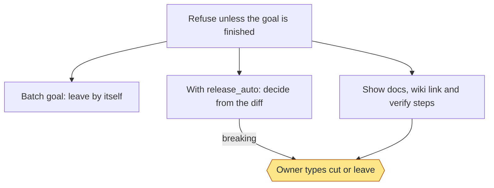
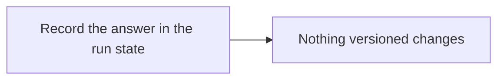
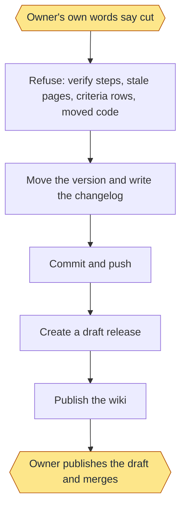
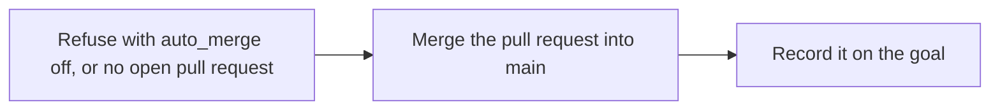
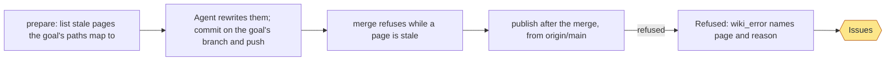
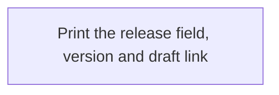

# Release: commands and flows

Moved from the wiki page, which is now only a summary, criteria and tests.

## Commands

```text
merge SLUG
wiki prepare SLUG [--commit]
wiki publish SLUG
ask SLUG
leave SLUG
cut SLUG [--bump patch|minor|major] [--user]
show SLUG
```

- `wiki prepare` lists the mapped pages that are stale (see `.loop/docs.tsv`). The agent rewrites them, then `--commit`
  commits them on the goal's branch and pushes it. `merge` runs the same check and refuses while a page is stale.
- `merge` (with `auto_merge` on) merges the goal's pull request and publishes the release (no draft): one version bump,
  a CHANGELOG entry and a published GitHub release. On a protected base (a `pull_request` rule from
  `gh api repos/{owner}/{repo}/rules/branches/<base>`, or a push refused with GH006, GH013, "protected branch", "through
  a pull request" or "rule violations") it goes through a release PR: branch `release/vX-<slug>`, title
  `Release vX (<slug>)`, the release notes as its body. The loop merges it itself with `gh pr merge --merge`, never
  `--admin`; pending checks wait (`release_pr_waiting`, shown under the board's Issues; the next `merge` retries); a required review records
  `RELEASE_PR_BLOCKED` with your command. The release targets the release PR's merge commit. Any other push refusal
  keeps the three tries. Before merging it scans the branch and release notes for private names.
- Bump rule: patch by default; minor or major only when the operation recorded the goal's bump with
  `goal.py set SLUG --bump minor|major`. A removed file or a `BREAKING` commit is named in the reason, never a major.
- `wiki publish` runs after the merge, from a clean checkout of `origin/main`. It first scans every page in the wiki
  folder for private names and publishes nothing on a hit. If publish refuses, the merge stands, the goal records
  `wiki_error` (which page and why) in its report, and it shows under Issues. A GitHub wiki with no first page can't be
  cloned: create the first page in the repo's Wiki tab, then run `merge.py SLUG` again.
- `ask` shows the changed docs, the wiki link and the verify steps, then prints `cut <slug>` and `leave <slug>`. A
  monitored batch goal without `release: ask` answers `leave` by itself.
- `leave` keeps the work unreleased and changes nothing versioned.
- `cut` refuses without numbered steps under `## Verify by hand`, if any step has no `Expect:` line, or with a mapped
  page that is stale since the goal's base or missing. After fixing a page, commit it and run the release again.
  `cut` then moves the version (`patch` by default), writes the changelog, commits, pushes and creates a **draft**
  GitHub release. You publish it. A batch goal refuses `cut` without `--user`, which means your own words said to cut.
- `cut` also refuses when a criterion on a wiki page (see Documentation) has a regression row that is missing, a draft
  or failing. A repo with no criteria is unaffected.
- `show` prints the `release` field, and the version and draft URL after a cut.

After a cut, the agent publishes the wiki with `workflow-docs` if `.loop/docs.tsv` exists. If that fails, the draft
stands.

### Automatic draft releases

Set `"release_auto": true` in `.loop/config.json` to let a monitored batch goal decide from its diff. `ask` prints
`NEED <leave|patch|minor|major>: <reason>` and records it. Docs, tests and `.loop` changes leave. Anything else cuts a
draft with the bump rule (patch unless the goal's bump was set), with no `--user`; a removed file or a breaking commit
is named in the reason. A goal marked `release: ask` waits for you. Every refusal of `cut` still applies, and then you
decide. Without `release_auto`, a batch goal leaves as before. This path's release is always a draft.

Without `auto_merge`, no release is published and nothing merges without you. With it, `merge` publishes the release
(no draft).

### Codes

Each refusal ends with one of these codes; the line also gives the fix and what was or wasn't pushed.

| Code | Means | Fix |
|---|---|---|
| `PRIVATE_NAME` | a private name is in the branch, a commit message, the release notes or a wiki page; nothing pushed or merged | remove it (squash so no commit keeps it), or edit that line of the list for a false positive |
| `PRIVATE_LIST` | the private-name list can't be read, holds an invalid pattern, or the scan failed | repair the line `private.py check` names |
| `PRIVATE_MODULE` | workflow-delivery's `private.py` or `fit.py` is missing beside this skill (the path is named) | reinstall, or put workflow-delivery beside workflow-release |
| `RELEASE_PR_BLOCKED` | the release PR needs a review or is blocked; branch pushed and PR open | `gh pr merge <n> --merge`, then `merge.py SLUG` |
| `RELEASE_VERSION_MISMATCH` | VERSION at the release PR's merge commit is not vX; no release made | set VERSION on the base, then `merge.py SLUG` |
| `RELEASE_EXISTS` | a GitHub release vX already exists at another target | look at it, keep or delete it, then `merge.py SLUG` |
| `REQUIREMENT_MISSING` | a criterion row names a requirement ID no wiki page on the base names; nothing merged | merge the goal that adds its text, then `merge.py SLUG` |

The package for Agensi is a skill pack: one ZIP with all seven skills, and the shared file contract under `shared/`.

### Example

```text
/workflow-release ask add-median
/workflow-release cut add-median --bump minor --user
```

### Stage charts

Amber marks where the command stops for the owner. [Home](Home) says what each status means. "Toy test" means a throwaway repo with stand-ins for GitHub.

#### `ask`



Status: built and proven: Refuse unless the goal is finished; Batch goal: leave by itself; With release_auto: decide from the diff; Show docs, wiki link and verify steps; Owner types cut or leave. Built only: none. Planned: none.
Stops for the owner: Owner types cut or leave.
Proof: toy tests. Seventeen real goals took the batch path and left, and on each of two repos one stopped for the owner, who answered `cut`. release_auto has only run on a toy repo.

#### `leave`



Status: built and proven: Record the answer in the run state; Nothing versioned changes. Built only: none. Planned: none.
Stops for the owner: none.
Proof: toy tests, and seventeen real goals through the batch path. No real owner's `leave` is on record.

#### `cut`



Status: built and proven: Owner's own words say cut; Refuse: verify steps, stale pages, criteria rows, moved code; Move the version and write the changelog; Commit and push; Create a draft release; Publish the wiki; Owner publishes the draft and merges. Built only: none. Planned: none.
Stops for the owner: Owner's own words say cut; Owner publishes the draft and merges.
Proof: toy tests with a stand-in for GitHub, and two real cuts, each to a real draft: one on a second repo, and v0.1.1 on this repo. The owner's stop was real in both. With release_auto, a non-breaking batch goal skips the first stop, proven only on a toy repo.

#### `merge`



Status: built and proven: Refuse with auto_merge off, or no open pull request; Merge the pull request into main; Record it on the goal. Built only: none. Planned: none.
Stops for the owner: none.
Proof: toy tests with a stand-in for GitHub, including a goal that changes a mapped path and ends with its page updated, the wiki published, and a refused publish shown under Issues. No real merge by it is on record yet.

#### `wiki`



Status: built and proven: prepare: list stale pages the goal's paths map to; Agent rewrites them; commit on the goal's branch and push; merge refuses while a page is stale; publish after the merge, from origin/main; Refused: wiki_error names page and reason; Needs you. Built only: none. Planned: none.
Stops for the owner: Issues, only when a publish is refused.
Proof: toy tests with a stand-in for GitHub and a bare wiki. No real merge has published through it yet.

#### `show`



Status: built and proven: Print the release field, version and draft link. Built only: none. Planned: none.
Stops for the owner: none.
Proof: toy tests.

## Exact command entries (as of main, 2026-11-13, when the Usage section was retired)

- `merge.py SLUG` — The release step: docs check, merge (where auto_merge is on), version bump, changelog, GitHub release, wiki publish. Prints `MERGED <pr> into main`, `RELEASED vX.Y.Z <release link> (<bump> bump)` and `PUBLISHED <wiki link>`. Refuses while a page is stale. Before the wiki publish it re-renders the generated Tests tables on the merged head (`RERENDERED Tests`), so staleness in only those tables never blocks the wiki; a stale hand-written page still refuses. Takes a per-repo merge lock so two pods never merge into one main at once, and refuses another pod's goal with one line naming the owner. The pod is `LOOP_POD_ID`, else the operation session's own id: a restarted operation session keeps its goals by setting `LOOP_POD_ID` to its old pod id.

- `mergebatch.py plan|run [--size N] [--merge]` — The batch merge (DEL-15). `plan` prints `BATCH n: a, b, c` for the ready goals (done, with a pull request, not held, no release ask), grouped so no two goals in a batch have overlapping touches (3 by default, at most 4). `run` merges each batch's branches into one temporary tree from origin/<base> and runs the check there (`batch_check` in the config, default `regression.py run`); a failing batch splits, each half is checked alone, and `CULPRIT slug` names the goal that fails (`a+b+c` when the halves pass alone but fail together). Prints `BATCH n PASSES: ...` or `BATCH n SPLIT: ...`, the goals that pass. Only with `--merge` does it run merge.py for the goals that pass; merge.py still refuses a goal whose base moved in paths its rows reach. Proof: dev/toy/test-merge-batch.py.
